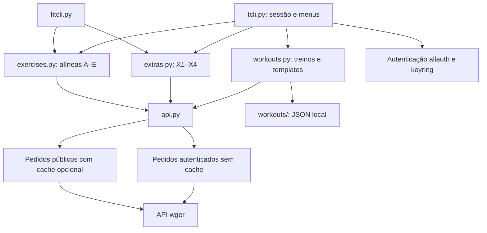

# FITCLI — Projeto de ALPCD, Grupo 12

Aplicação Python para consultar exercícios e ingredientes da API **wger**, criar
planos de treino e gerir treinos locais e templates privados através do terminal.

O projeto disponibiliza duas interfaces:

- **FITCLI** (`fitcli.py`): comandos para consultas públicas, classificação,
  comparação, nutrição e planos locais, sem necessidade de autenticação.
- **TCLI** (`tcli.py`): menus interativos para autenticação, consultas de exercícios,
  criação/importação de treinos e exportação/consulta de templates da conta wger.

## Equipa

| Aluno | Número |
|---|---|
| Nathan Pacheco Falcão Sperinde | A90606 |
| Rafale Dornelles Copetti | A112988 |
| Clauber Janauys de Amorim Filho | A114341 |

## Instalação e execução

Requisitos: **Python 3.14 ou superior**, `uv` e ligação à Internet para pedidos à
API. A sessão persistente do TCLI utiliza o keyring disponível no sistema.

A partir da pasta do repositório `ALPCD_12`:

```bash
uv sync
uv run python fitcli.py --help
uv run python tcli.py
```

`uv sync` instala as dependências de `pyproject.toml` usando `uv.lock` e o ambiente
local `.venv`. O código utiliza `requests` para HTTP, `typer` para comandos,
`questionary` para perguntas e `keyring` para guardar a sessão.

Para consultar a ajuda de um comando específico:

```bash
uv run python fitcli.py workout --help
```

## Funcionalidades da FITCLI

| Parte | Comando | Resultado |
|---|---|---|
| A | `top N` | Até N exercícios recentes com tradução inglesa |
| B | `search ALVO N` | Exercícios por músculo ou categoria, sem repetir IDs |
| C | `type ID` | Classificação `cardio`, `compound`, `isolated` ou `other` |
| D | `equipment CATEGORIA` | Contagem de menções a equipamentos nas descrições |
| E | `workout ALVOS ESFORCO N` | Plano com até N exercícios por alvo e exportação CSV opcional |
| X1 | `find TEXTO` | Pesquisa textual no nome e, com `--deep`, também na descrição |
| X2 | `compare ID ID ...` | Atributos comuns, partilhados e exclusivos entre exercícios |
| X3 | `difficulty ID` | Estimativa de dificuldade com pontuação e razões |
| X4 | `ingredient NOME` | Calorias e macronutrientes para a quantidade em gramas pedida |

Exemplos:

```bash
uv run python fitcli.py top 5 --refresh
uv run python fitcli.py search biceps 5
uv run python fitcli.py type 192
uv run python fitcli.py type "bench press" --find --deep --limit 5
uv run python fitcli.py equipment chest
uv run python fitcli.py workout biceps,back compound 3 --csv treino.csv
uv run python fitcli.py find "bench press" --deep --description --limit 5
uv run python fitcli.py compare 123 456
uv run python fitcli.py difficulty 192 --refresh
uv run python fitcli.py ingredient "chicken breast" --grams 150 --limit 3
```

Os IDs são exemplos: os resultados dependem do catálogo disponível. As consultas
normais usam os nomes e descrições em inglês. A opção `type --find` reutiliza a
pesquisa textual para classificar os resultados encontrados.

Na alínea E, `ESFORCO` é uma string validada: `compound`, `isolated` ou `any`.
O plano é calculado localmente; não cria um template na conta wger. A saída é
JSON, exceto nos comandos de classificação simples e na exportação CSV.

## Terminal interativo e treinos

Executar `uv run python tcli.py`. Depois do login ou criação de conta, o menu permite:

1. **Exercícios FITCLI:** consultar recentes, pesquisar, classificar, comparar,
   contar equipamentos e criar um plano por esforço, reutilizando as funções da CLI.
2. **Criar treino:** escolher equipamento, músculos, exercícios e séries, com
   gravação automática em JSON ao concluir.
3. **Importar treino local:** carregar e validar um JSON existente em `workouts/`.
4. **Exportar como template:** criar um template privado na conta, por escolha
   explícita do utilizador.
5. **Ver templates exportados:** consultar estruturas compatíveis da conta atual.
6. **Terminar sessão, trocar de conta ou sair.**

Os nomes dos exercícios aparecem em **português**, com inglês como alternativa
quando a API não oferece tradução portuguesa. A seleção aceita exercícios que
só tenham nome português. Apresentar um JSON antigo não reescreve o ficheiro para
mudar os nomes.

Os treinos locais são guardados em `workouts/`, sem sobrescrever nomes existentes.
Não contêm tokens e não pertencem a uma conta específica; podem ser importados
por outra conta neste computador. Um treino admite 1–7 sessões, cada uma com
exercícios de ID positivo e 1–50 séries.

A palavra-passe não é persistida. O refresh token e a identificação da última
conta são guardados no keyring; o access token fica em memória. Terminar sessão
não apaga a sessão persistida, pelo que o arranque seguinte pode autenticar
novamente. Falhas de acesso ao keyring permitem continuar com login manual.

O menu de exercícios do TCLI usa as mesmas funções da FITCLI, sem duplicar
a lógica das consultas. Os nomes apresentados são portugueses quando disponíveis.

## Organização do código

```text
ALPCD_12/
├── fitcli.py              # Comandos e apresentação da CLI
├── tcli.py                # Autenticação, perguntas e menus interativos
├── fitlib/
│   ├── api.py             # HTTP público/autenticado, cache e paginação
│   ├── exercises.py       # Alíneas A–E, normalização e saída JSON/CSV
│   ├── extras.py          # Pesquisa textual, comparação, dificuldade e ingredientes
│   └── workouts.py        # Nomes portugueses, treinos JSON e templates wger
├── workouts/              # Dados locais dos treinos; não é um módulo Python
├── docs/                  # Enunciado, análise e explicações por funcionalidade
├── pyproject.toml         # Requisitos e dependências
└── uv.lock                # Versões das dependências
```



HTTP, cache e paginação são partilhados. As funções de domínio reutilizam essa
base; os comandos e menus recolhem argumentos e apresentam os resultados.
Não se duplicam implementações de consultas entre a CLI e os extras.

## Cache e dados autenticados

`api.get_data()` e `api.get_list()` aceitam `cache_mode`:

| Modo | Comportamento |
|---|---|
| `none` | Executa HTTP sem ler nem guardar resultados em cache |
| `memory` | Guarda resultados no processo; perde-os quando o processo termina |
| `disk` | Guarda resultados em `fitlib/cache.json` e reutiliza-os entre execuções |

O modo predefinido é **`disk`**, utilizado pelas consultas públicas atuais da
aplicação. `memory` está disponível para chamadas explícitas à biblioteca; não é
selecionado automaticamente pelos comandos.

Memória e disco usam a estrutura `{"data": ..., "expires_at": ...}` e o mesmo TTL
de **14 dias**. Entradas expiradas ou antigas sem timestamp não são devolvidas
como resultados válidos. Ao guardar, removem-se entradas inválidas/expiradas e,
no modo disk, substitui-se o JSON de forma atómica através de um ficheiro temporário.
Não existem threads de limpeza nem coordenação de escritores concorrentes.

`refresh=True` ignora o resultado guardado e atualiza a cache selecionada.
Na CLI, `--refresh` existe em `top`, `search`, `difficulty` e `ingredient`.

```python
from fitlib import api

api.get_data("muscle/")
api.get_data("muscle/", cache_mode="memory")
api.get_list("muscle/", cache_mode="none")
api.get_data("muscle/", refresh=True)
```

Login, tokens, estruturas privadas e escritas na conta **não usam a cache pública**.
`api.request()` e `api.get_list(token=...)` seguem o caminho autenticado sem cache.
A paginação pública encaminha modo e refresh e conta apenas os itens aceites pelo
filtro `transform` para aplicar o limite de resultados.

## Documentação detalhada

| Tema | Guias |
|---|---|
| Alíneas A–E | [A](docs/Exercises/A_Exercises.md), [B](docs/Exercises/B_Exercises.md), [C](docs/Exercises/C_Exercises.md), [D](docs/Exercises/D_Exercises.md), [E](docs/Exercises/E_Exercises.md) |
| Extras X1–X4 | [Pesquisa textual](docs/Extras/X1.md), [comparação](docs/Extras/X2.md), [dificuldade e nutrição](docs/Extras/X3_X4.md) |
| TCLI e conta | [Lógica](docs/tcli/XTcli.md), [login](docs/tcli/XTcli_login.md), [criação de contas](docs/tcli/XTcli_criacao_contas.md) |
| Treinos | [Menus](docs/tcli/XTcli_treinos.md), [módulo workouts](docs/tcli/XWorkouts.md) |
| Cache | [Contrato e modos](docs/CACHE.md) |
| Requisitos e análise | [Enunciado](docs/ALPCD___TP1__26-1.pdf), [notebook das regex](docs/analysis_type.ipynb) |

Os cinco guias de `docs/tcli/` seguem o mesmo formato: **Parte 1 — funcionamento**,
com diagramas Mermaid divididos por operação, e **Parte 2 — código explicado**,
com trechos do código atual e tabelas linha por linha. Funções partilhadas têm um
único guia responsável e são ligadas a partir dos restantes, evitando repetição.
Este README da raiz é o único README do repositório e o ponto de entrada oficial.

## Estado e limitações

- A ordenação decrescente da frequência por equipamento na alínea D ainda está
  pendente; a contagem já está implementada.
- A classificação de esforço e a dificuldade usam regras e regex exploratórias;
  a pontuação de dificuldade não é uma avaliação científica individual.
- Ingredientes são pesquisados em inglês, numa página de até 50 registos. A base
  colaborativa pode ter nomes repetidos, valores ausentes ou registos inconsistentes.
- O TCLI suporta treinos simples com séries fixas. Não oferece ativação de rotinas,
  repetição semanal, registo de execuções nem histórico. O helper antigo
  `post_record` foi arquivado em `../ignore/post_record.py`, fora do repositório.
- Uma exportação interrompida pode deixar um template incompleto. Os POSTs não são
  repetidos automaticamente nem existe rollback dos objetos já criados.
- O notebook conserva uma divergência entre limiares descritos no texto e usados
  no código; a reorganização não alterou esses resultados.

## Verificação local

Para verificar a ajuda e a sintaxe sem aceder à conta:

```bash
uv run python fitcli.py --help
uv run python fitcli.py workout --help
uv run python -m compileall -q fitcli.py tcli.py fitlib
```

A cópia atual não inclui uma pasta `tests/`. Os testes simulados executados durante
as alterações anteriores não constituem uma suite distribuída nesta versão.
Consultar a ajuda não executa consultas; os restantes exemplos podem fazer pedidos
à API e, no TCLI, ações de conta dependem das escolhas explícitas do utilizador.
