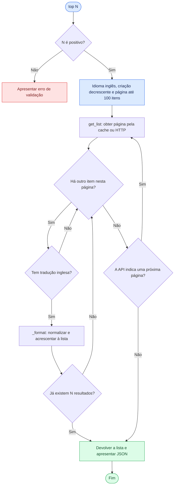

# Alínea A — Exercícios mais recentes

> **Comando:** `top N` · **Função:** `top_exercises()` · **Saída:** lista JSON

Obter até **N exercícios recentes com tradução inglesa**, reutilizando a
paginação, a cache e a normalização partilhadas pelo projeto.

## 1. Visão geral

| Entrada | Regra | Resultado |
|---|---|---|
| `N` | Inteiro maior ou igual a 1 | No máximo N exercícios aceites |
| `--refresh` | Desligado por padrão | Se ativo, consulta a API e atualiza a cache |
| Tradução inglesa | Obrigatória para aceitar o exercício | Nome, descrição e atributos normalizados |

### Como executar

A partir de `ALPCD_12`:

```bash
uv run python fitcli.py top 5
uv run python fitcli.py top 5 --refresh
uv run python fitcli.py top --help
```

## 2. Fluxo do algoritmo



O pedido usa estes parâmetros:

| Parâmetro | Valor | Finalidade |
|---|---|---|
| `language` | `LANGUAGE`, atualmente `2` | Pedir dados em inglês |
| `ordering` | `-created` | Pedir os registos mais recentes primeiro |
| `limit` | `min(N, 100)` | Limitar o tamanho pedido para cada página |
| `max_items` | `N` | Aplicar o limite global aos resultados aceites |
| `transform` | `_format` | Rejeitar exercícios sem inglês e normalizar os restantes |

> **Página não é resultado final.** Se os primeiros itens não tiverem tradução
> inglesa, `get_list()` continua a percorrer os itens e as páginas até obter N
> exercícios válidos ou esgotar os dados.

## 3. Quem faz cada parte

| Parte | Local | Responsabilidade |
|---|---|---|
| Comando `top` | [fitcli.py](../../fitcli.py) | Receber argumentos, validar N e apresentar a saída |
| `top_exercises` | [exercises.py](../../fitlib/exercises.py) | Preparar os parâmetros e delegar a consulta |
| `_format` | [exercises.py](../../fitlib/exercises.py) | Selecionar a tradução inglesa e organizar os campos |
| `get_list` | [api.py](../../fitlib/api.py) | Paginar, aplicar a transformação e contar os itens aceites |
| `get_data` | [api.py](../../fitlib/api.py) | Reutilizar a cache ou executar HTTP |

É por isso que a função A é curta: a paginação e o acesso HTTP não precisam de
ser repetidos dentro dela.

## 4. Código da função

```python
def top_exercises(limit: int, refresh: bool = False) -> list[dict[str, Any]]:
    """a) Obter até N exercícios recentes com tradução inglesa."""
    if limit <= 0:
        raise ValueError("O limite deve ser positivo.")
    params = {"language": LANGUAGE, "ordering": "-created", "limit": min(limit, 100)}
    return api.get_list(
        "exerciseinfo/", params, max_items=limit,
        refresh=refresh, transform=_format,
    )
```

| Passo | O que acontece |
|---|---|
| Validar `limit` | Impedir consultas com limite zero ou negativo |
| Construir `params` | Definir idioma, ordenação e tamanho da página |
| Chamar `api.get_list` | Reutilizar a paginação comum |
| Encaminhar `refresh` | Fazer a atualização chegar a todos os pedidos da consulta |
| Usar `_format` | Contar apenas exercícios que podem ser apresentados |

### Forma da saída

Cada exercício inclui `id`, `name`, `category`, `equipment`, `muscles`,
`muscles_secondary` e `description`. A saída é uma lista; o total pode ser menor
que N se não houver mais exercícios válidos.

## 5. Cache e limites

- Modo público predefinido: **disk**, com TTL de **14 dias**.
- `--refresh` ignora o resultado guardado e grava a resposta atualizada.
- Não é necessário login e não são utilizados tokens de conta.
- A ordenação depende da API; a função não volta a ordenar localmente os dados.
- Não existe deduplicação adicional de IDs nesta alínea.

Contrato completo: [CACHE.md](../CACHE.md). Pesquisa por músculo/categoria:
[B_Exercises.md](B_Exercises.md).

## 6. O que verificar

| Situação | Comportamento esperado |
|---|---|
| `top 0` | Erro antes da consulta |
| Exercício sem tradução inglesa | Ignorado sem consumir uma posição do limite |
| N exige mais de uma página | Continuar pelo URL `next` |
| Catálogo termina antes de N | Devolver os exercícios disponíveis |
| `top 5 --refresh` | Atualizar os pedidos em vez de reutilizar resultados guardados |

A ajuda pode ser verificada sem HTTP. As consultas dos exemplos podem aceder à
API; a tabela descreve o comportamento esperado, não uma nova execução real.
