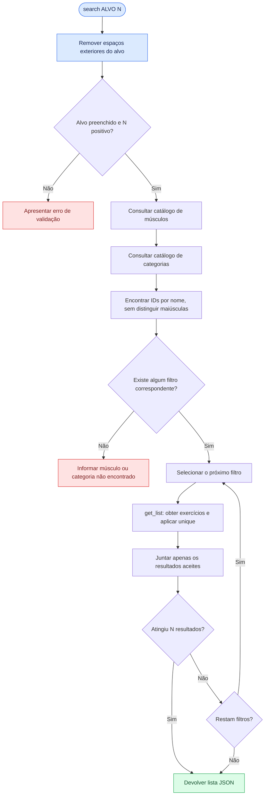
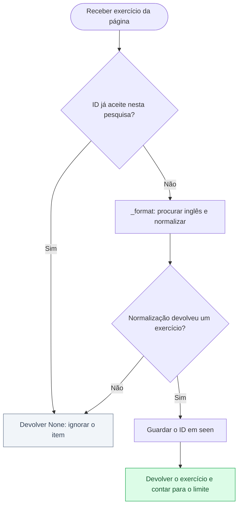

# Alínea B — Pesquisa por músculo ou categoria

> **Comando:** `search ALVO N` · **Função:** `search_exercises()` · **Saída:** lista JSON

Encontrar exercícios relacionados com um **músculo ou categoria**, reunindo as
correspondências sem repetir o mesmo ID e respeitando um limite global.

## 1. Visão geral

| Entrada | Regra | Resultado |
|---|---|---|
| `ALVO` | Texto não vazio | Correspondências nos nomes dos músculos e das categorias |
| `N` | Inteiro maior ou igual a 1 | No máximo N exercícios válidos e distintos |
| `--refresh` | Desligado por padrão | Atualizar os catálogos e as páginas de exercícios |

### Como executar

```bash
uv run python fitcli.py search back 5
uv run python fitcli.py search biceps 5 --refresh
uv run python fitcli.py search --help
```

A pesquisa não distingue maiúsculas de minúsculas. O texto é escapado com
`re.escape`: caracteres de regex introduzidos pelo utilizador são tratados como
texto literal. A correspondência nos catálogos pode ser parcial.

## 2. Fluxo principal



### Músculo OU categoria

Os IDs encontrados tornam-se consultas separadas:

| Correspondência no catálogo | Filtro enviado à API |
|---|---|
| Músculo | `muscles: ID` |
| Categoria | `category: ID` |

Os resultados são unidos. Não se exige que o mesmo exercício satisfaça ao mesmo
tempo um músculo e uma categoria. Os filtros de músculos são processados antes
dos filtros de categorias; a lista final não recebe uma ordenação global adicional.

## 3. Como são evitados os duplicados

A função interna `unique()` é usada como `transform` de `get_list()`. O conjunto
`seen` é partilhado entre todos os filtros desta pesquisa.



> **O limite aplica-se a resultados válidos e distintos.** Um duplicado ou um
> exercício sem tradução inglesa não consome uma posição. Para cada filtro,
> `max_items` recebe apenas o que falta: `N - len(results)`.

## 4. Código e responsabilidades

| Função | Local | Responsabilidade |
|---|---|---|
| Comando `search` | [fitcli.py](../../fitcli.py) | Receber ALVO/N, validar entrada e apresentar resultados |
| `_matching_ids` | [exercises.py](../../fitlib/exercises.py) | Procurar nomes nos catálogos |
| `search_exercises` | [exercises.py](../../fitlib/exercises.py) | Resolver filtros e reunir os resultados |
| `unique`, interna | `search_exercises` | Eliminar IDs repetidos e rejeitar itens sem inglês |
| `get_list` | [api.py](../../fitlib/api.py) | Paginar e contar apenas os itens aceites |

<details>
<summary><strong>Ver o código completo de search_exercises()</strong></summary>

```python
def search_exercises(target: str, limit: int, refresh: bool = False) -> list[dict[str, Any]]:
    """b) Pesquisar por músculo/categoria, sem repetir IDs entre filtros."""
    target = target.strip()
    if not target:
        raise ValueError("Indique um músculo ou uma categoria não vazios.")
    if limit <= 0:
        raise ValueError("O limite deve ser positivo.")
    pattern = re.compile(re.escape(target), re.IGNORECASE)
    muscles = api.get_list("muscle/", {"limit": 100}, refresh=refresh)
    categories = api.get_list("exercisecategory/", {"limit": 100}, refresh=refresh)

    # A wger recebe IDs nos filtros; resolver o nome introduzido nos catálogos.
    filters = [("muscles", ident) for ident in _matching_ids(muscles, pattern)]
    filters += [("category", ident) for ident in _matching_ids(categories, pattern)]
    if not filters:
        raise RuntimeError(f"'{target}' não corresponde a nenhum músculo nem categoria.")

    seen: set[int] = set()

    def unique(exercise: dict) -> dict[str, Any] | None:
        # O mesmo ID pode aparecer em vários filtros/páginas; nomes podem coincidir.
        if exercise["id"] in seen:
            return None
        formatted = _format(exercise)
        if formatted is not None:
            seen.add(exercise["id"])
        return formatted

    results: list[dict[str, Any]] = []
    # Unir correspondências de músculos OU categorias, com um limite global.
    for field, ident in filters:
        if len(results) >= limit:
            break
        params = {"language": LANGUAGE, field: ident, "limit": min(limit, 100)}
        results += api.get_list(
            "exerciseinfo/", params, max_items=limit - len(results),
            refresh=refresh, transform=unique,
        )
    return results
```

</details>

O processamento está dividido em quatro passos: **validar → resolver IDs →
consultar filtros → normalizar e eliminar duplicados**.

## 5. Exemplo de união

Exemplo ilustrativo, não obtido da API:

| Origem | IDs recebidos | IDs acrescentados |
|---|---|---|
| Primeiro filtro | `10, 20` | `10, 20` |
| Segundo filtro | `20, 30` | Apenas `30` |
| Resultado global | — | `10, 20, 30` |

Se N for 2, a função termina após obter os dois primeiros resultados aceites.

## 6. Cache e limites

- Os catálogos e os exercícios usam **disk**, com TTL de **14 dias**.
- `--refresh` é encaminhado às consultas dos dois catálogos e dos exercícios.
- São consultas públicas: não existe token de conta.
- Pode haver menos resultados do que os pedidos, mesmo com um alvo válido.
- Esta alínea procura **músculos/categorias**. Para palavras no nome ou descrição
  do exercício, utilizar o extra [X1](../Extras/X1.md).

Mais detalhes em [CACHE.md](../CACHE.md).

## 7. O que verificar

| Situação | Comportamento esperado |
|---|---|
| Alvo vazio ou N menor que 1 | Erro antes de consultar os catálogos |
| Nenhum músculo/categoria correspondente | Mensagem de alvo não encontrado |
| Mesmo ID em vários filtros | Aparece apenas uma vez |
| Nomes iguais em IDs diferentes | Podem aparecer ambos: a identidade é o ID |
| Exercício sem inglês | Não é aceite nem contado |
| `--refresh` ativo | Atualiza catálogos e páginas de exercícios |

Os exemplos de execução podem aceder à API. O código mostrado foi retirado do
ficheiro atual; os diagramas descrevem o fluxo, sem introduzir novas regras.
