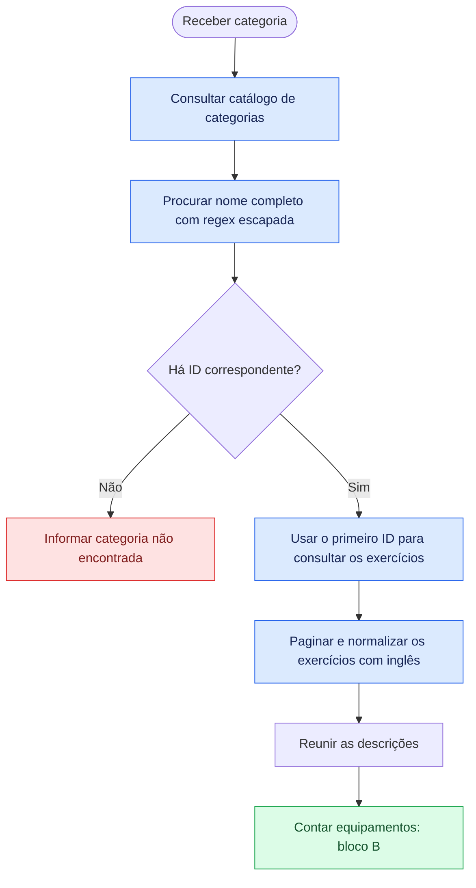
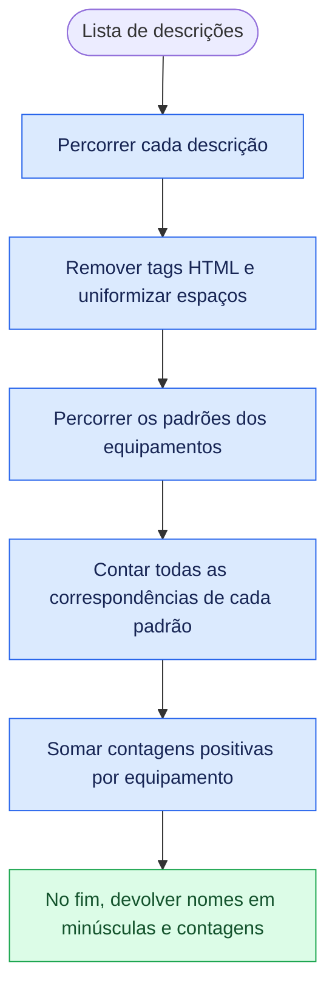

# Alínea D — Frequência de equipamentos

> **CLI:** `equipment CATEGORIA` · **TCLI:** “Frequência de equipamento” · **Saída:** lista JSON

**Neste guia:** [funcionamento](#parte-1--funcionamento) ·
[código explicado](#parte-2--código-explicado-linha-por-linha) · [verificação](#verificação)

## Parte 1 — Funcionamento

### 1. Objetivo e entrada

Contar menções textuais a equipamentos nas descrições inglesas dos exercícios
pertencentes a uma categoria. A contagem não usa simplesmente o campo estruturado
`equipment` do exercício: procura os nomes através de regex na descrição.

```bash
uv run python fitcli.py equipment chest
uv run python fitcli.py equipment --help
```

| Entrada | Regra | Saída |
|---|---|---|
| Categoria | Nome completo, sem distinguir maiúsculas; espaços exteriores removidos | Lista de contagens por equipamento |
| Categoria inexistente | Nenhum ID encontrado no catálogo | Mensagem de erro |
| Exercícios sem inglês | Rejeitados por `_format` | Não contribuem para a contagem |

### 2. Bloco A — Resolver a categoria e consultar os exercícios




A pesquisa da categoria é exata: o padrão usa `^` e `$`. Se houver vários IDs
com o nome correspondente, é escolhido apenas o primeiro. `get_list()` trata a
paginação; não existe um limite global de exercícios nesta alínea.

### 3. Bloco B — Limpar e contar as menções




As caixas resumem dois ciclos: um por descrição e outro por equipamento. Uma
mesma descrição pode contribuir com mais de uma menção ao mesmo equipamento.
A limpeza é predefinida, mas `count_equipment(..., limpar_html=False)` permite
desligá-la numa chamada Python; essa opção não existe no comando do terminal.

### 4. Padrões e tratamento do texto

| Aspeto | Comportamento |
|---|---|
| HTML | Remover tags e atributos, sem os contar como texto do exercício |
| Espaços | Uniformizar para separar os termos de forma consistente |
| Maiúsculas | Todas as regex usam `re.IGNORECASE` |
| Variações | Admitir formas como `dumbbell`/`dumbbells` e `barbell`/`barbells` |
| Bench / incline bench | O padrão de Bench evita o prefixo literal `incline `; a limpeza predefinida normaliza os espaços |
| Equipamento sem ocorrências | Não incluir no resultado |

<details>
<summary><strong>Ver os padrões completos usados na contagem</strong></summary>

```python
EQUIPMENT_PATTERNS = {
    "Barbell": re.compile(
        r"\bbarbells?\b",
        re.IGNORECASE
    ),
    # Não reconhecer "bench" dentro de "incline bench".
    "Bench": re.compile(
        r"(?<!incline )\bbench(?:es)?\b",
        re.IGNORECASE
    ),
    "Cable machine": re.compile(
        r"\b(?:cable\s+machines?|cables?)\b",
        re.IGNORECASE
    ),
    "Dumbbell": re.compile(
        r"\bdumbbells?\b",
        re.IGNORECASE
    ),
    "Gym mat": re.compile(
        r"\b(?:gym|exercise)\s+mats?\b",
        re.IGNORECASE
    ),
    "Incline bench": re.compile(
        r"\bincline\s+bench(?:es)?\b",
        re.IGNORECASE
    ),
    "Kettlebell": re.compile(
        r"\bkettlebells?\b",
        re.IGNORECASE
    ),
    "Pull-up bar": re.compile(
        r"\bpull[- ]up\s+bars?\b",
        re.IGNORECASE
    ),
    "Resistance band": re.compile(
        r"\bresistance\s+bands?\b",
        re.IGNORECASE
    ),
    "SZ-Bar": re.compile(
        r"\b(?:sz|ez)[- ]bar\b",
        re.IGNORECASE
    ),
    "Swiss Ball": re.compile(
        r"\b(?:swiss|stability)\s+balls?\b",
        re.IGNORECASE
    ),
    "none (bodyweight exercise)": re.compile(
        r"\b(?:bodyweight|body\s+weight)\b",
        re.IGNORECASE
    )
}
```

</details>

A limpeza remove tags, mas não faz tradução nem descodifica entidades HTML.
O sucesso da contagem depende das palavras e formas contempladas nos padrões.

### 5. Exemplo simulado

Descrições de entrada:

```text
<p>Use dumbbells and an incline bench.</p>
A dumbbell near the incline bench.
```

Resultado produzido pelo contador:

```json
[
  {"dumbbell": 2},
  {"incline bench": 2}
]
```

São **menções**, não o número de exercícios diferentes que usam cada equipamento.
`bench` não é contado separadamente neste exemplo. As contagens são devolvidas
na ordem de inserção; **a ordenação decrescente por frequência continua pendente**.

### 6. Funções e dependências

| Função | Responsabilidade |
|---|---|
| `equipment_frequency` | Resolver categoria, consultar exercícios e recolher descrições |
| `_matching_ids`, partilhada | Encontrar IDs no catálogo |
| `_format`, partilhada | Selecionar inglês e normalizar dados |
| `clean_description` | Retirar HTML e uniformizar espaços |
| `count_equipment` | Somar ocorrências e construir a lista |

Consultas públicas usam `disk`, TTL de 14 dias e nenhum token de conta.
A cache guarda respostas HTTP, não uma segunda versão das contagens.
Ver [CACHE.md](../CACHE.md) e [alínea B](B_Exercises.md) para a base reutilizada.

## Parte 2 — Código explicado linha por linha

Os blocos são cópias do código atual. As tabelas referem as linhas de
`fitlib/exercises.py`; linhas vazias e comentários separadores não executam lógica.
Não foram alterados os padrões, a contagem ou a ordenação nesta revisão documental.

### `equipment_frequency()`

[Fonte: exercises.py, linha 184](../../fitlib/exercises.py#L184)

```python
def equipment_frequency(
    category: str
) -> list[dict[str, int]]:
    """d) Contar as menções a equipamentos nas descrições de uma categoria."""
    categories = api.get_list(
        "exercisecategory/"
    )

    pattern = re.compile(
        rf"^{re.escape(category.strip())}$",
        re.IGNORECASE
    )

    category_ids = _matching_ids(
        categories,
        pattern
    )

    if not category_ids:
        raise ValueError(
            f"Categoria não encontrada: {category}"
        )

    category_id = category_ids[0]

    exercises = api.get_list(
        "exerciseinfo/",
        params={"category": category_id},
        transform=_format
    )

    descriptions = []

    for exercise in exercises:
        descriptions.append(exercise["description"])

    return count_equipment(
        descriptions
    )
```

| Linha | Explicação |
|---|---|
| 184 | Define `equipment_frequency` e os parâmetros/resultado desta operação. |
| 185 | Recebe o nome textual da categoria. |
| 186 | Declara uma lista de dicionários como resultado. |
| 187 | Documenta o objetivo da função. |
| 188 | Consulta todas as páginas do catálogo público de categorias. |
| 189 | Seleciona o endpoint das categorias. |
| 190 | Conclui a chamada iniciada nas linhas anteriores. |
| 192 | Prepara a expressão para localizar o nome da categoria. |
| 193 | Remove espaços exteriores, escapa caracteres de regex e exige correspondência do nome inteiro. |
| 194 | Não distingue maiúsculas de minúsculas. |
| 195 | Conclui a chamada iniciada nas linhas anteriores. |
| 197 | Reutiliza o helper de procura nos nomes dos catálogos. |
| 198 | Fornece as categorias recebidas da API. |
| 199 | Fornece o padrão preparado para a categoria pedida. |
| 200 | Conclui a chamada iniciada nas linhas anteriores. |
| 202 | Verifica se a categoria não teve correspondência. |
| 203 | Inicia uma mensagem de categoria inválida. |
| 204 | Identifica o texto que não foi encontrado. |
| 205 | Conclui a chamada iniciada nas linhas anteriores. |
| 207 | Escolhe o primeiro ID correspondente. |
| 209 | Consulta as páginas de exercícios da categoria selecionada. |
| 210 | Seleciona o endpoint com os detalhes dos exercícios. |
| 211 | Filtra pelo ID da categoria, não pelo nome recebido. |
| 212 | Normaliza os dados e rejeita exercícios sem tradução inglesa. |
| 213 | Conclui a chamada iniciada nas linhas anteriores. |
| 215 | Inicia a lista de descrições a analisar. |
| 217 | Produz uma linha por exercício dentro do grupo. |
| 218 | Guarda apenas a descrição de cada exercício para a contagem. |
| 220 | Delega a análise textual no contador partilhado. |
| 221 | Encaminha as descrições para o contador. |
| 222 | Conclui a chamada iniciada nas linhas anteriores. |

### `clean_description()`

[Fonte: exercises.py, linha 282](../../fitlib/exercises.py#L282)

```python
def clean_description(description: str) -> str:
    """Remover tags HTML e normalizar os espaços da descrição."""
    cleaned = HTML_TAGS.sub(" ", description)
    cleaned = " ".join(cleaned.split())
    return cleaned
```

| Linha | Explicação |
|---|---|
| 282 | Define `clean_description` e os parâmetros/resultado desta operação. |
| 283 | Documenta o objetivo da função. |
| 284 | Substitui tags HTML por espaços, removendo também os seus atributos. |
| 285 | Uniformiza os espaços e retira espaços exteriores. |
| 286 | Devolve a descrição limpa. |

### `count_equipment()`

[Fonte: exercises.py, linha 289](../../fitlib/exercises.py#L289)

```python
def count_equipment(
    descriptions: list[str],
    limpar_html: bool = True
) -> list[dict[str, int]]:
    """Contar as menções a cada equipamento nas descrições."""
    contagem = {}

    for description in descriptions:
        texto = description

        # Limpar HTML para não contar equipamento nos atributos das tags.
        if limpar_html:
            texto = clean_description(description)

        for equipment, pattern in EQUIPMENT_PATTERNS.items():
            encontrados = pattern.findall(texto)
            quantidade = len(encontrados)

            if quantidade > 0:
                anterior = contagem.get(equipment, 0)
                contagem[equipment] = anterior + quantidade

    resultado = []

    for equipment, quantidade in contagem.items():
        resultado.append({
            equipment.lower(): quantidade
        })

    # A ordenação por frequência decrescente fica por implementar.
    return resultado
```

| Linha | Explicação |
|---|---|
| 289 | Define `count_equipment` e os parâmetros/resultado desta operação. |
| 290 | Recebe a lista de descrições textuais. |
| 291 | Ativa a limpeza de tags e espaços por padrão. |
| 292 | Declara uma lista de dicionários como resultado. |
| 293 | Documenta o objetivo da função. |
| 294 | Inicia o dicionário que acumula ocorrências por equipamento. |
| 296 | Percorre cada descrição recebida. |
| 297 | Começa com o texto original da descrição. |
| 300 | Verifica se deve limpar HTML antes de procurar equipamentos. |
| 301 | Remove tags e uniformiza espaços através do helper. |
| 303 | Percorre os nomes oficiais e as suas expressões regulares. |
| 304 | Obtém todas as correspondências desse equipamento na descrição. |
| 305 | Conta menções; não limita a uma ocorrência por exercício. |
| 307 | Só regista equipamentos efetivamente encontrados. |
| 308 | Lê o total acumulado, usando zero na primeira ocorrência. |
| 309 | Soma as novas menções ao total do equipamento. |
| 311 | Inicia a lista de resultados. |
| 313 | Percorre as contagens na ordem de inserção; não ordena por frequência. |
| 314 | Acrescenta um dicionário de um único equipamento à lista. |
| 315 | Usa o nome em minúsculas como chave e a contagem como valor. |
| 316 | Fecha o dicionário e a chamada que o acrescenta à lista. |
| 319 | Devolve os resultados acumulados. |

## Verificação

| Caso | Resultado esperado |
|---|---|
| Categoria não encontrada | Erro antes da consulta de exercícios |
| Descrição com tags/atributos | Contar apenas o texto após limpeza |
| Duas menções no mesmo texto | Somar duas ocorrências |
| `incline bench` com limpeza predefinida | Contar Incline bench, sem duplicar em Bench |
| Nenhuma correspondência | Devolver lista vazia |
| Frequências diferentes | Não presumir que a saída já está ordenada |

O exemplo de contagem foi verificado com texto simulado, sem pedidos HTTP.
A cópia atual não inclui uma suite `tests/`; não é necessário criar contas ou
alterar treinos para testar o processamento puro.

Voltar ao [README oficial](../../README.md).
