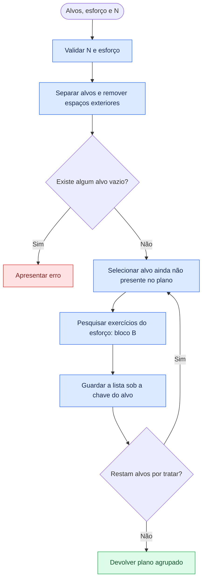
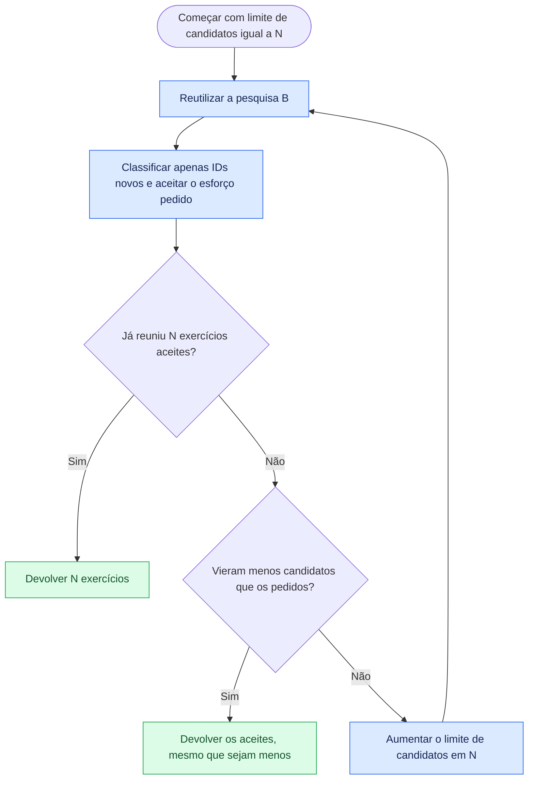
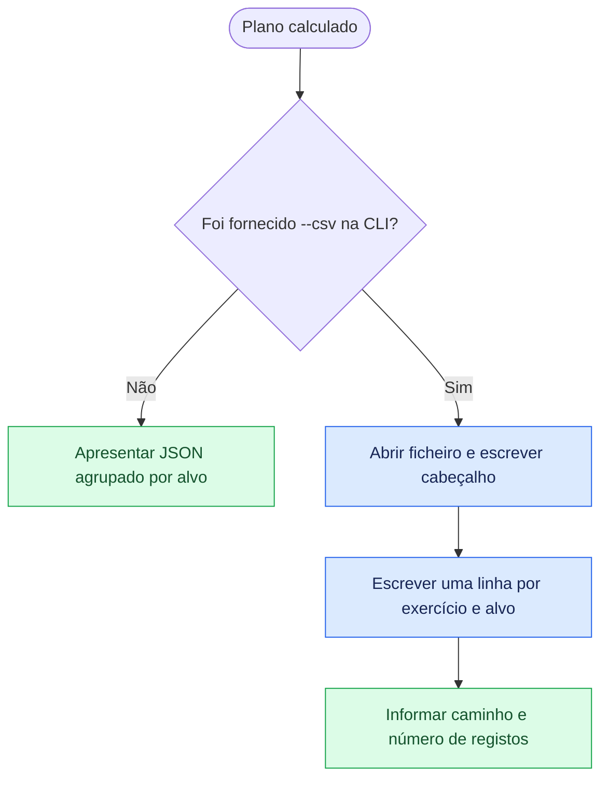

# Alínea E — Plano local por alvo e esforço

> **CLI:** `workout ALVOS ESFORCO N` · **TCLI:** “Plano por esforço” · **Saída:** JSON ou CSV na CLI

**Neste guia:** [funcionamento](#parte-1--funcionamento) ·
[código explicado](#parte-2--código-explicado-linha-por-linha) · [verificação](#verificação)

## Parte 1 — Funcionamento

### 1. Objetivo e argumentos

Criar um plano agrupado por alvo, com até N exercícios aceites para cada um.
A alínea reutiliza a [pesquisa B](B_Exercises.md) e a [classificação C](C_Exercises.md).

| Argumento/opção | Regra | Exemplo |
|---|---|---|
| `ALVOS` | Um ou mais alvos não vazios separados por vírgula | `biceps,back` |
| `ESFORCO` | String `compound`, `isolated` ou `any` | `compound` |
| `N` | Inteiro positivo, aplicado separadamente a cada alvo | `3` |
| `--csv CAMINHO` | Opcional e exclusivo da CLI | `--csv treino.csv` |

```bash
uv run python fitcli.py workout biceps,back compound 3
uv run python fitcli.py workout chest isolated 2 --csv treino.csv
uv run python fitcli.py workout --help
```

O esforço é texto validado por condições simples: **não existe a classe Effort**.
No TCLI, o menu pede os mesmos valores e mostra JSON; não cria automaticamente
um treino no formato de `workouts/` nem o exporta para a conta.

### 2. Bloco A — Preparar os alvos do plano




Alvos repetidos com o mesmo texto, depois de remover espaços, são tratados uma
vez. Não há normalização de maiúsculas nas chaves do plano. O mesmo exercício
pode aparecer em alvos diferentes: a eliminação de repetições não é global ao plano.

### 3. Bloco B — Reunir resultados suficientes para um alvo




Na caixa de filtragem, cada ID novo é classificado e guardado em `verificados`,
mesmo quando é rejeitado pelo esforço. Isso evita reclassificar os candidatos
que reaparecem quando o limite aumenta.

| Esforço pedido | Exercícios aceites |
|---|---|
| `compound` | Apenas os classificados como compound |
| `isolated` | Apenas os classificados como isolated |
| `any` | Todas as classificações, incluindo cardio e other |

A pesquisa não reclassifica um exercício só para preencher N: se o catálogo se
esgotar, devolve uma lista parcial ou vazia. O dicionário de verificados pertence
à pesquisa do alvo atual e não persiste entre execuções.

### 4. Exemplo simulado de ampliação

Para N = 2 e esforço `compound`:

| Tentativa | Candidatos | Decisão |
|---|---|---|
| Pedir 2 | ID 1 isolated; ID 2 compound | Aceitar apenas o ID 2 |
| Pedir 4 | IDs 1, 2, 3 e 4 | Ignorar os já vistos; se ID 3 for compound, completar N |

A apresentação pode atualizar os nomes para português no TCLI, mas só depois de
aplicar a seleção/classificação em inglês. As regras da alínea não são traduzidas.

### 5. Bloco C — Apresentar JSON ou exportar CSV




O CSV usa as colunas `target`, `id`, `name`, `category`, `equipment` e `type`.
Listas/dicionários de um campo são representados como texto JSON dentro da célula.
A exportação abre o ficheiro em modo `w`: **um CSV já existente nesse caminho é
substituído**. Isto é diferente dos treinos do TCLI guardados em modo exclusivo.

### 6. Funções e limites

| Função | Papel |
|---|---|
| `build_workout` | Validar entrada e reunir listas por alvo |
| `search_by_category` | Ampliar candidatos e filtrar por esforço |
| `search_exercises` | Reutilizar a alínea B |
| `exercise_type` | Reutilizar a alínea C |
| `_csv_value`, `write_workout_csv` | Converter campos e gravar o CSV |

Respostas públicas usam `disk` e TTL de 14 dias; as classificações e planos não
criam outra cache. Não existe token de conta nestas consultas. O número N limita
cada alvo, não a soma de todos os alvos. O total disponível pode ser menor que N.

Ver [CACHE.md](../CACHE.md). Os treinos locais/templates são outro fluxo:
[XTcli_treinos.md](../tcli/XTcli_treinos.md).

## Parte 2 — Código explicado linha por linha

Os blocos seguintes são retirados de `fitlib/exercises.py`. A numeração refere-se
a esse ficheiro; linhas vazias e comentários separadores não executam operações.

### `build_workout()`

[Fonte: exercises.py, linha 361](../../fitlib/exercises.py#L361)

```python
def build_workout(targets: str, effort: str, limit: int) -> dict[str, list[dict[str, Any]]]:
    """e) Reutilizar pesquisa e classificação, com um limite por alvo."""
    if limit <= 0:
        raise ValueError("O limite deve ser positivo.")
    if effort not in ("compound", "isolated", "any"):
        raise ValueError("Indique compound, isolated ou any.")

    alvos = []
    for target in targets.split(","):
        target = target.strip()
        if not target:
            raise ValueError("Indique alvos não vazios separados por vírgula.")
        alvos.append(target)

    plano = {}
    for target in alvos:
        if target not in plano:
            plano[target] = search_by_category(target, effort, limit)

    return plano
```

| Linha | Explicação |
|---|---|
| 361 | Define `build_workout` e os parâmetros/resultado desta operação. |
| 362 | Documenta o objetivo da função. |
| 363 | Valida o limite por alvo antes de construir o plano. |
| 364 | Interrompe a operação antes da pesquisa se a quantidade for inválida. |
| 365 | Valida esforço como texto simples, sem Enum ou classe. |
| 366 | Explica os três valores de esforço permitidos. |
| 368 | Inicia a lista de alvos normalizados. |
| 369 | Separa a entrada por vírgulas. |
| 370 | Remove espaços exteriores de cada alvo. |
| 371 | Rejeita alvos vazios, incluindo vírgulas seguidas ou uma vírgula final. |
| 372 | Explica como fornecer a lista de alvos. |
| 373 | Guarda cada alvo validado. |
| 375 | Inicia o dicionário que agrupa exercícios por alvo. |
| 376 | Percorre os alvos na ordem da entrada. |
| 377 | Evita repetir o mesmo alvo textual após a remoção de espaços. |
| 378 | Obtém até limit exercícios aceites para esse alvo e esforço. |
| 380 | Devolve o plano agrupado. |

### `search_by_category()`

[Fonte: exercises.py, linha 325](../../fitlib/exercises.py#L325)

```python
def search_by_category(muscle: str, category: str, n: int) -> list[dict[str, Any]]:
    """Pesquisar mais candidatos até reunir N exercícios do esforço pedido."""
    if n <= 0:
        raise ValueError("O limite deve ser positivo.")
    if category not in ("compound", "isolated", "any"):
        raise ValueError("Indique compound, isolated ou any.")

    resultado = []
    verificados = {}
    limite_pesquisa = n

    while True:
        candidatos = search_exercises(muscle, limite_pesquisa)

        for exercise in candidatos:
            exercise_id = exercise["id"]
            if exercise_id in verificados:
                continue

            tipo = exercise_type(exercise_id)
            verificados[exercise_id] = tipo

            if category == "any" or tipo == category:
                exercise = exercise.copy()
                exercise["type"] = tipo
                resultado.append(exercise)

                if len(resultado) == n:
                    return resultado

        if len(candidatos) < limite_pesquisa:
            return resultado

        limite_pesquisa += n
```

| Linha | Explicação |
|---|---|
| 325 | Define `search_by_category` e os parâmetros/resultado desta operação. |
| 326 | Documenta o objetivo da função. |
| 327 | Exige uma quantidade positiva de exercícios. |
| 328 | Interrompe a operação antes da pesquisa se a quantidade for inválida. |
| 329 | Valida a string de esforço aceite pelo filtro. |
| 330 | Explica os três valores de esforço permitidos. |
| 332 | Inicia a lista de resultados. |
| 333 | Memoriza a classificação dos IDs já examinados nesta pesquisa. |
| 334 | Começa por pedir tantos candidatos quantos os resultados pretendidos. |
| 336 | Permite ampliar a pesquisa se os primeiros candidatos não forem suficientes. |
| 337 | Reutiliza a alínea B para obter candidatos por músculo ou categoria. |
| 339 | Percorre os candidatos pela ordem devolvida pela pesquisa. |
| 340 | Obtém o ID usado para não repetir classificações. |
| 341 | Identifica um exercício já examinado numa pesquisa anterior do mesmo alvo. |
| 342 | Ignora esse ID e avança para o candidato seguinte. |
| 344 | Reutiliza a alínea C para classificar os detalhes do exercício. |
| 345 | Guarda a classificação mesmo quando o exercício não corresponde ao esforço pedido. |
| 347 | Aceita todos em any, ou só os que correspondem à classificação pedida. |
| 348 | Cria uma cópia para acrescentar type sem alterar o candidato original. |
| 349 | Acrescenta a classificação ao resultado do plano. |
| 350 | Acrescenta o candidato aceite. |
| 352 | Verifica se já reuniu a quantidade pretendida. |
| 353 | Devolve os resultados acumulados. |
| 355 | Reconhece o esgotamento quando a pesquisa devolve menos candidatos que os pedidos. |
| 356 | Devolve os resultados acumulados. |
| 358 | Aumenta o limite de candidatos em mais n para a próxima pesquisa. |

### Colunas do CSV

```python
CSV_FIELDS = ("target", "id", "name", "category", "equipment", "type")
```

Esta constante define as colunas e a ordem usadas pelo `csv.DictWriter`.
A coluna target vem do grupo; as restantes vêm de cada exercício.

### `_csv_value()`

[Fonte: exercises.py, linha 397](../../fitlib/exercises.py#L397)

```python
def _csv_value(value: Any) -> Any:
    """Representar estruturas numa célula sem perder os seus campos."""
    if isinstance(value, (list, dict)):
        return json.dumps(value, ensure_ascii=False, allow_nan=False)
    return value
```

| Linha | Explicação |
|---|---|
| 397 | Define `_csv_value` e os parâmetros/resultado desta operação. |
| 398 | Documenta o objetivo da função. |
| 399 | Identifica estruturas que não cabem diretamente numa célula CSV. |
| 400 | Representa listas/dicionários como JSON textual, preservando acentos. |
| 401 | Mantém valores simples para o escritor CSV. |

### `write_workout_csv()`

[Fonte: exercises.py, linha 404](../../fitlib/exercises.py#L404)

```python
def write_workout_csv(workout: dict[str, list[dict[str, Any]]], path: Path) -> None:

    with Path(path).open("w", encoding="utf-8", newline="") as file:
        writer = csv.DictWriter(file, fieldnames=CSV_FIELDS)
        writer.writeheader()
        for target, exercises in workout.items():
            for exercise in exercises:
                row = {
                    field: _csv_value(exercise.get(field, ""))
                    for field in CSV_FIELDS if field != "target"
                }
                writer.writerow({"target": target, **row})
```

| Linha | Explicação |
|---|---|
| 404 | Define `write_workout_csv` e os parâmetros/resultado desta operação. |
| 406 | Abre o caminho para escrita; um CSV existente com esse nome é substituído. |
| 407 | Define a ordem e os campos das colunas do CSV. |
| 408 | Escreve o cabeçalho. |
| 409 | Percorre os grupos do plano. |
| 410 | Produz uma linha por exercício dentro do grupo. |
| 411 | Começa a construir os valores da linha do exercício. |
| 412 | Converte cada campo e usa texto vazio se estiver ausente. |
| 413 | Percorre as colunas do exercício; target é acrescentado separadamente. |
| 414 | Fecha a construção do dicionário da linha. |
| 415 | Grava o alvo e os campos do exercício numa linha CSV. |

## Verificação

| Caso | Resultado esperado |
|---|---|
| Esforço fora das três strings | Erro antes da pesquisa |
| Alvo vazio entre vírgulas | Erro de validação |
| Alvo repetido | Uma única chave para esse texto |
| Primeiros candidatos não satisfazem o esforço | Ampliar a pesquisa e não reclassificar IDs já vistos |
| Catálogo esgotado | Resultado parcial ou vazio, sem alterar classificações |
| `any` | Aceitar também cardio e other |
| `--csv` | Criar cabeçalho/linhas e mostrar contagem, sem imprimir o plano JSON |

A revisão usa dados simulados para conferir filtragem, ampliação, strings e CSV.
Não executa consultas reais nem altera treinos ou templates existentes.

Voltar ao [README oficial](../../README.md).
