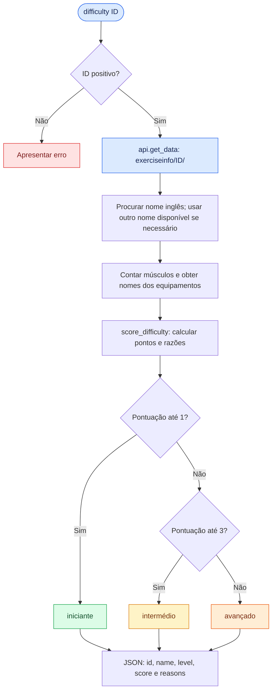
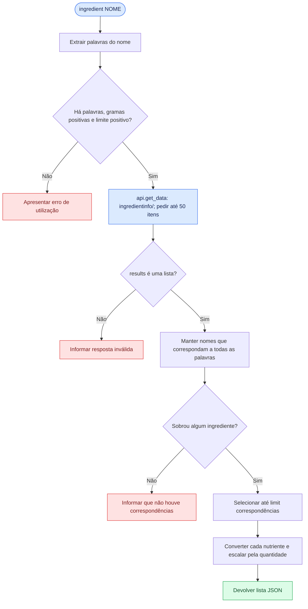

# Extras X3 e X4 — Dificuldade e nutrição

Duas consultas públicas implementadas em [extras.py](../../fitlib/extras.py),
com comandos em [fitcli.py](../../fitcli.py).

| Extra | Comando | Pergunta respondida | Resultado |
|---|---|---|---|
| **X3** | `difficulty ID` | Que dificuldade sugerem os dados deste exercício? | Nível, pontuação e razões |
| **X4** | `ingredient NOME` | Que valores nutricionais correspondem à quantidade pedida? | Lista de ingredientes e nutrientes escalados |

**Navegação:** [X3 — dificuldade](#x3--dificuldade-de-um-exercício) ·
[X4 — nutrição](#x4--valores-nutricionais) · [Cache](#cache-e-autenticação) ·
[Verificação](#verificação)

---

## X3 — Dificuldade de um exercício

> **Entrada:** ID positivo · **Função:** `exercise_difficulty()` · **Saída:** objeto JSON

### 1. Utilização

```bash
uv run python fitcli.py difficulty 192
uv run python fitcli.py difficulty 192 --refresh
uv run python fitcli.py difficulty --help
```

`--refresh` ignora a resposta guardada e atualiza os dados do exercício.

### 2. Fluxo do algoritmo



### 3. De onde vêm os pontos

A pontuação começa em zero. As pistas abaixo são somadas ou subtraídas:

| Pista | Pontos | Como é contada |
|---|---:|---|
| 0 ou 1 músculo | 0 | Soma dos músculos principais e secundários |
| 2 ou 3 músculos | +1 | Mesma contagem |
| 4 ou mais músculos | +2 | Mesma contagem |
| Palavra avançada no nome | +2 | Uma vez, mesmo com várias correspondências |
| Palavra de apoio no nome | −1 | Uma vez, mesmo com várias correspondências |
| Equipamento Barbell ou Kettlebell | +1 | Uma vez, se existir algum equipamento correspondente |

| Pontuação final | Nível |
|---|---|
| Até 1 | `iniciante` |
| 2 ou 3 | `intermédio` |
| 4 ou mais | `avançado` |

As duas contagens de palavras são independentes: um nome com pistas avançadas e
pistas de apoio pode somar +2 e subtrair 1 no mesmo exercício.

### 4. Papel das expressões regulares

| Grupo | Exemplos reconhecidos | Papel |
|---|---|---|
| Avançadas | `single-leg`, `one arm`, `pistol`, `weighted`, `snatch`, `handstand` | Acrescentar uma pista de maior exigência |
| Apoio | `assisted`, `machine`, `seated`, `supported`, `wall`, `kneeling` | Acrescentar uma pista de exercício guiado/apoiado |

A correspondência não distingue maiúsculas de minúsculas. As fronteiras `\b`
evitam algumas correspondências indevidas: `clean` não deve corresponder a
`Cleaner`. As alternativas para `single`/`one` admitem hífen, espaço ou junção.

<details>
<summary><strong>Ver as regex utilizadas pelo código</strong></summary>

```python
ADVANCED_PATTERN = re.compile(
    r"\b(?:single[- ]?(?:leg|arm)|one[- ]?(?:leg|arm)|pistol|deficit|weighted|"
    r"snatch|clean|jerk|muscle[- ]?up|handstand|archer|plyo\w*|explosive)\b",
    re.IGNORECASE,
)

BEGINNER_PATTERN = re.compile(
    r"\b(?:assisted|machine|seated|supported|wall|kneeling|stretch\w*)\b",
    re.IGNORECASE,
)
```

</details>

### 5. Exemplo explicado

**Dados simulados:** `Single-Leg Deficit Deadlift`, quatro músculos e equipamento
`Barbell`. O ID abaixo é fictício; este exemplo não representa um registo consultado.

| Passo | Alteração | Acumulado |
|---|---:|---:|
| Quatro músculos | +2 | 2 |
| `single-leg` e `deficit` | +2 no total | 4 |
| Barbell | +1 | **5** |

```json
{
  "id": 3,
  "name": "Single-Leg Deficit Deadlift",
  "level": "avançado",
  "score": 5,
  "reasons": [
    "4 músculos envolvidos (+2)",
    "palavras avançadas no nome: single-leg, deficit (+2)",
    "equipamento exigente: Barbell (+1)"
  ]
}
```

<details>
<summary><strong>Comparar os restantes casos simulados do material original</strong></summary>

Os músculos e equipamentos foram escolhidos para ilustrar o cálculo; não são
novas consultas ao catálogo.

| Nome | Músculos | Equipamento | Pontuação | Nível |
|---|---:|---|---:|---|
| Machine Chest Press | 3 | — | 0 | iniciante |
| Barbell Back Squat | 4 | Barbell | 3 | intermédio |
| Single-Leg Deficit Deadlift | 4 | Barbell | 5 | avançado |
| Plank | 0 | — | 0 | iniciante |
| Cleaner Row | 2 | — | 1 | iniciante |
| Weighted Pull-ups | 4 | — | 4 | avançado |
| Seated Cable Row | 3 | — | 0 | iniciante |

</details>

### 6. Funções e código

| Função | Responsabilidade |
|---|---|
| `_exercise_name` | Preferir inglês e, na sua ausência, o primeiro nome disponível |
| `_unique_matches` | Identificar correspondências sem repetir a mesma palavra |
| `score_difficulty` | Somar pontos e descrever as razões |
| `level_from_score` | Converter a pontuação em nível |
| `exercise_difficulty` | Consultar os dados e construir o resultado |

<details>
<summary><strong>Ver exercise_difficulty() e a conversão de nível</strong></summary>

```python
def exercise_difficulty(exercise_id: int, refresh: bool = False) -> dict[str, Any]:
    """Estimar a dificuldade do exercício com o ID dado (pede exerciseinfo/<id>/)."""
    if exercise_id <= 0:
        raise ValueError("O ID do exercício deve ser positivo.")

    exercise = api.get_data(f"exerciseinfo/{exercise_id}/", refresh=refresh)
    name = _exercise_name(exercise)
    n_muscles = len(exercise.get("muscles") or []) + len(exercise.get("muscles_secondary") or [])
    equipment = [e.get("name") for e in exercise.get("equipment") or []]

    score, reasons = score_difficulty(name, n_muscles, equipment)
    return {
        "id": exercise_id,
        "name": name,
        "level": level_from_score(score),
        "score": score,
        "reasons": reasons,
    }

def level_from_score(score: int) -> str:
    if score <= 1:
        return "iniciante"
    if score <= 3:
        return "intermédio"
    return "avançado"
```

</details>

### 7. Limitações da estimativa

- As regras são **exploratórias**, sem validação científica individual.
- Músculos principais e secundários contam da mesma forma.
- Nomes pouco informativos fornecem menos pistas, mas não determinam sozinhos o nível.
- As regex usam palavras inglesas. Um nome alternativo noutro idioma pode não
  fornecer as mesmas correspondências.
- O nível resume estas regras; `reasons` permite perceber como foi obtido.

---

## X4 — Valores nutricionais

> **Entrada:** nome do ingrediente · **Função:** `ingredient_info()` · **Saída:** lista JSON

Pesquisar ingredientes em inglês e converter os valores por 100 g para a
quantidade em gramas pedida pelo utilizador.

### 1. Utilização e opções

```bash
uv run python fitcli.py ingredient banana
uv run python fitcli.py ingredient "chicken breast" --grams 150 --limit 3
uv run python fitcli.py ingredient banana --refresh
uv run python fitcli.py ingredient --help
```

| Argumento/opção | Padrão | Regra na CLI |
|---|---|---|
| `name` | Obrigatório | Nome do ingrediente em inglês |
| `--limit` | 5 | Entre 1 e 20 resultados |
| `--grams` | 100 | Pelo menos 1 grama |
| `--refresh` | Desligado | Atualizar a resposta guardada |

Na função Python, `limit` e `grams` precisam de ser positivos; os limites adicionais
acima são aplicados pelo comando Typer.

### 2. Fluxo do algoritmo



> **Uma página apenas.** A função pede até 50 ingredientes e filtra essa resposta.
> Não segue `next`; `--limit` limita o que é apresentado, não ativa paginação.

### 3. Consulta e filtro por palavras

O pedido usa `name__search`, `language=2` e `limit=50`. Depois, o código confirma
localmente as correspondências, sem depender apenas do filtro remoto.

| Pesquisa | Nome recebido | Resultado do filtro local |
|---|---|---|
| `chicken breast` | `Chicken, breast, grilled` | Aceite |
| `chicken breast` | `Chicken leg` | Rejeitado: falta `breast` |
| `!!!` | — | Erro: não existem palavras para pesquisar |

Todas as palavras precisam de corresponder, sem distinguir maiúsculas e sem exigir
uma ordem. Cada padrão começa em `\b`, mas não exige fronteira no fim: pode aceitar
uma palavra que comece pelo termo procurado. A função não elimina registos diferentes
com o mesmo nome.

### 4. Conversão dos nutrientes

```text
valor para a quantidade pedida = valor por 100 g × gramas / 100
```

O resultado é arredondado a **uma casa decimal**. Se o valor estiver ausente ou não
puder ser convertido em número, a função devolve `None`, apresentado como `null`.

**Exemplo de cálculo simulado:** usando os valores de teste `165.0` e `3.6`, para
150 g obtém-se:

| Valor por 100 g | Conta | Resultado |
|---|---|---:|
| `165.0` | `165 × 150 / 100` | 247,5 |
| `3.6` | `3,6 × 150 / 100` | 5,4 |
| `null` ou `"abc"` | Conversão impossível | `null` |

Estes números ilustram o algoritmo, não uma recomendação alimentar nem uma nova
consulta ao catálogo.

### 5. Campos devolvidos

| Campo JSON | Significado | Campo original da API |
|---|---|---|
| `name` | Nome do ingrediente | `name` |
| `quantity_g` | Quantidade pedida | Argumento `grams` |
| `energy_kcal` | Energia para essa quantidade | `energy` |
| `protein_g` | Proteínas | `protein` |
| `carbs_g` | Hidratos de carbono | `carbohydrates` |
| `fat_g` | Gorduras | `fat` |

### 6. Funções e código

| Função | Responsabilidade |
|---|---|
| `_number` | Converter texto/valor em número, ou devolver `None` |
| `_scaled` | Aplicar a proporção e arredondar |
| `ingredient_info` | Validar, consultar, filtrar e construir a lista |

<details>
<summary><strong>Ver as funções de conversão e escala</strong></summary>

```python
def _number(value: Any) -> float | None:
    """A API devolve os nutrientes como texto ("165.0") ou null: converter com segurança."""
    try:
        return float(value)
    except (TypeError, ValueError):
        return None

def _scaled(value: Any, grams: float) -> float | None:
    number = _number(value)
    return None if number is None else round(number * grams / 100, 1)
```

</details>

<details>
<summary><strong>Ver ingredient_info() completa</strong></summary>

```python
def ingredient_info(name: str, limit: int = 5, grams: float = 100.0,
                    refresh: bool = False) -> list[dict[str, Any]]:
    """Pesquisar ingredientes pelo nome e devolver calorias e macronutrientes."""
    words = re.findall(r"\w+", name)
    if not words:
        raise ValueError("Indique o nome de um ingrediente.")
    if grams <= 0:
        raise ValueError("A quantidade em gramas deve ser positiva.")
    if limit <= 0:
        raise ValueError("O limite deve ser positivo.")

    params = {"name__search": name.strip(), "language": LANGUAGE, "limit": PAGE_SIZE}
    page = api.get_data("ingredientinfo/", params, refresh=refresh)
    items = page.get("results")
    if not isinstance(items, list):
        raise RuntimeError("A API não devolveu uma lista de ingredientes.")

    # Guarda: a API pode ignorar um filtro em silêncio e devolver o catálogo todo.
    # Só ficamos com ingredientes cujo nome contém TODAS as palavras pedidas.
    patterns = [re.compile(r"\b" + re.escape(word), re.IGNORECASE) for word in words]
    matches = [
        item for item in items
        if isinstance(item, dict)
        and all(pattern.search(item.get("name") or "") for pattern in patterns)
    ]
    if not matches:
        raise RuntimeError(f"Nenhum ingrediente encontrado para '{name.strip()}'.")

    return [
        {
            "name": item["name"],
            "quantity_g": grams,
            "energy_kcal": _scaled(item.get("energy"), grams),
            "protein_g": _scaled(item.get("protein"), grams),
            "carbs_g": _scaled(item.get("carbohydrates"), grams),
            "fat_g": _scaled(item.get("fat"), grams),
        }
        for item in matches[:limit]
    ]
```

</details>

<details>
<summary><strong>Exemplo histórico: registos chamados Banana</strong></summary>

O material original relata estes valores por 100 g. São mantidos como exemplo
de nomes repetidos com dados diferentes, sem uma nova validação da API:

| Nome | Energia (kcal) | Proteínas (g) | Hidratos (g) | Gorduras (g) |
|---|---:|---:|---:|---:|
| Banana | 312,0 | 12,5 | 40,6 | 6,2 |
| Banana | 336,0 | 0,0 | 78,6 | 1,1 |
| Banana | 200,0 | 3,6 | 26,0 | 9,0 |

O nome, por si só, não identifica a composição nem a qualidade do registo.
A função apresenta as correspondências; não escolhe a entrada mais fiável.

</details>

### 7. Limitações dos resultados

- A pesquisa é dirigida aos nomes ingleses do catálogo.
- A base colaborativa pode apresentar duplicados e valores inconsistentes.
- A função não escolhe qual registo é mais fiável.
- Uma página pode não conter todas as correspondências existentes.
- A escala usa os valores fornecidos pela API; não acrescenta informação nutricional.

---

## Cache e autenticação

| Aspeto | X3 e X4 |
|---|---|
| Função HTTP partilhada | `api.get_data()` |
| Modo predefinido | `disk` |
| TTL | 14 dias |
| Atualização manual | `--refresh` |
| Login/token | Não é necessário |
| Cache de pontuações ou cálculos | Não existe: os resultados são calculados a partir dos dados recebidos |

Contrato completo em [CACHE.md](../CACHE.md). O nome antigo `get_json` não é usado
pelas funções atuais; ambos os extras reutilizam a mesma base HTTP do projeto.

## Verificação

| Cenário | Resultado esperado |
|---|---|
| ID de dificuldade menor que 1 | Erro de validação |
| Várias palavras avançadas no nome | +2 no total, sem somar +2 por palavra |
| Pontuação 1 / 2 / 4 | `iniciante` / `intermédio` / `avançado` |
| Ingrediente sem todas as palavras | Excluído do resultado |
| Nutriente ausente ou texto inválido | Campo correspondente com `null` |
| Pedido de 150 g | Valores por 100 g multiplicados por 1,5 |
| `--refresh` | Atualização dos dados públicos guardados |

Os blocos de implementação foram extraídos dos ficheiros atuais. Os exemplos
numéricos são simulados; não representam uma nova validação da API real.
