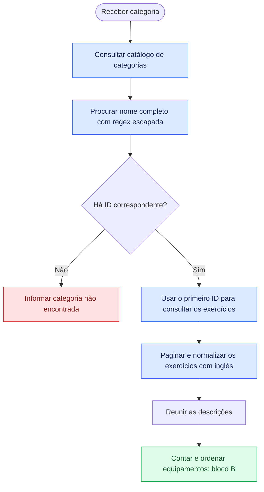
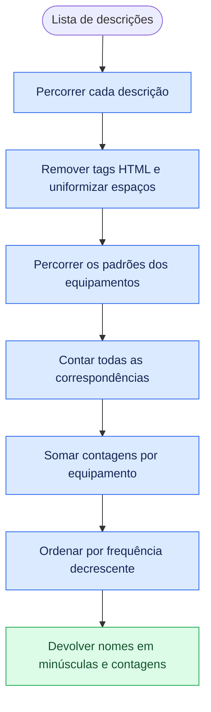

# Alínea D — Frequência de equipamentos

> **CLI:** `equipment CATEGORIA` · **TCLI:** “Frequência de equipamento” · **Saída:** lista JSON ordenada por frequência decrescente

**Neste guia:** [funcionamento](#parte-1--funcionamento) · [código explicado](#parte-2--código-explicado-linha-por-linha) · [verificação](#verificação)

## Parte 1 — Funcionamento

### 1. Objetivo e entrada

Contar menções textuais a equipamentos nas descrições inglesas dos exercícios pertencentes a uma categoria e apresentar os resultados por **ordem decrescente de frequência**.

A contagem não utiliza simplesmente o campo estruturado `equipment` do exercício: procura os nomes dos equipamentos através de expressões regulares (*regex*) nas descrições.

```bash
uv run python fitcli.py equipment chest
uv run python fitcli.py equipment --help
```

| Entrada | Regra | Saída |
|---|---|---|
| Categoria | Nome completo, sem distinguir maiúsculas; espaços exteriores removidos | Lista de contagens por equipamento |
| Categoria inexistente | Nenhum ID encontrado no catálogo | Mensagem de erro |
| Exercícios sem inglês | Rejeitados por `_format()` | Não contribuem para a contagem |
| Equipamentos encontrados | Contagem de todas as menções | Resultados ordenados por frequência decrescente |

### 2. Bloco A — Resolver a categoria e consultar os exercícios



A pesquisa da categoria é exata: o padrão utiliza `^` e `$`. Se houver vários IDs com o nome correspondente, é escolhido apenas o primeiro.

A função `get_list()` trata da paginação e a função `_format()` seleciona os exercícios com tradução inglesa. Não existe um limite global de exercícios nesta alínea.

### 3. Bloco B — Limpar, contar e ordenar as menções



A análise percorre cada descrição e, dentro dela, os padrões dos equipamentos. Uma mesma descrição pode contribuir com várias menções ao mesmo equipamento.

A limpeza é predefinida, mas `count_equipment(..., limpar_html=False)` permite desativá-la numa chamada Python. Essa opção não existe no comando do terminal.

Depois da contagem, os equipamentos são ordenados pelo número de menções, do maior para o menor. Quando existem frequências iguais, a ordenação estável do Python preserva a ordem relativa anterior.

### 4. Padrões e tratamento do texto

| Aspeto | Comportamento |
|---|---|
| HTML | Remover tags e atributos, sem os contar como texto do exercício |
| Espaços | Uniformizar para separar os termos de forma consistente |
| Maiúsculas | Todas as regex utilizam `re.IGNORECASE` |
| Variações | Admitir formas como `dumbbell`/`dumbbells` e `barbell`/`barbells` |
| Bench / incline bench | O padrão de Bench evita o prefixo literal `incline `; a limpeza predefinida normaliza os espaços |
| Equipamento sem ocorrências | Não incluir no resultado |
| Ordenação | Frequência decrescente, com `sorted()` e `reverse=True` |

<details>
<summary><strong>Ver os padrões completos utilizados na contagem</strong></summary>

```python
EQUIPMENT_PATTERNS = {
    "Barbell": re.compile(
        r"\bbarbells?\b",
        re.IGNORECASE
    ),
    # Não reconhecer "bench" dentro de "incline bench".
    "Bench": re.compile(
        r"(?<!incline )\bbench(?:es)?\b",
        re.IGNORECASE
    ),
    "Cable machine": re.compile(
        r"\b(?:cable\s+machines?|cables?)\b",
        re.IGNORECASE
    ),
    "Dumbbell": re.compile(
        r"\bdumbbells?\b",
        re.IGNORECASE
    ),
    "Gym mat": re.compile(
        r"\b(?:gym|exercise)\s+mats?\b",
        re.IGNORECASE
    ),
    "Incline bench": re.compile(
        r"\bincline\s+bench(?:es)?\b",
        re.IGNORECASE
    ),
    "Kettlebell": re.compile(
        r"\bkettlebells?\b",
        re.IGNORECASE
    ),
    "Pull-up bar": re.compile(
        r"\bpull[- ]up\s+bars?\b",
        re.IGNORECASE
    ),
    "Resistance band": re.compile(
        r"\bresistance\s+bands?\b",
        re.IGNORECASE
    ),
    "SZ-Bar": re.compile(
        r"\b(?:sz|ez)[- ]bar\b",
        re.IGNORECASE
    ),
    "Swiss Ball": re.compile(
        r"\b(?:swiss|stability)\s+balls?\b",
        re.IGNORECASE
    ),
    "none (bodyweight exercise)": re.compile(
        r"\b(?:bodyweight|body\s+weight)\b",
        re.IGNORECASE
    )
}
```

</details>

A limpeza remove tags, mas não faz tradução nem descodifica entidades HTML. O sucesso da contagem continua a depender das palavras e variações contempladas nos padrões.

### 5. Exemplo simulado

Considere as seguintes descrições:

```text
<p>Use dumbbells and an incline bench.</p>
A dumbbell near the incline bench.
Finish on an incline bench.
```

Após a limpeza e a contagem, são identificadas três menções a *incline bench* e duas a *dumbbell*.

Resultado:

```json
[
  {"incline bench": 3},
  {"dumbbell": 2}
]
```

O resultado apresenta primeiro o equipamento mais frequente.

São contabilizadas **menções textuais**, não o número de exercícios diferentes que utilizam cada equipamento. Além disso, `bench` não é contado separadamente quando integra a expressão `incline bench`.

A ordenação altera apenas a apresentação dos resultados, preservando os valores calculados.

### 6. Funções e dependências

| Função | Responsabilidade |
|---|---|
| `equipment_frequency()` | Resolver a categoria, consultar exercícios e recolher descrições |
| `_matching_ids()` | Encontrar IDs no catálogo |
| `_format()` | Selecionar a tradução inglesa e normalizar dados |
| `clean_description()` | Retirar HTML e uniformizar espaços |
| `count_equipment()` | Somar ocorrências, ordenar e construir a lista |

As consultas públicas utilizam o modo `disk`, com TTL de 14 dias e sem autenticação.

A cache armazena respostas HTTP, não uma segunda versão das contagens. Ver [cache](../../shared/cache.md) e [alínea B](b_search.md) para as funcionalidades reutilizadas.

## Parte 2 — Código explicado linha por linha

Os blocos apresentam o código da implementação, incluindo a ordenação decrescente acrescentada à função `count_equipment()`.

As tabelas referem as linhas de `fitlib/exercises.py`, considerando a atualização indicada neste guia. A remoção do comentário sobre a ordenação pendente desloca as linhas posteriores uma posição.

Não foram modificados os padrões regex nem as regras de contagem.

### `equipment_frequency()`

[Fonte: exercises.py, linha 183](../../../fitlib/exercises.py#L183)

```python
def equipment_frequency(
    category: str
) -> list[dict[str, int]]:
    """d) Contar as menções a equipamentos nas descrições de uma categoria."""
    categories = api.get_list(
        "exercisecategory/"
    )

    pattern = re.compile(
        rf"^{re.escape(category.strip())}$",
        re.IGNORECASE
    )

    category_ids = _matching_ids(
        categories,
        pattern
    )

    if not category_ids:
        raise ValueError(
            f"Categoria não encontrada: {category}"
        )

    category_id = category_ids[0]

    exercises = api.get_list(
        "exerciseinfo/",
        params={"category": category_id},
        transform=_format
    )

    descriptions = []

    for exercise in exercises:
        descriptions.append(exercise["description"])

    return count_equipment(
        descriptions
    )
```

| Linha | Explicação |
|---|---|
| 183 | Define `equipment_frequency()` e os parâmetros/resultado da operação. |
| 184 | Recebe o nome textual da categoria. |
| 185 | Declara uma lista de dicionários como resultado. |
| 186 | Documenta o objetivo da função. |
| 187–189 | Consulta o catálogo público de categorias. |
| 191–194 | Prepara o regex para corresponder ao nome completo, sem distinguir maiúsculas. |
| 196–199 | Reutiliza `_matching_ids()` para encontrar os IDs da categoria. |
| 201–204 | Verifica se existem correspondências e apresenta um erro quando necessário. |
| 206 | Seleciona o primeiro ID correspondente. |
| 208–212 | Consulta os exercícios filtrados pela categoria e normaliza os resultados. |
| 214 | Inicializa a lista de descrições. |
| 216–217 | Recolhe a descrição de cada exercício. |
| 219–221 | Encaminha as descrições para `count_equipment()` e devolve a lista resultante. |

### `clean_description()`

[Fonte: exercises.py, linha 283](../../../fitlib/exercises.py#L283)

```python
def clean_description(description: str) -> str:
    """Remover tags HTML e normalizar os espaços da descrição."""
    cleaned = HTML_TAGS.sub(" ", description)
    cleaned = " ".join(cleaned.split())
    return cleaned
```

| Linha | Explicação |
|---|---|
| 283 | Define `clean_description()` e os parâmetros/resultado. |
| 284 | Documenta o objetivo da função. |
| 285 | Substitui tags HTML por espaços, removendo também os atributos. |
| 286 | Uniformiza os espaços e retira os espaços exteriores. |
| 287 | Devolve a descrição limpa. |

### `count_equipment()`

[Fonte: exercises.py, linha 290](../../../fitlib/exercises.py#L290)

```python
def count_equipment(
    descriptions: list[str],
    limpar_html: bool = True
) -> list[dict[str, int]]:
    """Contar as menções a cada equipamento nas descrições."""
    contagem = {}

    for description in descriptions:
        texto = description

        # Limpar HTML para não contar equipamento nos atributos das tags.
        if limpar_html:
            texto = clean_description(description)

        for equipment, pattern in EQUIPMENT_PATTERNS.items():
            encontrados = pattern.findall(texto)
            quantidade = len(encontrados)

            if quantidade > 0:
                anterior = contagem.get(equipment, 0)
                contagem[equipment] = anterior + quantidade

    resultado = []

    for equipment, quantidade in sorted(contagem.items(), key=lambda item: item[1], reverse=True):
        resultado.append({
            equipment.lower(): quantidade
        })

    return resultado
```

| Linha | Explicação |
|---|---|
| 290 | Define `count_equipment()` e os parâmetros/resultado. |
| 291 | Recebe a lista de descrições textuais. |
| 292 | Ativa a limpeza de HTML por predefinição. |
| 293 | Declara uma lista de dicionários como resultado. |
| 294 | Documenta o objetivo da função. |
| 295 | Inicializa o dicionário que acumula as ocorrências. |
| 297–298 | Percorre cada descrição e recupera o texto original. |
| 300–302 | Limpa o HTML quando a opção está ativa. |
| 304 | Percorre os nomes dos equipamentos e os respetivos padrões regex. |
| 305 | Procura todas as correspondências do padrão na descrição. |
| 306 | Conta o número de menções encontradas. |
| 308–310 | Atualiza a contagem acumulada quando existem correspondências. |
| 312 | Inicializa a lista de resultados. |
| 314 | **Ordena os equipamentos pelo valor da contagem, do maior para o menor.** |
| 315–317 | Constrói um dicionário por equipamento, com o nome em minúsculas e a respetiva frequência. |
| 319 | Devolve a lista de resultados ordenada. |

A alteração foi feita exclusivamente na iteração final:

```python
for equipment, quantidade in sorted(contagem.items(), key=lambda item: item[1], reverse=True):
```

O método `items()` fornece os pares de equipamento e frequência. A função `sorted()` ordena esses pares utilizando o segundo elemento de cada um (`item[1]`), enquanto `reverse=True` determina a ordem decrescente.

O dicionário `contagem` e todos os valores calculados permanecem inalterados. A saída continua a ser uma lista de dicionários JSON, agora ordenada.

## Verificação

| Caso | Resultado esperado |
|---|---|
| Categoria não encontrada | Erro antes da consulta de exercícios |
| Descrição com tags e atributos | Contar apenas o texto após limpeza |
| Duas menções no mesmo texto | Somar duas ocorrências |
| `incline bench` com limpeza predefinida | Contar Incline bench, sem duplicar em Bench |
| Nenhuma correspondência | Devolver lista vazia |
| Frequências 3, 7 e 2 | Apresentar os resultados por ordem 7, 3 e 2 |
| Frequências iguais | Preservar a ordem relativa de inserção |
| Nomes com maiúsculas diferentes | Contar as correspondências sem distinguir capitalização |
| Variações singular/plural contempladas | Contabilizar as duas formas no mesmo equipamento |

### Teste local da ordenação

É possível verificar o comportamento diretamente, sem consultar a API:

```python
from fitlib.exercises import count_equipment

descriptions = [
    "Use dumbbells and an incline bench.",
    "A dumbbell near the incline bench.",
    "Finish on an incline bench."
]

print(count_equipment(descriptions))
```

Resultado esperado:

```python
[
    {"incline bench": 3},
    {"dumbbell": 2}
]
```

Este teste verifica a contagem e a ordenação sobre texto simulado, sem depender da disponibilidade da API.

A implementação mantém a mesma estrutura e as mesmas expressões regulares. A única alteração funcional é a ordenação por frequência decrescente.

Voltar ao [README oficial](../../../README.md).