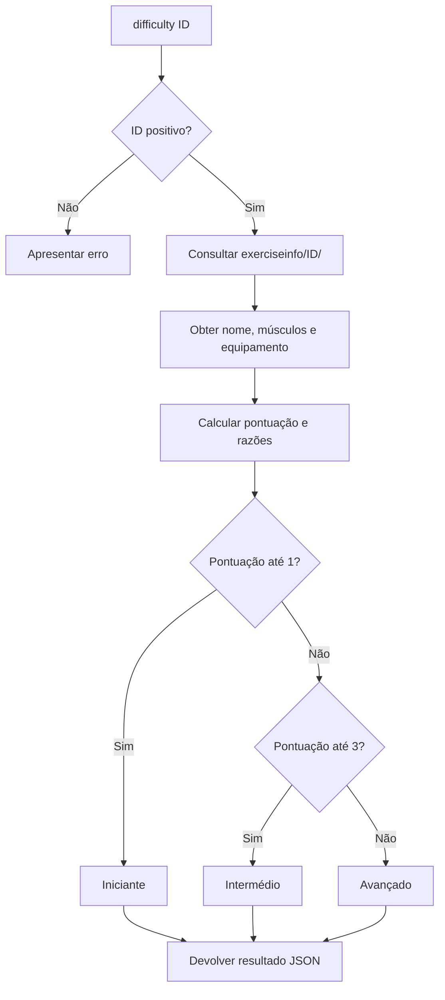

# Extra X3 — Dificuldade de um exercício

**Comando:** `difficulty ID`  
**Função:** `exercise_difficulty()`  
**Saída:** objeto JSON

## 1. Objetivo

Estimar o nível de dificuldade de um exercício físico a partir das informações disponibilizadas pela API wger, classificando-o como `iniciante`, `intermédio` ou `avançado`.

A classificação utiliza uma pontuação baseada em três características: número de músculos envolvidos, palavras presentes no nome do exercício e equipamentos necessários.

Trata-se de uma estimativa exploratória baseada em regras, não de uma avaliação científica individual da dificuldade.

A implementação encontra-se em [fitlib/extras.py](../../../fitlib/extras.py), com o comando definido em [fitcli.py](../../../fitcli.py).

## 2. Utilização

```bash
uv run python fitcli.py difficulty 192
uv run python fitcli.py difficulty 192 --refresh
uv run python fitcli.py difficulty --help
```

O comando recebe um ID positivo e devolve o nome do exercício, o nível atribuído, a pontuação calculada e as razões que justificam o resultado.

A opção `--refresh` permite ignorar a resposta guardada na cache e consultar novamente os dados da API.

## 3. Fluxo do algoritmo



O algoritmo é composto pelas seguintes operações:

1. Validar o ID do exercício.
2. Consultar os dados através de `api.get_data()`.
3. Identificar o nome, preferencialmente em inglês.
4. Contar os músculos principais e secundários.
5. Identificar os equipamentos associados.
6. Aplicar as regras de pontuação.
7. Converter a pontuação num nível de dificuldade.
8. Devolver o resultado em JSON, incluindo as razões da classificação.

## 4. Sistema de pontuação

A pontuação começa em zero. Cada característica pode acrescentar ou subtrair pontos.

| Critério | Pontos |
|---|---:|
| 0 ou 1 músculo envolvido | 0 |
| 2 ou 3 músculos envolvidos | +1 |
| 4 ou mais músculos envolvidos | +2 |
| Presença de palavras avançadas no nome | +2 |
| Presença de palavras de apoio no nome | −1 |
| Equipamento Barbell ou Kettlebell | +1 |

Os músculos principais e secundários são contabilizados conjuntamente.

A presença de várias palavras avançadas acrescenta apenas dois pontos no total, enquanto várias palavras de apoio subtraem apenas um ponto.

As duas regras são independentes: um exercício pode apresentar simultaneamente palavras avançadas e palavras de apoio.

### Conversão da pontuação

| Pontuação | Nível |
|---|---|
| Até 1 | `iniciante` |
| 2 ou 3 | `intermédio` |
| 4 ou mais | `avançado` |

## 5. Utilização de expressões regulares

O algoritmo recorre ao módulo `re` para identificar palavras no nome dos exercícios que possam sugerir maior exigência ou assistência na execução.

### Palavras avançadas

Exemplos: `single-leg`, `one arm`, `pistol`, `weighted`, `snatch`, `handstand`, `explosive`.

```python
ADVANCED_PATTERN = re.compile(
    r"\b(?:single[- ]?(?:leg|arm)|one[- ]?(?:leg|arm)|pistol|deficit|weighted|"
    r"snatch|clean|jerk|muscle[- ]?up|handstand|archer|plyo\w*|explosive)\b",
    re.IGNORECASE,
)
```

### Palavras de apoio

Exemplos: `assisted`, `machine`, `seated`, `supported`, `wall`, `kneeling`.

```python
BEGINNER_PATTERN = re.compile(
    r"\b(?:assisted|machine|seated|supported|wall|kneeling|stretch\w*)\b",
    re.IGNORECASE,
)
```

A opção `re.IGNORECASE` permite pesquisar independentemente das maiúsculas e minúsculas.

As fronteiras `\b` evitam determinadas correspondências indevidas. Por exemplo, a palavra `clean` não deve corresponder a `Cleaner`.

As expressões `single[- ]?` e `one[- ]?` reconhecem variantes com hífen, espaço ou sem separação.

## 6. Exemplo de classificação

Considere-se o exercício fictício `Single-Leg Deficit Deadlift`, com quatro músculos envolvidos e equipamento `Barbell`.

| Característica | Pontos | Acumulado |
|---|---:|---:|
| Quatro músculos | +2 | 2 |
| Palavras `single-leg` e `deficit` | +2 | 4 |
| Equipamento Barbell | +1 | 5 |

**Resultado:** `avançado`, com cinco pontos.

```json
{
  "id": 3,
  "name": "Single-Leg Deficit Deadlift",
  "level": "avançado",
  "score": 5,
  "reasons": [
    "4 músculos envolvidos (+2)",
    "palavras avançadas no nome: single-leg, deficit (+2)",
    "equipamento exigente: Barbell (+1)"
  ]
}
```

O ID e os dados são simulados, servindo apenas para demonstrar o funcionamento do algoritmo.

### Outros exemplos simulados

| Exercício | Músculos | Equipamento | Pontuação | Nível |
|---|---:|---|---:|---|
| Machine Chest Press | 3 | — | 0 | Iniciante |
| Barbell Back Squat | 4 | Barbell | 3 | Intermédio |
| Single-Leg Deficit Deadlift | 4 | Barbell | 5 | Avançado |
| Plank | 0 | — | 0 | Iniciante |
| Cleaner Row | 2 | — | 1 | Iniciante |
| Weighted Pull-ups | 4 | — | 4 | Avançado |
| Seated Cable Row | 3 | — | 0 | Iniciante |

Estes exemplos demonstram as regras implementadas e não correspondem necessariamente às dificuldades reais dos exercícios.

## 7. Funções implementadas

| Função | Responsabilidade |
|---|---|
| `_exercise_name()` | Obter o nome inglês ou outro disponível |
| `_unique_matches()` | Identificar palavras correspondentes sem duplicação |
| `score_difficulty()` | Calcular a pontuação e justificar as alterações |
| `level_from_score()` | Converter a pontuação num nível |
| `exercise_difficulty()` | Consultar e organizar os dados do exercício |

### Função principal

```python
def exercise_difficulty(exercise_id: int, refresh: bool = False) -> dict[str, Any]:
    """Estimar a dificuldade do exercício com o ID dado (pede exerciseinfo/<id>/)."""
    if exercise_id <= 0:
        raise ValueError("O ID do exercício deve ser positivo.")

    exercise = api.get_data(f"exerciseinfo/{exercise_id}/", refresh=refresh)
    name = _exercise_name(exercise)
    n_muscles = len(exercise.get("muscles") or []) + len(exercise.get("muscles_secondary") or [])
    equipment = [e.get("name") for e in exercise.get("equipment") or []]

    score, reasons = score_difficulty(name, n_muscles, equipment)
    return {
        "id": exercise_id,
        "name": name,
        "level": level_from_score(score),
        "score": score,
        "reasons": reasons,
    }
```

### Conversão da pontuação

```python
def level_from_score(score: int) -> str:
    if score <= 1:
        return "iniciante"
    if score <= 3:
        return "intermédio"
    return "avançado"
```

A função principal reutiliza funções auxiliares, evitando concentrar todas as regras num único bloco de código.

O campo `reasons` permite explicar ao utilizador como foi obtida a classificação.

## 8. Cache e autenticação

Esta funcionalidade utiliza `api.get_data()` para consultar informações públicas da wger.

| Aspeto | Comportamento |
|---|---|
| Autenticação | Não necessária |
| Cache predefinida | `disk` |
| Validade da cache | 14 dias |
| Atualização manual | `--refresh` |
| Cache de pontuações | Não existe |

A pontuação é calculada a partir dos dados recebidos, sem guardar separadamente as classificações.

Para mais informações, consultar a [documentação da cache](../../shared/cache.md).

## 9. Limitações

- A classificação baseia-se em regras exploratórias, sem validação científica individual.
- O número de músculos não corresponde necessariamente à dificuldade de execução.
- Músculos principais e secundários têm o mesmo peso na contagem.
- As expressões regulares dependem de palavras inglesas.
- Exercícios com nomes pouco informativos podem receber classificações pouco representativas.
- Não são considerados fatores individuais, como experiência, mobilidade, intensidade ou condição física.

Consequentemente, o resultado deve ser interpretado como uma estimativa baseada nos dados disponíveis.

## 10. Verificação

| Cenário | Resultado esperado |
|---|---|
| ID inferior a 1 | Erro de validação |
| Várias palavras avançadas | Apenas +2 pontos |
| Pontuação igual a 1 | `iniciante` |
| Pontuação igual a 2 ou 3 | `intermédio` |
| Pontuação igual ou superior a 4 | `avançado` |
| Utilização de `--refresh` | Nova consulta aos dados públicos |

Os exemplos apresentados são ilustrativos e não representam uma nova validação da API real.