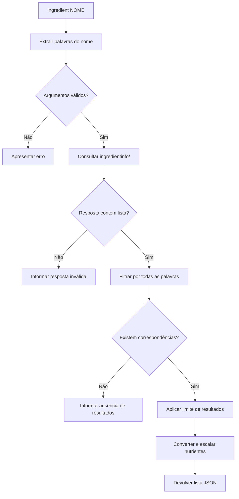

# Extra X4 — Valores nutricionais

**Comando:** `ingredient NOME`  
**Função:** `ingredient_info()`  
**Saída:** lista JSON

## 1. Objetivo

Permitir a pesquisa de ingredientes alimentares disponibilizados pela API wger e apresentar os respetivos valores nutricionais para uma quantidade definida pelo utilizador.

A funcionalidade permite consultar energia, proteínas, hidratos de carbono e gorduras, convertendo os valores originais por 100 gramas para a quantidade pretendida.

A implementação encontra-se em [fitlib/extras.py](../../../fitlib/extras.py), com o comando definido em [fitcli.py](../../../fitcli.py).

## 2. Utilização

```bash
uv run python fitcli.py ingredient banana
uv run python fitcli.py ingredient "chicken breast" --grams 150 --limit 3
uv run python fitcli.py ingredient banana --refresh
uv run python fitcli.py ingredient --help
```

### Argumentos e opções

| Argumento ou opção | Valor predefinido | Descrição |
|---|---|---|
| `name` | Obrigatório | Nome do ingrediente em inglês |
| `--limit` | 5 | Número máximo de resultados, entre 1 e 20 |
| `--grams` | 100 | Quantidade pretendida, igual ou superior a 1 g |
| `--refresh` | Desligado | Ignorar a cache e atualizar os dados |

Os limites adicionais de `--limit` e `--grams` são aplicados pela CLI através do Typer. Na função Python, os valores precisam de ser positivos.

## 3. Fluxo do algoritmo



O algoritmo é composto pelas seguintes etapas:

1. Receber o nome do ingrediente e os parâmetros opcionais.
2. Extrair as palavras relevantes da pesquisa.
3. Validar os argumentos introduzidos.
4. Consultar os ingredientes disponíveis na API.
5. Verificar a estrutura dos dados recebidos.
6. Filtrar os nomes que correspondam à pesquisa.
7. Aplicar o número máximo de resultados.
8. Converter os valores nutricionais para a quantidade pedida.
9. Apresentar os resultados em JSON.

## 4. Consulta à API

A função utiliza o endpoint público:

```text
https://wger.de/api/v2/ingredientinfo/
```

O pedido inclui os seguintes parâmetros:

| Parâmetro | Finalidade |
|---|---|
| `name__search` | Pesquisar pelo nome do ingrediente |
| `language=2` | Solicitar dados em inglês |
| `limit=50` | Limitar a resposta da API a 50 registos |

A implementação consulta uma única página de resultados, com até 50 ingredientes.

O argumento `--limit` determina quantas correspondências serão apresentadas, mas não modifica esta limitação da consulta original.

**Importante:** a função não percorre automaticamente as páginas seguintes da API. Por esse motivo, podem existir ingredientes correspondentes que não são apresentados.

## 5. Filtragem dos resultados

Embora o pedido utilize o filtro `name__search` da API, o programa realiza uma segunda verificação local.

Esta verificação utiliza expressões regulares para confirmar que todas as palavras pesquisadas estão presentes no nome do ingrediente.

### Exemplo

| Pesquisa | Nome recebido | Resultado |
|---|---|---|
| `chicken breast` | `Chicken, breast, grilled` | Aceite |
| `chicken breast` | `Chicken leg` | Rejeitado |
| `!!!` | — | Erro: pesquisa sem palavras |

As palavras podem aparecer em qualquer ordem e a correspondência não distingue maiúsculas de minúsculas.

O padrão utiliza `\b` no início de cada palavra, mas não exige uma fronteira no final. Assim, pode aceitar nomes que contenham palavras começadas pelo termo pesquisado.

A função também não elimina automaticamente ingredientes diferentes que apresentem o mesmo nome.

## 6. Conversão dos valores nutricionais

A API disponibiliza os valores nutricionais por 100 gramas.

Para calcular os valores correspondentes à quantidade pretendida, utiliza-se a fórmula:

**Valor ajustado = Valor por 100 g × Quantidade pretendida / 100**

O resultado é arredondado a uma casa decimal.

### Exemplo de cálculo

Considere-se uma quantidade pretendida de 150 gramas e dois valores nutricionais simulados de 165,0 e 3,6 por 100 gramas.

| Valor por 100 g | Cálculo | Resultado |
|---|---|---:|
| 165,0 | 165 × 150 / 100 | 247,5 |
| 3,6 | 3,6 × 150 / 100 | 5,4 |
| Valor ausente | Conversão impossível | `null` |

Quando um nutriente está ausente ou não pode ser convertido num número, a função devolve `None`, representado como `null` na saída JSON.

Estes exemplos são simulados e servem exclusivamente para explicar o funcionamento do algoritmo.

## 7. Campos devolvidos

A resposta apresenta uma lista de ingredientes com os seguintes atributos:

| Campo JSON | Significado | Origem |
|---|---|---|
| `name` | Nome do ingrediente | `name` |
| `quantity_g` | Quantidade pretendida | `grams` |
| `energy_kcal` | Energia | `energy` |
| `protein_g` | Proteínas | `protein` |
| `carbs_g` | Hidratos de carbono | `carbohydrates` |
| `fat_g` | Gorduras | `fat` |

Os valores apresentados correspondem à quantidade solicitada pelo utilizador, e não necessariamente aos valores originais por 100 gramas.

## 8. Funções implementadas

| Função | Responsabilidade |
|---|---|
| `_number()` | Converter valores em números |
| `_scaled()` | Ajustar os nutrientes à quantidade pretendida |
| `ingredient_info()` | Validar, consultar, filtrar e construir o resultado |

### Conversão numérica

```python
def _number(value: Any) -> float | None:
    """A API devolve os nutrientes como texto ("165.0") ou null: converter com segurança."""
    try:
        return float(value)
    except (TypeError, ValueError):
        return None
```

### Conversão proporcional

```python
def _scaled(value: Any, grams: float) -> float | None:
    number = _number(value)
    return None if number is None else round(number * grams / 100, 1)
```

### Função principal

```python
def ingredient_info(name: str, limit: int = 5, grams: float = 100.0,
                    refresh: bool = False) -> list[dict[str, Any]]:
    """Pesquisar ingredientes pelo nome e devolver calorias e macronutrientes."""
    words = re.findall(r"\w+", name)
    if not words:
        raise ValueError("Indique o nome de um ingrediente.")
    if grams <= 0:
        raise ValueError("A quantidade em gramas deve ser positiva.")
    if limit <= 0:
        raise ValueError("O limite deve ser positivo.")

    params = {"name__search": name.strip(), "language": LANGUAGE, "limit": PAGE_SIZE}
    page = api.get_data("ingredientinfo/", params, refresh=refresh)
    items = page.get("results")
    if not isinstance(items, list):
        raise RuntimeError("A API não devolveu uma lista de ingredientes.")

    # Guarda: a API pode ignorar um filtro em silêncio e devolver o catálogo todo.
    # Só ficamos com ingredientes cujo nome contém TODAS as palavras pedidas.
    patterns = [re.compile(r"\b" + re.escape(word), re.IGNORECASE) for word in words]
    matches = [
        item for item in items
        if isinstance(item, dict)
        and all(pattern.search(item.get("name") or "") for pattern in patterns)
    ]
    if not matches:
        raise RuntimeError(f"Nenhum ingrediente encontrado para '{name.strip()}'.")

    return [
        {
            "name": item["name"],
            "quantity_g": grams,
            "energy_kcal": _scaled(item.get("energy"), grams),
            "protein_g": _scaled(item.get("protein"), grams),
            "carbs_g": _scaled(item.get("carbohydrates"), grams),
            "fat_g": _scaled(item.get("fat"), grams),
        }
        for item in matches[:limit]
    ]
```

A utilização de funções auxiliares permite distinguir a obtenção dos dados, a conversão numérica e a construção da resposta.

## 9. Exemplo de resultados históricos

O material original de desenvolvimento apresenta diferentes registos com o nome `Banana`, mas com valores nutricionais distintos.

| Nome | Energia (kcal) | Proteínas (g) | Hidratos (g) | Gorduras (g) |
|---|---:|---:|---:|---:|
| Banana | 312,0 | 12,5 | 40,6 | 6,2 |
| Banana | 336,0 | 0,0 | 78,6 | 1,1 |
| Banana | 200,0 | 3,6 | 26,0 | 9,0 |

Estes valores foram preservados como exemplo histórico e não foram novamente verificados na API.

A existência de registos com o mesmo nome demonstra que a pesquisa não garante, por si só, a identificação de uma composição nutricional única ou fiável.

A função apresenta os resultados encontrados, sem selecionar automaticamente o registo nutricionalmente mais adequado.

## 10. Cache e autenticação

Esta funcionalidade utiliza o método `api.get_data()` e não exige autenticação.

| Aspeto | Comportamento |
|---|---|
| Autenticação | Não necessária |
| Cache predefinida | `disk` |
| Validade da cache | 14 dias |
| Atualização manual | `--refresh` |
| Cache de cálculos nutricionais | Não existe |

Os cálculos nutricionais são realizados localmente a partir dos dados recebidos da API.

Para informações adicionais, consultar a [documentação da cache](../../shared/cache.md).

## 11. Limitações

- A pesquisa utiliza nomes de ingredientes em inglês.
- A API contém dados provenientes de uma base colaborativa, que pode apresentar registos duplicados, ausentes ou inconsistentes.
- A função não determina qual dos ingredientes encontrados apresenta os dados mais fiáveis.
- A consulta é limitada a uma página de até 50 registos.
- A conversão utiliza exclusivamente os valores fornecidos pela API.
- A funcionalidade não acrescenta informação nutricional nem substitui uma avaliação alimentar especializada.

Os resultados devem, portanto, ser interpretados como informações provenientes da base consultada.

## 12. Verificação

| Cenário | Resultado esperado |
|---|---|
| Nome sem palavras válidas | Erro de validação |
| Quantidade igual ou inferior a zero | Erro de validação |
| Ingrediente sem todas as palavras pesquisadas | Excluído |
| Nutriente ausente ou inválido | `null` |
| Pedido de 150 g | Valores multiplicados por 1,5 |
| `--refresh` | Atualização dos dados públicos |
| Ausência de correspondências | Mensagem de erro |

Os exemplos numéricos são ilustrativos ou históricos e não representam uma nova validação da API real.