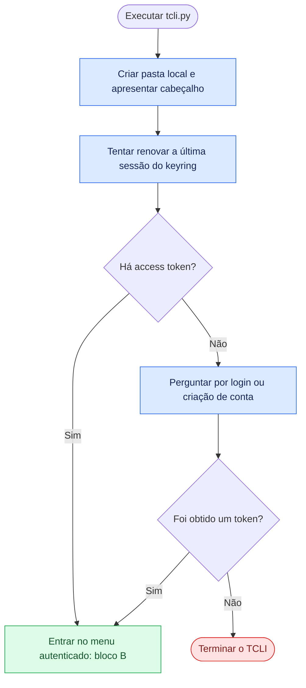
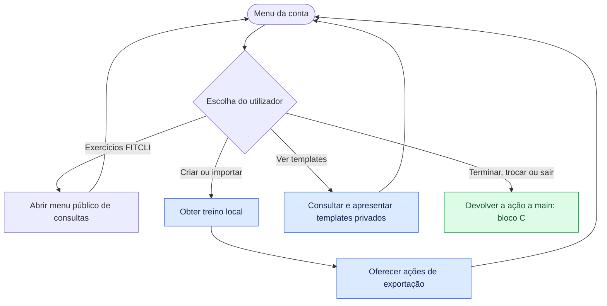
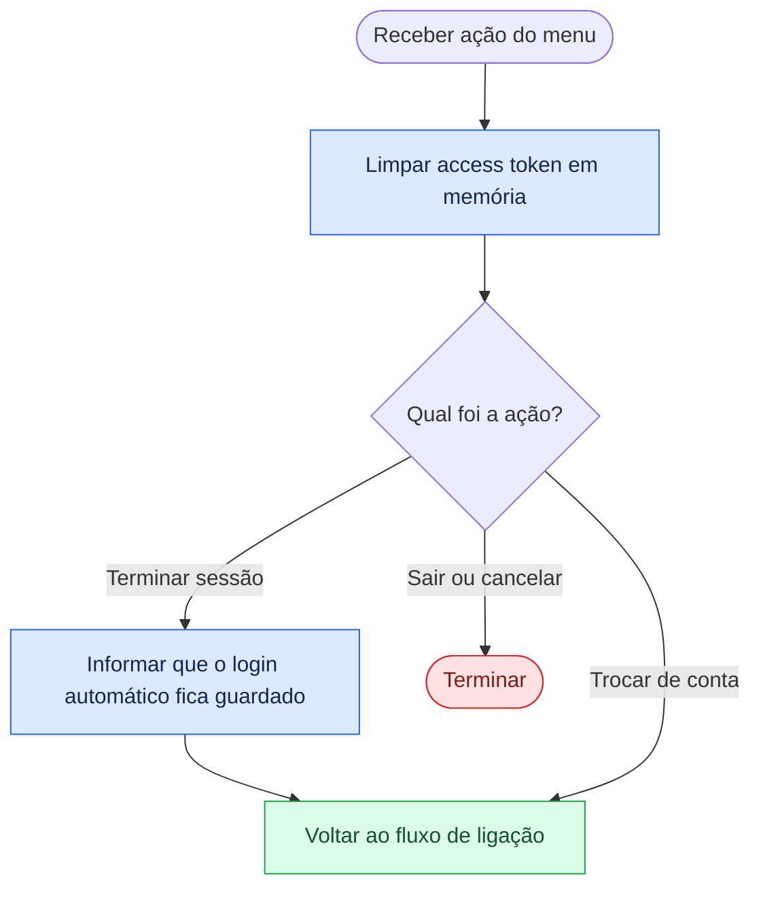
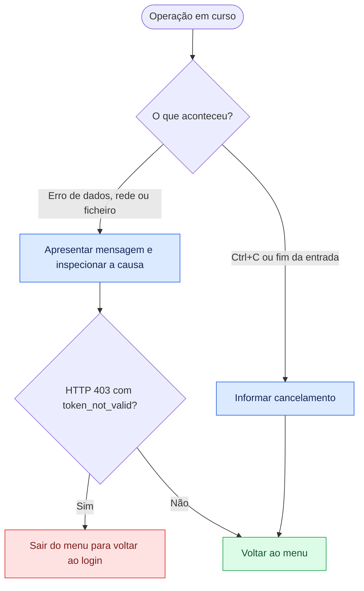

# XTcli — Lógica e navegação do terminal

> **Código:** `tcli.py` · **Entrada:** `main()` · **Interface:** perguntas e menus

**Neste guia:** [funcionamento](#parte-1--funcionamento) ·
[código linha por linha](#parte-2--código-explicado-linha-por-linha) · [verificação](#verificação)

## Parte 1 — Funcionamento

### 1. Responsabilidades e leitura dos guias

O TCLI gere sessões, consultas de exercícios, treinos locais e templates privados.
O menu de exercícios reutiliza as funções da FITCLI; a interface por comandos
continua disponível em `fitcli.py`. As consultas não recebem token, embora a
navegação atual apresente esse menu depois do login.

| Guia | Parte que explica em detalhe |
|---|---|
| Este documento | Arranque, menus, entrada partilhada e POST de autenticação |
| [Login](XTcli_login.md) | Credenciais, renovação, verificação e keyring |
| [Criação de contas](XTcli_criacao_contas.md) | Registo e confirmação da sessão |
| [Treinos no terminal](XTcli_treinos.md) | Perguntas, importação, apresentação e exportação |
| [Workouts](XWorkouts.md) | Validação, JSON, filtros e operações de templates |

Os blocos seguintes descrevem etapas diferentes. Uma caixa que refere outro
fluxo é uma chamada a esse fluxo, não a repetição de todas as suas decisões.

### 2. Bloco A — Arranque e ligação à conta




Sem autenticação, o código mostra uma mensagem e termina: não abre um menu
alternativo nem executa consultas públicas automaticamente.

### 3. Bloco B — Ação no menu autenticado




### 4. Bloco C — Saída e troca de conta




> **Terminar sessão não apaga o keyring.** `main()` limpa a sessão em memória,
> mas a próxima execução pode autenticar automaticamente a última conta guardada.

### 5. Bloco D — Falha de uma operação




O código não repete POSTs depois de um erro. Nem todo HTTP 403 significa sessão
expirada: o retorno ao login depende também do código `token_not_valid`.

### 6. Base partilhada

| Função | Entrada | Resultado |
|---|---|---|
| `post_data` | URL e dicionário JSON | Objeto de resposta ou RuntimeError |
| `text` | Pergunta e comprimento máximo | Texto limpo ou cancelamento |
| `number` | Pergunta e máximo | Inteiro de 1 até ao máximo |
| `choose` | Pergunta e lista de objetos | Objeto, lista de objetos ou retorno/cancelamento |

Autenticação e operações privadas não usam a cache pública. Os catálogos e detalhes
públicos dos treinos usam `disk`, conforme [CACHE.md](../CACHE.md).

### 7. Menu de exercícios: reutilizar as alíneas

```mermaid
flowchart TD
    start(["Exercícios FITCLI"]) --> choice{"Foi escolhida uma consulta?"}
    choice -->|Não ou Voltar| finish(["Regressar ao menu da conta"])
    choice -->|Sim| input["Pedir os argumentos com text e number"]
    input --> call["Chamar exercises ou extras"]
    call --> display["Mostrar nomes portugueses e resultado JSON"]
    display --> finish
```

| Opção | Função reutilizada |
|---|---|
| Recentes | `exercises.top_exercises` |
| Pesquisar músculo/categoria | `exercises.search_exercises` |
| Pesquisar por texto | `extras.find_exercises` |
| Classificar exercício | `exercises.exercise_type` |
| Comparar exercícios | `extras.compare_exercises` |
| Frequência de equipamento | `exercises.equipment_frequency` |
| Plano por esforço | `exercises.build_workout` |

O menu usa os parâmetros básicos das funções. Pesquisa profunda, descrição,
refresh, exportação CSV e os extras difficulty/ingredient continuam disponíveis
na CLI normal; não se acrescentaram perguntas para todas as opções.
Os nomes são traduzidos depois da seleção/classificação, preservando as regras
inglesas das alíneas. Falhas de tradução mantêm o nome anterior.

## Parte 2 — Código explicado linha por linha

Os trechos abaixo são cópias do código atual, não versões alternativas da implementação.
Cada tabela explica **todas as linhas não vazias de código do trecho**. A coluna
“Linha” refere-se ao ficheiro original; comentários separadores não precisam de
uma explicação repetida. Nas funções longas, os recortes são consecutivos e devem
ser lidos em conjunto: um recorte interior não é uma função autónoma para executar.

### Imports e configuração

#### Bibliotecas e cabeçalhos

[Fonte: tcli.py, linha 1](../../tcli.py#L1)

```python
import requests
import questionary
import keyring

from fitlib import api, exercises, extras, workouts

HEADERS = {
    "User-Agent": "ALPCD-Grupo12/0.1",
    "Accept": "application/json"
}
```

| Linha | Explicação |
|---|---|
| 1 | Importa o cliente HTTP usado pelo login, registo e verificação de tokens. |
| 2 | Importa as perguntas e os menus do terminal. |
| 3 | Importa o acesso ao armazenamento de credenciais do sistema. |
| 5 | Reutiliza a API, as alíneas, os extras e o módulo de dados dos treinos. |
| 7 | Inicia os cabeçalhos comuns aos pedidos de autenticação. |
| 8 | Identifica a aplicação no cabeçalho User-Agent. |
| 9 | Indica que o cliente aceita respostas JSON. |
| 10 | Fecha o dicionário de cabeçalhos. |

#### Mapa de estados HTTP

[Fonte: tcli.py, linha 12](../../tcli.py#L12)

```python
HTTP_ERRORS = {
    400: "Bad request.",
    401: "Authentication required.",
    403: "Access forbidden.",
    404: "Resource not found.",
    408: "Request timeout.",
    429: "Too many requests."
}
```

| Linha | Explicação |
|---|---|
| 12 | Inicia as mensagens associadas a estados HTTP conhecidos. |
| 13 | Associa HTTP 400 a pedido inválido. |
| 14 | Associa HTTP 401 a autenticação necessária. |
| 15 | Associa HTTP 403 a acesso recusado. |
| 16 | Associa HTTP 404 a recurso não encontrado. |
| 17 | Associa HTTP 408 a tempo limite do pedido. |
| 18 | Associa HTTP 429 a excesso de pedidos. |
| 19 | Fecha o mapa das mensagens HTTP. |

### `post_data()`

Helper partilhado por login, registo e renovação. Não guarda resultados em cache e mantém a causa dos erros para o chamador poder interpretar a resposta HTTP.

#### Pedido e resposta

[Fonte: tcli.py, linha 27](../../tcli.py#L27)

```python
def post_data(url: str, dados: dict) -> dict:
    try:
        response = requests.post(
            url,
            json=dados,
            headers=HEADERS,
            timeout=15
        )

        response.raise_for_status()

        data = response.json()

        if not isinstance(data, dict):
            raise RuntimeError(
                "The API did not return a JSON object."
            )

        return data
```

| Linha | Explicação |
|---|---|
| 27 | Define `post_data` e os parâmetros/resultado usados neste bloco. |
| 28 | Agrupa o pedido e a leitura da resposta para tratar as falhas abaixo. |
| 29 | Inicia um POST HTTP direto, sem utilizar a cache pública. |
| 30 | Usa o URL recebido pelo chamador. |
| 31 | Envia o dicionário dados como corpo JSON. |
| 32 | Aplica os cabeçalhos comuns. |
| 33 | Limita a espera do pedido a 15 segundos. |
| 34 | Fecha a chamada HTTP. |
| 36 | Converte uma resposta HTTP de erro numa exceção. |
| 38 | Tenta descodificar o corpo da resposta como JSON. |
| 40 | Exige um objeto JSON; listas e outros tipos não são aceites aqui. |
| 41 | Inicia o erro de formato da resposta. |
| 42 | Define a mensagem para um JSON que não é objeto. |
| 43 | Fecha a construção do erro, que é propagado como RuntimeError. |
| 45 | Devolve o dicionário quando o pedido e a validação têm sucesso. |

#### Estados HTTP e timeout

[Fonte: tcli.py, linha 47](../../tcli.py#L47)

```python
    except requests.exceptions.HTTPError as error:
        status = error.response.status_code

        message = HTTP_ERRORS.get(
            status,
            "Server error." if status >= 500 else "HTTP error."
        )

        raise RuntimeError(
            f"HTTP {status}: {message}"
        ) from error

    except requests.exceptions.Timeout as error:
        raise RuntimeError(
            "The request timed out."
        ) from error
```

| Linha | Explicação |
|---|---|
| 47 | Trata respostas HTTP malsucedidas. |
| 48 | Lê o estado da resposta associado ao erro. |
| 50 | Procura uma mensagem no mapa HTTP_ERRORS. |
| 51 | Usa o estado HTTP como chave da procura. |
| 52 | Para estados não mapeados, distingue erros de servidor dos restantes. |
| 53 | Fecha a escolha da mensagem. |
| 55 | Inicia a conversão do erro HTTP para RuntimeError. |
| 56 | Inclui estado e mensagem no texto apresentado ao chamador. |
| 57 | Preserva a exceção original em __cause__, permitindo aos fluxos ler o HTTP. |
| 59 | Trata o tempo limite de rede. |
| 60 | Inicia uma mensagem uniforme de timeout. |
| 61 | Explica que o pedido excedeu o tempo permitido. |
| 62 | Preserva a causa original do timeout. |

#### Ligação e JSON

[Fonte: tcli.py, linha 64](../../tcli.py#L64)

```python
    except requests.exceptions.ConnectionError as error:
        raise RuntimeError(
            "Connection error."
        ) from error

    except ValueError as error:
        raise RuntimeError(
            "Invalid JSON response."
        ) from error

    except requests.exceptions.RequestException as error:
        raise RuntimeError(
            "Request failed."
        ) from error
```

| Linha | Explicação |
|---|---|
| 64 | Trata falhas de ligação. |
| 65 | Inicia o erro de ligação apresentado pela aplicação. |
| 66 | Define a mensagem de falha de ligação. |
| 67 | Preserva a causa original da ligação. |
| 69 | Trata falha na descodificação JSON. |
| 70 | Inicia a mensagem uniforme de JSON inválido. |
| 71 | Define a mensagem de formato inválido. |
| 72 | Preserva a causa da falha de JSON. |
| 74 | Trata outras exceções de requests não abrangidas pelos casos anteriores. |
| 75 | Inicia o erro genérico de pedido. |
| 76 | Define a mensagem genérica de falha HTTP. |
| 77 | Preserva a causa original para diagnóstico pelo chamador. |

### `text()`

Entrada textual com comprimento limitado. Cancelar levanta KeyboardInterrupt para abandonar a operação que está a usar o campo.

#### text

[Fonte: tcli.py, linha 338](../../tcli.py#L338)

```python
def text(prompt, maximum=1000):
    while True:
        answer = questionary.text(prompt).ask()
        if answer is None:
            raise KeyboardInterrupt
        if 1 <= len(answer.strip()) <= maximum:
            return answer.strip()
        print(f"Introduza texto entre 1 e {maximum} caracteres.")
```

| Linha | Explicação |
|---|---|
| 338 | Define `text` e os parâmetros/resultado usados neste bloco. |
| 339 | Repete a pergunta de texto até obter uma entrada válida ou cancelamento. |
| 340 | Apresenta o prompt recebido e lê a resposta. |
| 341 | Deteta cancelamento. |
| 342 | Propaga KeyboardInterrupt para o nível que controla a operação. |
| 343 | Exige 1 a maximum caracteres depois de remover espaços exteriores. |
| 344 | Devolve o texto limpo. |
| 345 | Explica o intervalo de comprimento e repete a pergunta. |

### `number()`

Entrada de um inteiro positivo com limite superior. Uma conversão inválida repete a pergunta, em vez de terminar a aplicação.

#### number

[Fonte: tcli.py, linha 348](../../tcli.py#L348)

```python
def number(prompt, maximum):
    while True:
        answer = questionary.text(prompt).ask()
        if answer is None:
            raise KeyboardInterrupt
        try:
            value = int(answer)
            if 1 <= value <= maximum:
                return value
        except ValueError:
            pass
        print(f"Introduza um número inteiro entre 1 e {maximum}.")
```

| Linha | Explicação |
|---|---|
| 348 | Define `number` e os parâmetros/resultado usados neste bloco. |
| 349 | Repete a pergunta numérica até obter um inteiro válido. |
| 350 | Lê a entrada como texto. |
| 351 | Deteta cancelamento. |
| 352 | Interrompe a operação atual. |
| 353 | Protege a conversão numérica. |
| 354 | Converte a resposta para inteiro. |
| 355 | Exige valor entre 1 e maximum. |
| 356 | Devolve o inteiro válido. |
| 357 | Captura texto que não representa um inteiro. |
| 358 | Não encerra a operação: continua para a mensagem e nova pergunta. |
| 359 | Explica o intervalo permitido. |

### `choose()`

Constrói menus a partir de objetos. A etiqueta pode mostrar o ID, mas o valor devolvido continua a ser o objeto completo.

#### choose

[Fonte: tcli.py, linha 362](../../tcli.py#L362)

```python
def choose(prompt, items, multiple=False, selected=False):
    if not items:
        print("Não existem opções disponíveis.")
        return [] if multiple else None
    choices = []
    for item in items:
        name = item["name"]
        if "id" in item:
            name += f" [#{item['id']}]"
        choices.append(questionary.Choice(name, value=item, checked=selected))
    if multiple:
        answer = questionary.checkbox(prompt, choices=choices).ask()
        if answer is None:
            raise KeyboardInterrupt
        return answer
    choices.append(questionary.Choice("Voltar", value=False))
    return questionary.select(prompt, choices=choices).ask()
```

| Linha | Explicação |
|---|---|
| 362 | Define `choose` e os parâmetros/resultado usados neste bloco. |
| 363 | Trata a ausência de opções antes de abrir um menu. |
| 364 | Informa que não há opções disponíveis. |
| 365 | Devolve lista vazia na seleção múltipla, ou None na seleção simples. |
| 366 | Inicia a lista de opções apresentadas. |
| 367 | Percorre os objetos recebidos. |
| 368 | Começa a etiqueta com o nome do objeto. |
| 369 | Verifica se pode mostrar o ID ao lado do nome. |
| 370 | Acrescenta o ID apenas à etiqueta, preservando o objeto original. |
| 371 | Cria a opção cujo valor é o objeto; selected controla a pré-seleção. |
| 372 | Escolhe o modo de seleção múltipla. |
| 373 | Apresenta checkboxes com as opções construídas. |
| 374 | Deteta cancelamento dos checkboxes. |
| 375 | Interrompe a operação atual. |
| 376 | Devolve a lista de objetos selecionados. |
| 377 | Na seleção simples acrescenta Voltar com valor False. |
| 378 | Devolve a opção escolhida ou o valor de retorno/cancelamento do menu. |

### `show_exercises()`

[Fonte: tcli.py, linha 385](../../tcli.py#L385)

```python
def show_exercises(result):
    """Apresentar nomes portugueses sem alterar as regras das consultas."""
    items = result if isinstance(result, list) else []
    if isinstance(result, dict):
        for value in result.values():
            if isinstance(value, list):
                items.extend(value)
    for item in items:
        if isinstance(item, dict) and "id" in item and "name" in item:
            try:
                raw = api.get_data(f"exerciseinfo/{item['id']}/")
                item["name"] = workouts.exercise_name(raw) or item["name"]
            except RuntimeError as error:
                print(f"Não foi possível atualizar o nome do exercício #{item['id']}: {error}")
    exercises.print_json(result)
```

| Linha | Explicação |
|---|---|
| 385 | Define a apresentação dos resultados das consultas públicas. |
| 386 | Documenta que a tradução é apenas de apresentação. |
| 387 | Usa diretamente os itens de uma lista, ou começa com uma lista vazia. |
| 388 | Trata planos por alvo, que são dicionários de listas. |
| 389 | Percorre as coleções de resultados desse dicionário. |
| 390 | Seleciona apenas os valores que são listas. |
| 391 | Reúne os exercícios dessas listas para atualizar a apresentação. |
| 392 | Percorre os itens a apresentar. |
| 393 | Só procura nomes de objetos com ID e name; contagens e classificações não precisam disso. |
| 394 | Protege a consulta pública usada para obter traduções. |
| 395 | Reutiliza get_data e a cache pública dos detalhes do exercício. |
| 396 | Prefere português, depois inglês, conservando o nome anterior se não houver tradução. |
| 397 | Trata falha HTTP/JSON comunicada pela API. |
| 398 | Mostra o aviso e conserva o nome guardado; não repete a consulta automaticamente. |
| 399 | Apresenta o resultado final em JSON através do helper partilhado. |

### `exercise_menu()`

[Fonte: tcli.py, linha 402](../../tcli.py#L402)

```python
def exercise_menu():
    action = questionary.select("Exercícios FITCLI:", choices=[
        "Recentes", "Pesquisar músculo/categoria", "Pesquisar por texto",
        "Classificar exercício", "Comparar exercícios", "Frequência de equipamento",
        "Plano por esforço", "Voltar"]).ask()
    result = None
    if action == "Recentes":
        result = exercises.top_exercises(number("Quantidade:", 999))
    elif action == "Pesquisar músculo/categoria":
        result = exercises.search_exercises(text("Músculo/categoria:"), number("Quantidade:", 999))
    elif action == "Pesquisar por texto":
        result = extras.find_exercises(text("Pesquisa:"), number("Quantidade:", 999))
    elif action == "Classificar exercício":
        result = exercises.exercise_type(number("ID:", 2147483647))
```

| Linha | Explicação |
|---|---|
| 402 | Define o menu de consultas públicas, sem receber token nem duplicar as pesquisas. |
| 403 | Abre a pergunta de seleção das funcionalidades da FITCLI. |
| 404 | Disponibiliza listagem e pesquisas por músculo/categoria ou texto. |
| 405 | Disponibiliza classificação, comparação e contagem de equipamento. |
| 406 | Acrescenta plano por esforço e Voltar e recebe a escolha. |
| 407 | Começa sem resultado, para que Voltar ou cancelar não imprimam uma resposta. |
| 408 | Identifica a opção de exercícios recentes. |
| 409 | Pede a quantidade e chama a alínea A. |
| 410 | Identifica a pesquisa por músculo ou categoria. |
| 411 | Pede alvo/quantidade e reutiliza a alínea B. |
| 412 | Identifica a pesquisa por texto. |
| 413 | Pede pesquisa/quantidade e usa a função atual em extras.py. |
| 414 | Identifica a classificação de um exercício por ID. |
| 415 | Pede um ID positivo e reutiliza a alínea C. |

[Fonte: tcli.py, linha 416](../../tcli.py#L416)

```python
    elif action == "Comparar exercícios":
        ids = []
        for value in text("IDs separados por vírgulas:").split(","):
            ids.append(int(value.strip()))
        result = extras.compare_exercises(ids)
    elif action == "Frequência de equipamento":
        result = exercises.equipment_frequency(text("Categoria:"))
    elif action == "Plano por esforço":
        target = text("Alvos separados por vírgulas:")
        effort = questionary.select("Esforço:", choices=["compound", "isolated", "any"]).ask()
        if effort:
            result = exercises.build_workout(target, effort, number("Quantidade por alvo:", 999))
    if result is not None:
        show_exercises(result)
```

| Linha | Explicação |
|---|---|
| 416 | Identifica a comparação entre exercícios. |
| 417 | Inicia a lista de IDs para comparação. |
| 418 | Divide a entrada pelos separadores de vírgula. |
| 419 | Remove espaços e converte cada ID; erros são tratados pelo menu autenticado. |
| 420 | Delega a validação e comparação em extras.py. |
| 421 | Identifica a contagem de equipamento. |
| 422 | Pede a categoria e reutiliza a alínea D. |
| 423 | Identifica a criação de plano local por esforço. |
| 424 | Pede os alvos separados por vírgulas. |
| 425 | Pede o esforço entre as três strings permitidas, sem a antiga classe Effort. |
| 426 | Só avança se o esforço não foi cancelado. |
| 427 | Pede a quantidade por alvo e reutiliza build_workout da alínea E. |
| 428 | Verifica se uma ação produziu um resultado, incluindo listas vazias. |
| 429 | Traduz apenas os nomes apresentados e imprime o resultado. |

### `authenticated_menu()`

Encaminha ações para treinos e templates. Um token rejeitado regressa ao fluxo de autenticação; um cancelamento da operação regressa ao menu.

#### Escolha e execução

[Fonte: tcli.py, linha 533](../../tcli.py#L533)

```python
def authenticated_menu(token):
    while token:
        action = questionary.select("Conta autenticada. O que deseja fazer?", choices=[
            "Exercícios FITCLI", "Criar treino", "Importar treino local", "Ver templates exportados",
            "Terminar sessão", "Trocar de conta", "Sair"]).ask()
        if action in (None, "Terminar sessão", "Trocar de conta", "Sair"):
            return action
        try:
            if action == "Exercícios FITCLI":
                exercise_menu()
            elif action in ("Criar treino", "Importar treino local"):
                workout = create_workout() if action == "Criar treino" else import_workout()
                if workout:
                    workout_actions(workout, token)
            elif action == "Ver templates exportados":
                template_menu(token)
```

| Linha | Explicação |
|---|---|
| 533 | Define `authenticated_menu` e os parâmetros/resultado usados neste bloco. |
| 534 | Mantém a navegação enquanto existe token de sessão. |
| 535 | Inicia o menu principal da conta autenticada. |
| 536 | Oferece consultas públicas, criação/importação local e consulta de templates. |
| 537 | Acrescenta as opções de terminar sessão, trocar conta e sair; recebe a escolha. |
| 538 | Identifica cancelamento e ações que devem sair deste menu. |
| 539 | Devolve a ação para main decidir se pede login ou termina. |
| 540 | Protege a execução de uma operação do menu. |
| 541 | Seleciona o ramo das consultas públicas da FITCLI. |
| 542 | Abre o menu de exercícios e regressa quando a consulta terminar. |
| 543 | Seleciona o ramo de criar ou importar um treino. |
| 544 | Chama apenas a função correspondente à escolha. |
| 545 | Verifica se a operação devolveu efetivamente um treino. |
| 546 | Nesse caso abre as ações de exportação desse treino. |
| 547 | Seleciona o ramo de consulta de templates. |
| 548 | Abre o menu de templates autenticados. |

#### Erros e cancelamento

[Fonte: tcli.py, linha 549](../../tcli.py#L549)

```python
        except (RuntimeError, ValueError, OSError) as error:
            print(f"Erro: {error}")
            # A wger usa 403 também para JWT expirado. Não repetir POSTs automaticamente.
            cause = error
            while cause.__cause__ is not None:
                cause = cause.__cause__
            if isinstance(cause, requests.exceptions.HTTPError) and cause.response is not None:
                try:
                    code = cause.response.json().get("code")
                except ValueError:
                    code = None
                if cause.response.status_code == 403 and code == "token_not_valid":
                    print("A sessão expirou ou foi rejeitada. Volte a fazer login.")
                    return "Trocar de conta"
        except (KeyboardInterrupt, EOFError):
            print("Operação cancelada.")
    return "Sair"
```

| Linha | Explicação |
|---|---|
| 549 | Trata erros da operação, validação ou sistema de ficheiros. |
| 550 | Mostra a mensagem do erro. |
| 552 | Começa a procurar a causa original do erro. |
| 553 | Continua enquanto houver uma exceção encadeada. |
| 554 | Avança para a exceção que originou o problema. |
| 555 | Só analisa estados se a causa for HTTP e tiver resposta. |
| 556 | Protege a leitura do corpo de erro. |
| 557 | Tenta obter o código de erro devolvido pela API. |
| 558 | Trata corpo que não seja JSON válido. |
| 559 | Usa None quando não conseguiu ler um código. |
| 560 | Distingue HTTP 403 de token rejeitado de um simples erro de permissão. |
| 561 | Explica que será preciso autenticar novamente. |
| 562 | Devolve a ação Trocar de conta; não repete a operação que falhou. |
| 563 | Trata Ctrl+C ou fim da entrada durante uma operação. |
| 564 | Informa o cancelamento e volta ao menu. |
| 565 | Sem token no ciclo, devolve Sair. |

### `main()`

Coordena restauro, login e navegação. O token em memória é limpo ao sair do menu, mas o código não apaga os refresh tokens guardados.

#### Arranque e restauro

[Fonte: tcli.py, linha 568](../../tcli.py#L568)

```python
def main() -> str | None:
    workouts.WORKOUTS_DIR.mkdir(exist_ok=True)
    print("========= FIT TCLI =========")
    access_token = None

    try:
        try:
            last_username = keyring.get_password("FITCLI-wger", "last_username")
            access_token = refresh_login(last_username)
        except (RuntimeError, keyring.errors.KeyringError, OSError):
            print("Não foi possível restaurar a sessão. Pode fazer login novamente.")
```

| Linha | Explicação |
|---|---|
| 568 | Define `main` e os parâmetros/resultado usados neste bloco. |
| 569 | Garante a existência da pasta local de treinos no arranque. |
| 570 | Apresenta o cabeçalho do programa. |
| 571 | Começa sem access token em memória. |
| 573 | Protege o arranque e a navegação contra cancelamento. |
| 574 | Isola a tentativa de restauro automático. |
| 575 | Lê no keyring a identificação da última conta. |
| 576 | Tenta renovar a sessão dessa conta. |
| 577 | Trata falhas de renovação, keyring ou sistema durante o restauro. |
| 578 | Informa que ainda é possível fazer login manualmente. |

#### Navegação e fim da sessão

[Fonte: tcli.py, linha 580](../../tcli.py#L580)

```python
        while True:
            if not access_token:
                access_token = connection_questionary()
            if not access_token:
                print("A utilizar o FITCLI sem autenticação.")
                return None

            action = authenticated_menu(access_token)
            access_token = None
            if action == "Terminar sessão":
                print("Sessão terminada. O login automático mantém-se no próximo arranque.")
            elif action != "Trocar de conta":
                return None
    except (KeyboardInterrupt, EOFError):
        return None
```

| Linha | Explicação |
|---|---|
| 580 | Inicia o ciclo que permite trocar ou voltar a autenticar contas. |
| 581 | Verifica se ainda não tem um access token. |
| 582 | Pede login/registo apenas quando necessário. |
| 583 | Verifica se o utilizador terminou a ligação sem obter uma sessão. |
| 584 | Mostra a mensagem de uso sem autenticação. |
| 585 | Encerra o TCLI; não abre um menu público de exercícios. |
| 587 | Entrega o token ao menu autenticado e recebe a ação de saída. |
| 588 | Limpa o access token em memória depois desse menu. |
| 589 | Identifica a ação Terminar sessão. |
| 590 | Explica que os dados guardados permitem login automático no próximo arranque. |
| 591 | Se não foi pedido trocar de conta, termina a aplicação. |
| 592 | Devolve None e encerra o ciclo de navegação. |
| 593 | Captura Ctrl+C ou fim da entrada na navegação principal. |
| 594 | Termina de forma controlada, sem apresentar um traceback ao utilizador. |

### Ponto de entrada

#### Execução direta

[Fonte: tcli.py, linha 597](../../tcli.py#L597)

```python
if __name__ == "__main__":
    main()
```

| Linha | Explicação |
|---|---|
| 597 | Só inicia a aplicação quando este ficheiro é executado diretamente. |
| 598 | Chama main; importar tcli.py não inicia as perguntas. |

## Verificação

A aplicação pode ser iniciada a partir de `ALPCD_12`:

```bash
uv run python tcli.py
```

| Caso | Resultado a verificar com dados simulados |
|---|---|
| Importar o módulo | Não iniciar perguntas nem pedidos HTTP |
| Sem sessão guardada | Oferecer login/registo |
| Exercícios FITCLI | Encaminhar as sete opções para as funções existentes |
| Voltar/cancelar no menu de exercícios | Regressar sem executar uma consulta |
| Recusar a ligação | Terminar sem abrir consultas públicas |
| Terminar sessão | Limpar token em memória, sem apagar keyring |
| Erro de permissão | Mostrar erro e regressar ao menu |
| Token rejeitado | Regressar ao login sem repetir o pedido falhado |
| Cancelar uma operação | Regressar ao menu sem encerrar à força |

Estes casos descrevem verificações recomendadas, não execuções reais novas.
A cópia atual não inclui uma pasta `tests/`. Para testes automáticos, simular
requests, keyring e questionary e usar pastas temporárias: não criar contas,
guardar tokens reais ou exportar templates apenas para validar a documentação.

Voltar ao [README oficial](../../README.md).
