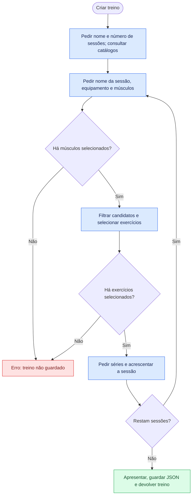
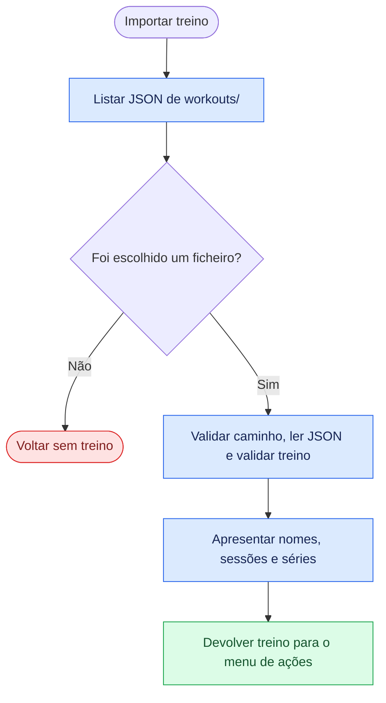
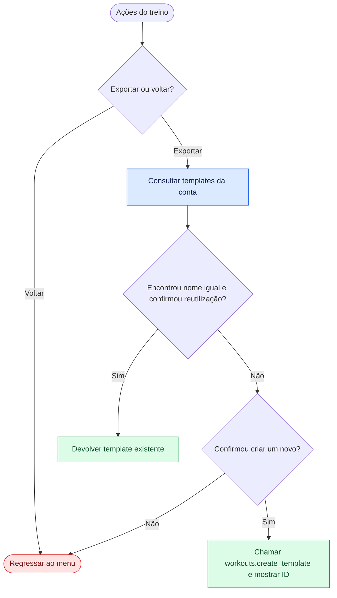
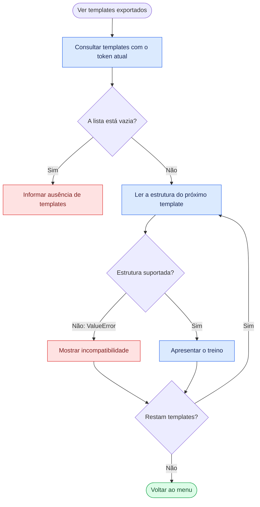

# XTcli — Menus dos treinos e templates

> **Código da interação:** `tcli.py` · **Dados e operações:** `fitlib/workouts.py`

**Neste guia:** [funcionamento](#parte-1--funcionamento) ·
[código linha por linha](#parte-2--código-explicado-linha-por-linha) · [verificação](#verificação)

## Parte 1 — Funcionamento

### 1. Separação de responsabilidades

| No TCLI | No módulo workouts |
|---|---|
| Perguntar e apresentar opções | Validar o formato do treino |
| Escolher equipamentos, músculos e exercícios | Filtrar candidatos e escolher nomes portugueses |
| Perguntar séries | Guardar e carregar JSON |
| Confirmar exportação | Executar a criação de templates privados |
| Mostrar nomes, sessões e séries | Converter estruturas remotas para formato local |

O código de dados está explicado em [XWorkouts.md](XWorkouts.md). Este fluxo não
é o comando `fitcli.py workout`: o plano da alínea E tem um [guia próprio](../Exercises/E_Exercises.md).

### 2. Bloco A — Criar um treino local




A criação consulta os catálogos uma vez antes do ciclo das sessões. Exercícios
aparecem em português, com inglês como alternativa; nomes de músculos não são
traduzidos automaticamente para português.

### 3. Bloco B — Importar e apresentar




A apresentação tenta atualizar o nome do exercício a partir dos detalhes públicos.
Se não houver tradução ou ocorrer RuntimeError de HTTP/JSON, conserva o nome
já guardado. Importar não regrava nem duplica o JSON.

### 4. Bloco C — Escolher exportar




O nome igual não prova que dois treinos tenham conteúdo igual: o código pede
confirmação e não substitui nem compara automaticamente as estruturas.
Se recusar reutilizar um nome, pode ainda confirmar a criação de outro template.

### 5. Bloco D — Consultar templates privados




### 6. Persistência, cache e limites

- Treinos concluídos são guardados em `workouts/` sem sobrescrever nomes existentes.
- O JSON local não contém tokens nem pertence a uma conta específica.
- Catálogos e detalhes públicos usam `disk`; templates e escritas privadas não
  usam a cache pública. Ver [CACHE.md](../CACHE.md).
- Uma falha/cancelamento antes da gravação pode deixar o treino por guardar.
- A exportação remota pode ficar incompleta se um POST intermédio falhar; não
  existe rollback nem repetição automática.
- O menu não oferece ativação de rotinas, repetição semanal ou registo de execuções.

## Parte 2 — Código explicado linha por linha

Os trechos abaixo são cópias do código atual, não versões alternativas da implementação.
Cada tabela explica **todas as linhas não vazias de código do trecho**. A coluna
“Linha” refere-se ao ficheiro original; comentários separadores não precisam de
uma explicação repetida. Nas funções longas, os recortes são consecutivos e devem
ser lidos em conjunto: um recorte interior não é uma função autónoma para executar.

### `show_workout()`

Traduz a apresentação para português com alternativa inglesa ou nome guardado. Não altera o JSON do treino.

#### show_workout

[Fonte: tcli.py, linha 437](../../tcli.py#L437)

```python
def show_workout(workout):
    print(f"\n{workout['name']}")
    for session in workout["sessions"]:
        print(f"  {session['name']} — músculos: " + (", ".join(session["muscles"]) or "não indicados"))
        for entry in session["exercises"]:
            # JSON antigos podem guardar nomes ingleses; usar a tradução quando disponível.
            name = entry["name"]
            try:
                raw = api.get_data(f"exerciseinfo/{entry['id']}/")
                name = workouts.exercise_name(raw) or name
            except RuntimeError as error:
                # Manter o nome guardado sem impedir a importação local.
                print(f"Não foi possível atualizar o nome do exercício #{entry['id']}: {error}")
            print(f"    {name}: {entry['sets']} séries")
```

| Linha | Explicação |
|---|---|
| 437 | Define `show_workout` e os parâmetros/resultado usados neste bloco. |
| 438 | Mostra o nome do treino. |
| 439 | Percorre as sessões. |
| 440 | Mostra nome da sessão e músculos, ou a indicação de que não foram informados. |
| 441 | Percorre os exercícios dessa sessão. |
| 443 | Começa pelo nome já guardado no treino. |
| 444 | Protege a consulta pública usada para atualizar a apresentação. |
| 445 | Obtém os detalhes do exercício por ID, usando a cache pública. |
| 446 | Prefere português, depois inglês; sem tradução mantém o nome guardado. |
| 447 | Trata falha HTTP/JSON comunicada pela API como RuntimeError. |
| 449 | Informa a falha sem impedir a apresentação do nome guardado. |
| 450 | Mostra o nome escolhido e o número de séries; não reescreve o JSON. |

### `import_workout()`

Escolhe um JSON local, delega a leitura/validação e apresenta o treino. Importar não cria uma cópia nem volta a guardar o ficheiro.

#### import_workout

[Fonte: tcli.py, linha 453](../../tcli.py#L453)

```python
def import_workout():
    files = []
    workouts.WORKOUTS_DIR.mkdir(exist_ok=True)
    for path in sorted(workouts.WORKOUTS_DIR.glob("*.json")):
        files.append({"name": path.name})
    selected = choose("Importar ficheiro:", files)
    if selected:
        workout = workouts.load_workout(selected["name"])
        show_workout(workout)
        return workout
```

| Linha | Explicação |
|---|---|
| 453 | Define `import_workout` e os parâmetros/resultado usados neste bloco. |
| 454 | Inicia a lista de ficheiros que podem ser importados. |
| 455 | Garante que a pasta local de treinos existe. |
| 456 | Percorre ficheiros .json ordenados pelo caminho. |
| 457 | Cria uma opção de menu com o nome de cada ficheiro. |
| 458 | Pede ao utilizador que escolha um ficheiro. |
| 459 | Só avança se a escolha não for Voltar/cancelamento. |
| 460 | Lê e valida o JSON através de workouts.load_workout. |
| 461 | Apresenta o treino sem voltar a gravar o ficheiro. |
| 462 | Devolve o treino para permitir ações como exportação. |

### `create_workout()`

Recolhe os dados das sessões, obtém candidatos, apresenta o resultado e só então o guarda automaticamente.

#### Preparar o treino e selecionar músculos

[Fonte: tcli.py, linha 465](../../tcli.py#L465)

```python
def create_workout():
    workout = {"version": 1, "name": text("Nome do treino:", 25), "sessions": []}
    count = number("Número de sessões (1–7):", 7)
    equipment = api.get_list("equipment/")
    muscles = api.get_list("muscle/")
    for muscle in muscles:
        muscle["name"] = muscle.get("name_en") or muscle["name"]
    for index in range(count):
        session = {"name": text(f"Nome da sessão {index + 1}:", 20), "muscles": [], "exercises": []}
        session["equipment"] = choose("Equipamento disponível:", equipment, multiple=True, selected=True)
        targets = choose("Músculos a treinar:", muscles, multiple=True)
        if not targets:
            raise ValueError("Selecione pelo menos um músculo.")
        for muscle in targets:
            session["muscles"].append(muscle["name"])
```

| Linha | Explicação |
|---|---|
| 465 | Define `create_workout` e os parâmetros/resultado usados neste bloco. |
| 466 | Pede o nome, limita-o a 25 caracteres e inicia o formato local versão 1. |
| 467 | Pede entre uma e sete sessões. |
| 468 | Consulta o catálogo público de equipamentos. |
| 469 | Consulta o catálogo público de músculos. |
| 470 | Percorre os músculos antes de os apresentar. |
| 471 | Usa o nome inglês do músculo quando disponível; isto não traduz músculos para português. |
| 472 | Repete a criação das sessões pedidas. |
| 473 | Pede o nome da sessão e inicia as suas listas. |
| 474 | Permite escolher os equipamentos disponíveis; começam pré-selecionados. |
| 475 | Pede os músculos a treinar, permitindo várias escolhas. |
| 476 | Deteta que nenhum músculo foi selecionado. |
| 477 | Interrompe a criação em vez de guardar uma sessão incompleta. |
| 478 | Percorre os músculos escolhidos. |
| 479 | Guarda os seus nomes no formato local. |

#### Selecionar exercícios e guardar

[Fonte: tcli.py, linha 480](../../tcli.py#L480)

```python
        candidates = workouts.filtered_exercises(session["equipment"], targets)
        selected = choose("Exercícios:", candidates, multiple=True)
        if not selected:
            raise ValueError("Selecione pelo menos um exercício. Treino não guardado.")
        for entry in selected:
            session["exercises"].append({"id": entry["id"], "name": entry["name"],
                                         "sets": number(f"Séries de {entry['name']}:", 50)})
        workout["sessions"].append(session)
    show_workout(workout)
    workouts.save_workout(workout)
    return workout
```

| Linha | Explicação |
|---|---|
| 480 | Obtém candidatos filtrados por músculos/equipamentos, com nomes portugueses ou alternativa inglesa. |
| 481 | Permite selecionar os exercícios candidatos. |
| 482 | Deteta que nenhum exercício foi selecionado. |
| 483 | Interrompe sem guardar o treino incompleto. |
| 484 | Percorre os exercícios selecionados. |
| 485 | Começa a entrada local preservando ID e nome apresentados. |
| 486 | Pede 1–50 séries e conclui a entrada do exercício. |
| 487 | Acrescenta a sessão concluída ao treino. |
| 488 | Apresenta o treino completo antes da gravação. |
| 489 | Valida e guarda automaticamente o JSON sem sobrescrever nomes existentes. |
| 490 | Devolve o treino criado para as ações seguintes. |

### `export_template()`

Verifica nomes de templates existentes, oferece reutilização e só cria um novo depois de confirmação explícita.

#### export_template

[Fonte: tcli.py, linha 498](../../tcli.py#L498)

```python
def export_template(workout, token):
    for template in api.get_list("templates/", token=token):
        if template["name"] == workout["name"]:
            if questionary.confirm(
                    f"Já existe '{template['name']}' [#{template['id']}]. Reutilizar?", default=True).ask():
                return template
    if questionary.confirm("Tem certeza que deseja exportar?", default=True).ask():
        template = workouts.create_template(workout, token)
        print(f"Template exportado: {template['name']} [#{template['id']}]")
        return template
```

| Linha | Explicação |
|---|---|
| 498 | Define `export_template` e os parâmetros/resultado usados neste bloco. |
| 499 | Lista os templates da conta por paginação autenticada, sem cache pública. |
| 500 | Procura um template com o mesmo nome do treino local. |
| 501 | Inicia a pergunta de reutilização de um nome existente. |
| 502 | Mostra nome/ID do template e pede confirmação de reutilização. |
| 503 | Se confirmada, devolve o template existente sem criar outro. |
| 504 | Depois das verificações, pergunta explicitamente se deve exportar um novo template. |
| 505 | Delega os POSTs de criação em workouts.create_template. |
| 506 | Informa nome e ID do template criado. |
| 507 | Devolve o resultado da exportação; sem confirmação a função termina com None. |

### `workout_actions()`

É o pequeno menu comum aos treinos criados e importados.

#### workout_actions

[Fonte: tcli.py, linha 510](../../tcli.py#L510)

```python
def workout_actions(workout, token):
    action = questionary.select("O que deseja fazer?", choices=[
        "Exportar como template", "Voltar"]).ask()
    if action == "Exportar como template":
        export_template(workout, token)
```

| Linha | Explicação |
|---|---|
| 510 | Define `workout_actions` e os parâmetros/resultado usados neste bloco. |
| 511 | Inicia o menu de ações para um treino concluído ou importado. |
| 512 | Oferece exportação ou Voltar e lê a escolha. |
| 513 | Só exporta quando a opção foi selecionada. |
| 514 | Delega confirmação e exportação em export_template. |

### `template_menu()`

Consulta templates privados, converte estruturas suportadas e apresenta cada treino. ValueError afeta o template em causa; falhas HTTP podem subir ao menu principal.

#### template_menu

[Fonte: tcli.py, linha 517](../../tcli.py#L517)

```python
def template_menu(token):
    templates = api.get_list("templates/", token=token)
    if not templates:
        print("Ainda não existem templates exportados nesta conta.")
    for template in templates:
        print(f"\nTemplate #{template['id']}: {template['name']}")
        try:
            show_workout(workouts.read_structure(template["id"], token))
        except ValueError as error:
            print(f"Template não compatível: {error}")
```

| Linha | Explicação |
|---|---|
| 517 | Define `template_menu` e os parâmetros/resultado usados neste bloco. |
| 518 | Consulta os templates da conta atual sem cache pública. |
| 519 | Deteta a conta sem templates. |
| 520 | Informa a ausência de templates. |
| 521 | Percorre cada template devolvido. |
| 522 | Mostra nome e ID do template. |
| 523 | Protege a conversão e apresentação da estrutura. |
| 524 | Obtém a estrutura privada, converte para formato local e apresenta o treino. |
| 525 | Trata estruturas incompatíveis rejeitadas por ValueError. |
| 526 | Mostra a incompatibilidade e continua para os outros templates. |

## Verificação

A aplicação pode ser iniciada a partir de `ALPCD_12`:

```bash
uv run python tcli.py
```

| Caso | Resultado a verificar com dados temporários |
|---|---|
| Criar treino válido | Apresentar e gravar um JSON novo |
| Cancelar seleção ou não escolher exercícios | Não guardar treino incompleto |
| Importar JSON | Validar e apresentar sem reescrever |
| API pública indisponível na apresentação | Manter nome guardado |
| Reutilizar template confirmado | Não executar POST de criação |
| Recusar exportação | Não modificar a conta |
| Estrutura incompatível | Mostrar erro do template e continuar a lista |

Estes casos descrevem verificações recomendadas, não execuções reais novas.
A cópia atual não inclui uma pasta `tests/`. Para testes automáticos, simular
requests, keyring e questionary e usar pastas temporárias: não criar contas,
guardar tokens reais ou exportar templates apenas para validar a documentação.

Voltar ao [README oficial](../../README.md).
