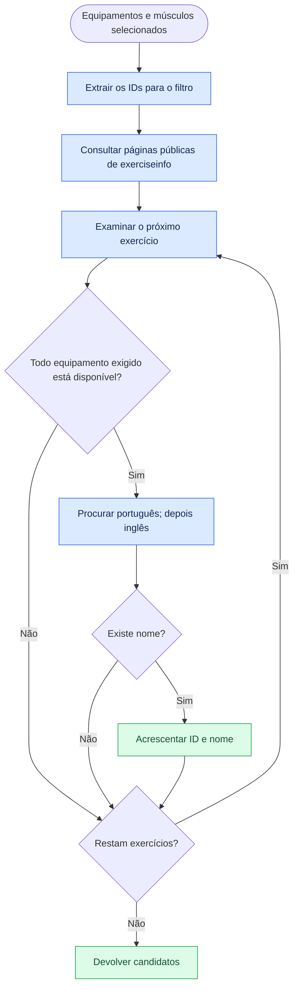
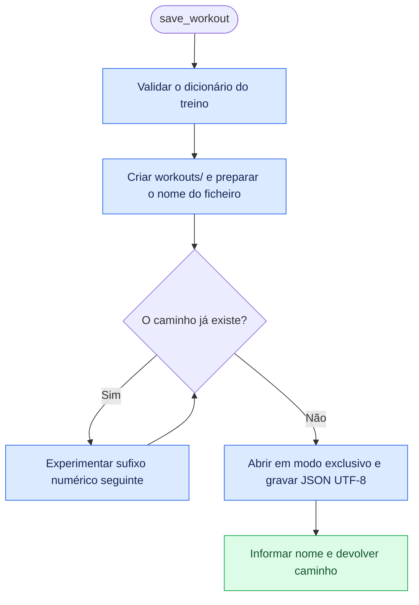
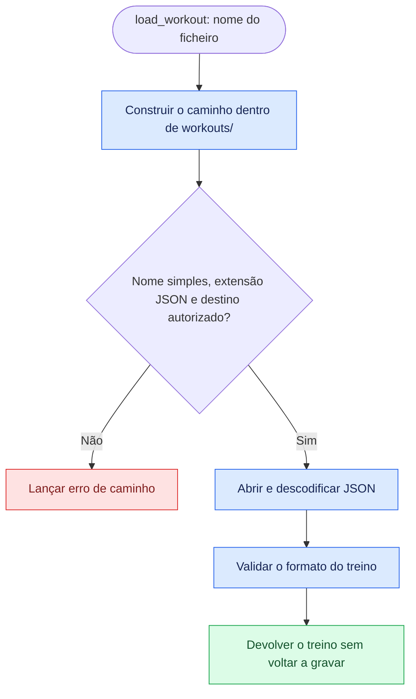
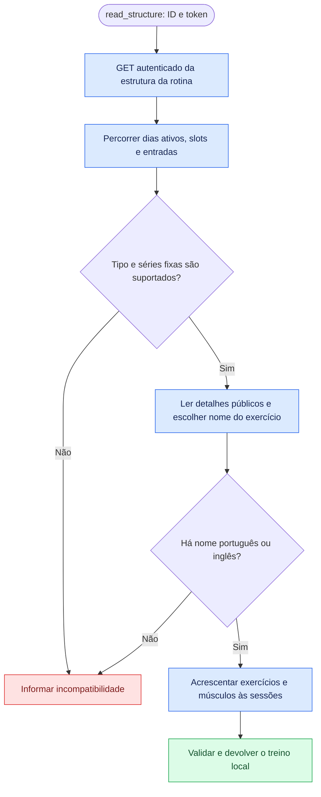
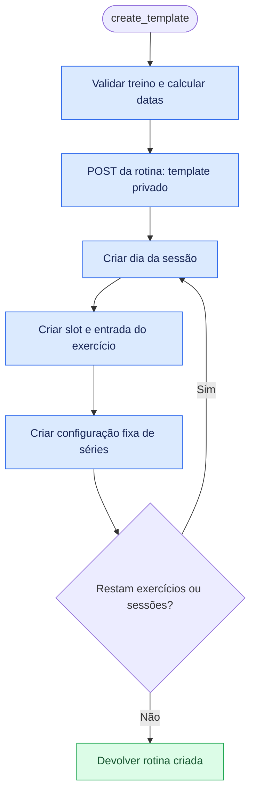

# XWorkouts — Dados e operações dos treinos

> **Código:** `fitlib/workouts.py` · **Interface que o utiliza:** `tcli.py`

**Neste guia:** [funcionamento](#parte-1--funcionamento) ·
[código linha por linha](#parte-2--código-explicado-linha-por-linha) ·
[verificação](#verificação)

## Parte 1 — Funcionamento

### 1. Objetivo e responsabilidades

Este módulo contém os dados e operações dos treinos: não faz as perguntas da
interface. Os menus estão em [XTcli_treinos.md](XTcli_treinos.md).
Cada diagrama seguinte representa uma operação pequena e independente.

| Área | Funções | Dados envolvidos |
|---|---|---|
| Nomes e seleção | `exercise_name`, `filtered_exercises` | Catálogo público e escolhas do utilizador |
| Persistência local | `validate_workout`, `save_workout`, `load_workout` | Dicionário do treino e JSON em workouts/ |
| Leitura remota | `read_structure` | Estrutura privada mais detalhes públicos dos exercícios |
| Exportação | `current_period`, `create_template` | Datas e POSTs autenticados do template |

### 2. Bloco A — Filtrar candidatos e escolher nomes




A preferência é pelo idioma 7 (português), seguido do 2 (inglês). Os IDs mantêm-se;
traduzir o nome não altera a identidade do exercício. Um exercício que exige um
equipamento não disponível é excluído. A apresentação dos músculos continua a
usar os campos recebidos, sem tradução automática de todos os termos.

### 3. Bloco B — Guardar JSON sem sobrescrever




O modo `x` impede sobrescrita mesmo se outro processo criar o nome escolhido
antes da abertura. Esse caso pode resultar em erro; não existe nova tentativa
interna depois de uma falha na abertura.

### 4. Bloco C — Carregar um JSON local




Validação e erros de leitura podem subir ao menu. A verificação do destino
resolvido também impede que um link simbólico aponte para fora da pasta autorizada.

### 5. Bloco D — Ler uma estrutura privada




A caixa de montagem resume os ciclos sobre todas as entradas: não representa
apenas um exercício. Dias de descanso são ignorados. Quantidades de séries devem
ser finitas, inteiras, na iteração/operação suportadas, e respeitar a validação final.

**Duas origens de dados:** estrutura da conta sem cache; detalhes públicos dos
exercícios com a cache habitual. A estrutura privada nunca é guardada na cache pública.

### 6. Bloco E — Criar um template privado




A repetição no diagrama resume os ciclos: há um dia por sessão e slots/entradas
por exercício. Não significa criar um novo dia para cada exercício.

Se ocorrer falha ou cancelamento depois de criar a rotina, o código informa o ID
possivelmente incompleto e não repete a exportação. **Não há rollback automático.**
Uma falha no primeiro POST propaga-se diretamente, antes de existir o bloco de
proteção da criação dos componentes.

### Código arquivado fora do repositório

O helper antigo `post_record` foi retirado deste módulo e preservado em
`../../../ignore/post_record.py`, numa pasta local fora de `ALPCD_12` e do Git.
Não tem chamadores na aplicação atual e não faz parte dos treinos/templates.
A opção `weekly=True` de `current_period` continua no módulo, mas também não
representa uma opção de repetição semanal disponível nos menus.

### 7. Formato e validação locais

```json
{
  "version": 1,
  "name": "Treino A",
  "sessions": [{
    "name": "Sessão A",
    "muscles": ["Back"],
    "exercises": [{"id": 1, "name": "Remada", "sets": 3}]
  }]
}
```

Exemplo ilustrativo: o ID não identifica aqui um exercício real validado.

| Campo | Validação atual |
|---|---|
| `version` | Inteiro exatamente igual a 1; bool não é aceite |
| Nome do treino | Texto com 1–25 caracteres, desconsiderando espaços exteriores |
| `sessions` | Lista com 1–7 sessões |
| Nome da sessão | Texto com 1–20 caracteres, desconsiderando espaços exteriores |
| `muscles` | Lista de nomes textuais |
| `exercises` | Lista não vazia |
| ID do exercício | Inteiro positivo |
| Nome do exercício | Texto não vazio |
| `sets` | Inteiro de 1 a 50 |

A validação não elimina campos adicionais, não reescreve nomes e não significa
que os IDs tenham sido confirmados remotamente. Ficheiros locais são dados do
utilizador; não devem ser tratados como cache descartável.

## Parte 2 — Código explicado linha por linha

O código abaixo corresponde ao módulo após retirar o helper arquivado (16/11/2026).
A numeração nas tabelas refere-se às linhas desse ficheiro. Linhas vazias e
comentários separadores não executam operações e não são repetidos nas tabelas.
Quando o módulo mudar, atualizar os blocos e a explicação em conjunto.

### Imports e configuração

```python
import json
import re
from datetime import date, timedelta
from decimal import Decimal, InvalidOperation
from pathlib import Path

from . import api

WORKOUTS_DIR = Path(__file__).resolve().parent.parent / "workouts"
```

| Linha | Explicação |
|---|---|
| 1 | Importa a leitura e escrita de JSON. |
| 2 | Importa regex para converter nomes de treinos em nomes de ficheiro. |
| 3 | Importa a data atual e intervalos de dias para as datas do template. |
| 4 | Importa números decimais e o erro de conversão, usados na validação das séries. |
| 5 | Importa operações de caminhos e ficheiros. |
| 7 | Reutiliza o módulo de HTTP e cache do projeto. |
| 9 | Define workouts/ a partir do caminho do módulo, sem depender da pasta de execução. |

### exercise_name

```python
def exercise_name(exercise):
    """Nome em português (7), com inglês como alternativa."""
    for language in (7, 2):
        for translation in exercise.get("translations") or []:
            if translation.get("language") == language and translation.get("name"):
                return translation["name"]
    return ""
```

| Linha | Explicação |
|---|---|
| 16 | Define `exercise_name` e os parâmetros usados nas linhas seguintes. |
| 17 | Documenta a preferência de idioma usada pelo TCLI. |
| 18 | Procura primeiro português (7) e só depois inglês (2). |
| 19 | Percorre as traduções; lista ausente ou nula equivale a lista vazia. |
| 20 | Exige o idioma procurado e um nome preenchido. |
| 21 | Devolve a primeira tradução válida no idioma preferido. |
| 22 | Sem português ou inglês, devolve vazio para o chamador escolher a alternativa. |

### validate_workout

```python
def validate_workout(workout):
    try:
        if type(workout["version"]) is not int or workout["version"] != 1 or not isinstance(workout["name"], str):
            raise ValueError
        if not 1 <= len(workout["name"].strip()) <= 25:
            raise ValueError
        if not isinstance(workout["sessions"], list) or not 1 <= len(workout["sessions"]) <= 7:
            raise ValueError
        for session in workout["sessions"]:
            if not isinstance(session["name"], str) or not 1 <= len(session["name"].strip()) <= 20:
                raise ValueError
            if not isinstance(session["muscles"], list) or not isinstance(session["exercises"], list):
                raise ValueError
            if not session["exercises"]:
                raise ValueError
            for name in session["muscles"]:
                if not isinstance(name, str):
                    raise ValueError
            for entry in session["exercises"]:
                if (type(entry["id"]) is not int or entry["id"] <= 0
                        or not isinstance(entry["name"], str) or not entry["name"].strip()):
                    raise ValueError
                if type(entry["sets"]) is not int or not 1 <= entry["sets"] <= 50:
                    raise ValueError
    except (KeyError, TypeError, ValueError) as error:
        raise ValueError("Workout inválido: verifique nomes, sessões, músculos, exercícios e séries (1–50).") from error
    return workout
```

| Linha | Explicação |
|---|---|
| 25 | Define `validate_workout` e os parâmetros usados nas linhas seguintes. |
| 26 | Agrupa a validação para converter os erros de formato numa mensagem comum. |
| 27 | Exige versão exatamente inteira 1 e nome textual; bool não é aceite como versão. |
| 28 | Interrompe a validação quando a versão ou o tipo do nome é inválido. |
| 29 | Exige entre 1 e 25 caracteres no nome, desconsiderando espaços exteriores. |
| 30 | Sinaliza nome de treino vazio ou demasiado comprido. |
| 31 | Exige uma lista com uma a sete sessões. |
| 32 | Sinaliza número ou tipo de sessões inválido. |
| 33 | Valida cada sessão do treino. |
| 34 | Exige nome textual de sessão com 1 a 20 caracteres. |
| 35 | Sinaliza nome de sessão inválido. |
| 36 | Exige listas para músculos e exercícios. |
| 37 | Sinaliza tipo incorreto nessas coleções. |
| 38 | Não aceita uma sessão sem exercícios. |
| 39 | Sinaliza a sessão vazia. |
| 40 | Percorre os nomes de músculos da sessão. |
| 41 | Exige que cada nome de músculo seja texto. |
| 42 | Sinaliza nome de músculo com tipo inválido. |
| 43 | Valida cada exercício da sessão. |
| 44 | Começa a condição que exige um ID inteiro positivo. |
| 45 | Completa a condição exigindo nome textual não vazio. |
| 46 | Sinaliza ID ou nome de exercício inválido. |
| 47 | Exige séries inteiras entre 1 e 50. |
| 48 | Sinaliza quantidade ou tipo de séries inválido. |
| 49 | Captura campos ausentes, tipos incompatíveis e validações rejeitadas. |
| 50 | Devolve uma mensagem uniforme, preservando a causa original do erro. |
| 51 | Devolve o mesmo treino, sem o copiar ou alterar. |

### save_workout

```python
def save_workout(workout):
    validate_workout(workout)
    WORKOUTS_DIR.mkdir(exist_ok=True)
    name = re.sub(r"[^\w-]+", "_", workout["name"]).strip("_") or "treino"
    path = WORKOUTS_DIR / f"{name}.json"
    counter = 2
    while path.exists():
        path = WORKOUTS_DIR / f"{name}_{counter}.json"
        counter += 1
    with path.open("x", encoding="utf-8") as file:
        json.dump(workout, file, ensure_ascii=False, indent=2)
    print(f"Treino guardado: {path.name}")
    return path
```

| Linha | Explicação |
|---|---|
| 54 | Define `save_workout` e os parâmetros usados nas linhas seguintes. |
| 55 | Valida o treino antes de criar qualquer ficheiro. |
| 56 | Cria workouts/ se ainda não existir. |
| 57 | Substitui caracteres inadequados por sublinhados e usa treino se o nome ficar vazio. |
| 58 | Constrói o primeiro caminho JSON candidato. |
| 59 | Inicia em 2 o sufixo para nomes repetidos. |
| 60 | Enquanto o caminho já existir, procura outro nome. |
| 61 | Monta uma alternativa como nome_2.json. |
| 62 | Avança o sufixo para uma nova tentativa. |
| 63 | Abre em modo exclusivo: nunca sobrescreve um ficheiro já existente. |
| 64 | Grava o dicionário como JSON indentado, preservando acentos. |
| 65 | Informa o nome do ficheiro criado. |
| 66 | Devolve o caminho para permitir reutilização pelo chamador. |

### load_workout

```python
def load_workout(filename):
    path = WORKOUTS_DIR / filename
    if Path(filename).name != filename or path.suffix != ".json" or path.resolve().parent != WORKOUTS_DIR.resolve():
        raise ValueError("Escolha um ficheiro JSON dentro de workouts/.")
    with path.open(encoding="utf-8") as file:
        return validate_workout(json.load(file))
```

| Linha | Explicação |
|---|---|
| 69 | Define `load_workout` e os parâmetros usados nas linhas seguintes. |
| 70 | Combina o nome recebido com a pasta autorizada. |
| 71 | Rejeita caminhos com pastas, extensões diferentes de .json e destinos fora de workouts/, incluindo symlinks para fora. |
| 72 | Explica que a seleção deve ser um JSON da pasta de treinos. |
| 73 | Abre o ficheiro em UTF-8 para leitura. |
| 74 | Lê o JSON, valida o formato e só então devolve o treino. |

### filtered_exercises

```python
def filtered_exercises(equipment, muscles):
    available = []
    targets = []
    for item in equipment:
        available.append(item["id"])
    for item in muscles:
        targets.append(item["id"])
    found = []
    for raw in api.get_list("exerciseinfo/", {"muscles": targets, "limit": 100}):
        allowed = True
        for item in raw.get("equipment", []):
            if item["id"] not in available:
                allowed = False
        name = exercise_name(raw)
        if allowed and name:
            found.append({"id": raw["id"], "name": name})
    return found
```

| Linha | Explicação |
|---|---|
| 77 | Define `filtered_exercises` e os parâmetros usados nas linhas seguintes. |
| 78 | Inicia a lista de IDs de equipamentos disponíveis. |
| 79 | Inicia a lista de IDs dos músculos selecionados. |
| 80 | Percorre os equipamentos escolhidos pelo utilizador. |
| 81 | Guarda apenas o ID necessário ao filtro. |
| 82 | Percorre os músculos escolhidos. |
| 83 | Guarda os IDs usados nos parâmetros da API. |
| 84 | Inicia os resultados que serão apresentados para seleção. |
| 85 | Consulta todas as páginas de exercícios para os músculos; usa cache pública disk predefinida. |
| 86 | Começa por considerar o exercício compatível com os equipamentos. |
| 87 | Percorre cada equipamento exigido pelo exercício. |
| 88 | Verifica se algum equipamento exigido não está disponível. |
| 89 | Marca o exercício como incompatível se faltar equipamento. |
| 90 | Obtém português, ou inglês quando não existir português. |
| 91 | Aceita apenas exercícios com equipamento compatível e nome utilizável. |
| 92 | Devolve para o menu somente ID e nome, sem alterar os dados públicos originais. |
| 93 | Entrega a lista de candidatos ao TCLI. |

### read_structure

```python
def read_structure(ident, token):
    structure = api.request("GET", f"routine/{ident}/structure/", token)
    workout = {"version": 1, "id": ident, "name": structure["name"], "sessions": []}
    for day in structure["days"]:
        if day["is_rest"]:
            continue
        session = {"id": day["id"], "name": day["name"], "muscles": [], "exercises": []}
        for slot in day["slots"]:
            for entry in slot["entries"]:
                configs = entry.get("set_nr_configs", [])
                if (len(configs) != 1 or entry.get("max_set_nr_configs") or entry.get("config")
                        or entry.get("type", "normal") != "normal" or day.get("type", "custom") != "custom"):
                    raise ValueError("O TCLI aceita apenas workouts simples com séries fixas.")
                config = configs[0]
                try:
                    value = Decimal(str(config["value"]))
                except InvalidOperation as error:
                    raise ValueError("Número de séries inválido.") from error
                if (not value.is_finite() or value != int(value) or config["iteration"] != 1
                        or config.get("operation", "r") != "r" or config.get("requirements")):
                    raise ValueError("Configuração de séries não suportada.")
                raw = api.get_data(f"exerciseinfo/{entry['exercise']}/")
                name = exercise_name(raw)
                if not name:
                    raise ValueError("Exercício sem nome em português ou inglês; template não compatível.")
                session["exercises"].append({"id": entry["exercise"], "name": name,
                                             "slot_entry": entry["id"], "sets": int(value)})
                for muscle in (raw.get("muscles") or []) + (raw.get("muscles_secondary") or []):
                    name = muscle.get("name_en") or muscle.get("name")
                    if name not in session["muscles"]:
                        session["muscles"].append(name)
        workout["sessions"].append(session)
    return validate_workout(workout)
```

| Linha | Explicação |
|---|---|
| 100 | Define `read_structure` e os parâmetros usados nas linhas seguintes. |
| 101 | Obtém a estrutura privada com token e sem usar a cache pública. |
| 102 | Inicia o treino local com identificação da rotina e sessões vazias. |
| 103 | Percorre os dias da rotina. |
| 104 | Identifica os dias marcados como descanso. |
| 105 | Ignora dias de descanso na montagem das sessões. |
| 106 | Cria a sessão local para um dia ativo. |
| 107 | Percorre os slots, ou posições de exercício, do dia. |
| 108 | Percorre as entradas de exercício de cada slot. |
| 109 | Lê as configurações de número de séries; ausentes equivalem a lista vazia. |
| 110 | Começa a rejeitar configurações múltiplas, máximos variáveis ou outras configurações complexas. |
| 111 | Também rejeita tipos de entrada ou dia diferentes dos suportados. |
| 112 | Explica a limitação a treinos simples com séries fixas. |
| 113 | Seleciona a única configuração de séries aceite. |
| 114 | Inicia a conversão protegida do valor de séries. |
| 115 | Converte por texto para Decimal, permitindo validar sem arredondamento inteiro prematuro. |
| 116 | Captura valor decimal inválido. |
| 117 | Explica a falha e preserva a causa da conversão. |
| 118 | Exige valor finito, inteiro e aplicado à primeira iteração. |
| 119 | Exige a operação suportada e ausência de requisitos adicionais. |
| 120 | Interrompe a leitura se a configuração não puder ser representada localmente. |
| 121 | Obtém os detalhes públicos do exercício, estes sim com cache pública. |
| 122 | Escolhe o nome português ou a alternativa inglesa. |
| 123 | Verifica se existe um nome num dos idiomas suportados. |
| 124 | Rejeita o exercício sem nome utilizável, em vez de criar um JSON inválido. |
| 125 | Começa a acrescentar a entrada local com ID e nome do exercício. |
| 126 | Inclui o ID da entrada remota e converte o número de séries para inteiro. |
| 127 | Une músculos principais e secundários para percorrer os nomes. |
| 128 | Usa name_en quando disponível, com name como alternativa; esta linha não traduz músculos. |
| 129 | Evita repetir um nome de músculo na sessão. |
| 130 | Acrescenta o músculo ainda não presente. |
| 131 | Acrescenta a sessão completa ao treino local. |
| 132 | Valida o resultado final antes de o devolver. |

### current_period

```python
def current_period(weekly=False):
    monday = date.today() - timedelta(days=date.today().weekday())
    return {"start": monday.isoformat(), "end": (monday + timedelta(days=83 if weekly else 6)).isoformat()}
```

| Linha | Explicação |
|---|---|
| 135 | Define `current_period` e os parâmetros usados nas linhas seguintes. |
| 136 | Calcula a segunda-feira da semana atual. |
| 137 | Devolve datas ISO: até domingo no uso normal, ou 83 dias após a segunda-feira se weekly=True; o menu atual não usa essa opção. |

### create_template

```python
def create_template(workout, token):
    validate_workout(workout)
    data = {**current_period(), "name": workout["name"], "is_template": True,
            "is_public": False, "fit_in_week": True}
    routine = api.request("POST", "routine/", token, data)
    try:
        for order, session in enumerate(workout["sessions"]):
            day = api.request("POST", "day/", token,
                              {"routine": routine["id"], "name": session["name"], "order": order})
            for position, entry in enumerate(session["exercises"]):
                slot = api.request("POST", "slot/", token, {"day": day["id"], "order": position})
                saved = api.request("POST", "slot-entry/", token,
                                    {"slot": slot["id"], "exercise": entry["id"],
                                     "repetition_unit": 1, "weight_unit": 1})
                api.request("POST", "sets-config/", token,
                            {"slot_entry": saved["id"], "iteration": 1, "value": entry["sets"], "operation": "r"})
    except (RuntimeError, KeyboardInterrupt, EOFError) as error:
        raise RuntimeError(f"Template #{routine['id']} incompleto. "
                           "Não repetir a exportação automaticamente.") from error
    return routine
```

| Linha | Explicação |
|---|---|
| 144 | Define `create_template` e os parâmetros usados nas linhas seguintes. |
| 145 | Valida o treino antes de iniciar escritas na conta. |
| 146 | Começa os dados da rotina com datas, nome e marcação de template. |
| 147 | Define o template como privado e ajustado à semana. |
| 148 | Cria a rotina com um POST autenticado, fora da cache. |
| 149 | Protege a criação dos componentes depois de já existir a rotina. |
| 150 | Percorre as sessões com a respetiva ordem. |
| 151 | Inicia o POST que cria um dia para a sessão. |
| 152 | Liga o dia à rotina e envia nome e ordem. |
| 153 | Percorre os exercícios com a respetiva posição. |
| 154 | Cria um slot dentro do dia. |
| 155 | Inicia a criação da entrada de exercício no slot. |
| 156 | Envia os IDs do slot e do exercício selecionado. |
| 157 | Envia os identificadores de unidade usados pelo código atual. |
| 158 | Inicia a configuração de séries da entrada criada. |
| 159 | Liga a configuração à entrada e envia iteração, quantidade de séries e operação. |
| 160 | Captura falha HTTP, cancelamento de teclado ou fim da entrada durante a montagem. |
| 161 | Começa uma mensagem que identifica a rotina possivelmente incompleta. |
| 162 | Desaconselha repetir a exportação automaticamente e mantém a causa do erro. |
| 163 | Devolve a rotina criada; não ativa rotinas nem regista uma execução. |

## Verificação

| Caso | Resultado recomendado para testes simulados |
|---|---|
| Traduções inglesa e portuguesa fora de ordem | Preferir português |
| Apenas português | Aceitar o exercício na seleção e leitura de templates |
| Falta de equipamento | Excluir o candidato |
| Nome de ficheiro já existente | Criar outro caminho sem sobrescrever |
| Caminho ou symlink fora de workouts/ | Rejeitar a importação |
| Séries variáveis ou não inteiras | Rejeitar estrutura incompatível |
| Erro durante a exportação | Informar rotina incompleta, sem repetir POSTs |
| Templates privados | Não utilizar a cache pública para a estrutura |

A cópia atual não inclui uma pasta `tests/`. As tabelas acima descrevem os casos
que devem ser cobertos com HTTP simulado e ficheiros temporários, sem criar
objetos na conta apenas para testar. Os testes executados em etapas anteriores
não constituem uma suite distribuída nesta cópia.

Os blocos de código e a correspondência das linhas foram comparados com o módulo
atual durante a revisão documental. Essa conferência não executa POSTs nem prova
que a API real esteja disponível.

Voltar ao [README oficial](../../README.md).
