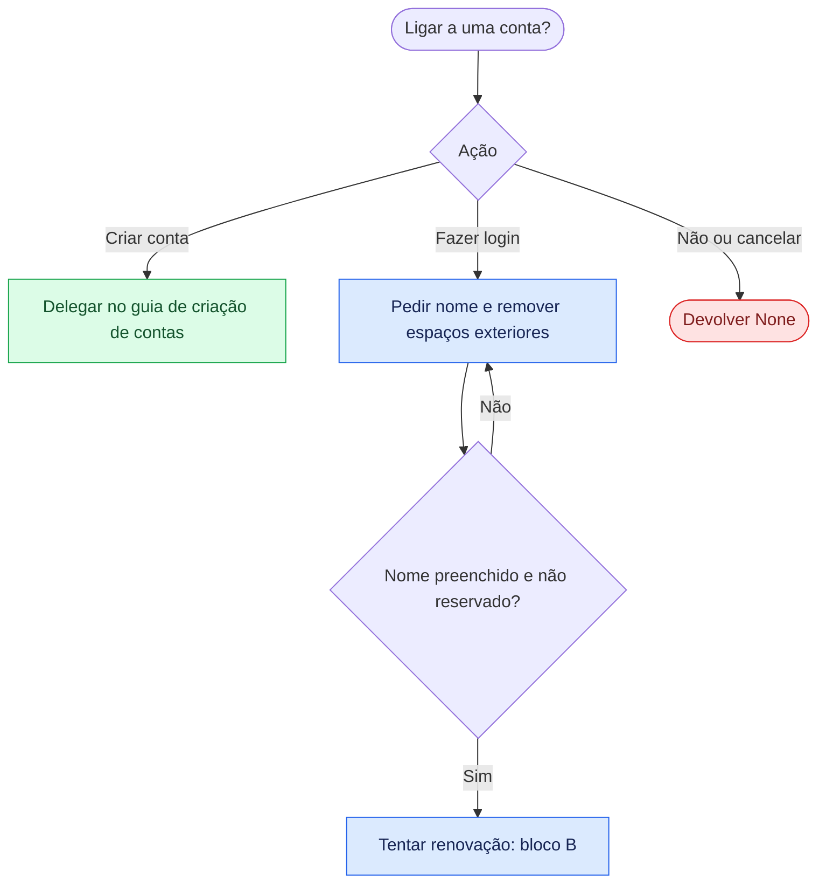
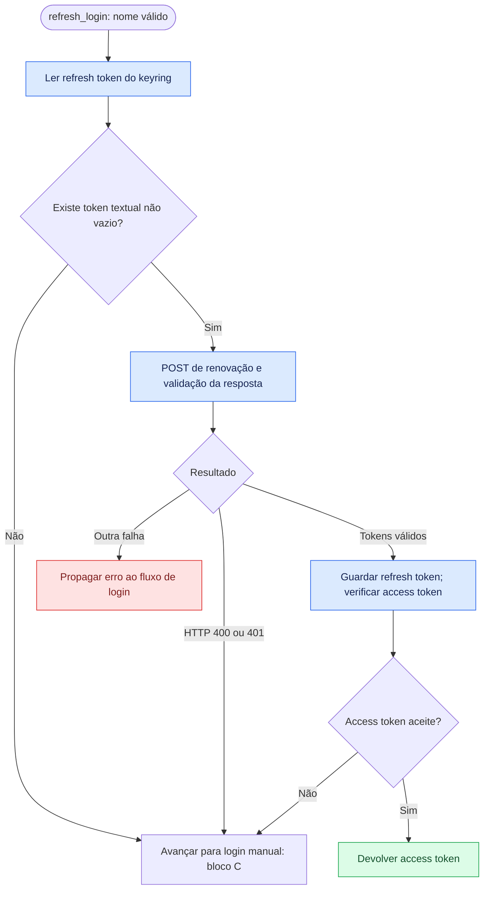
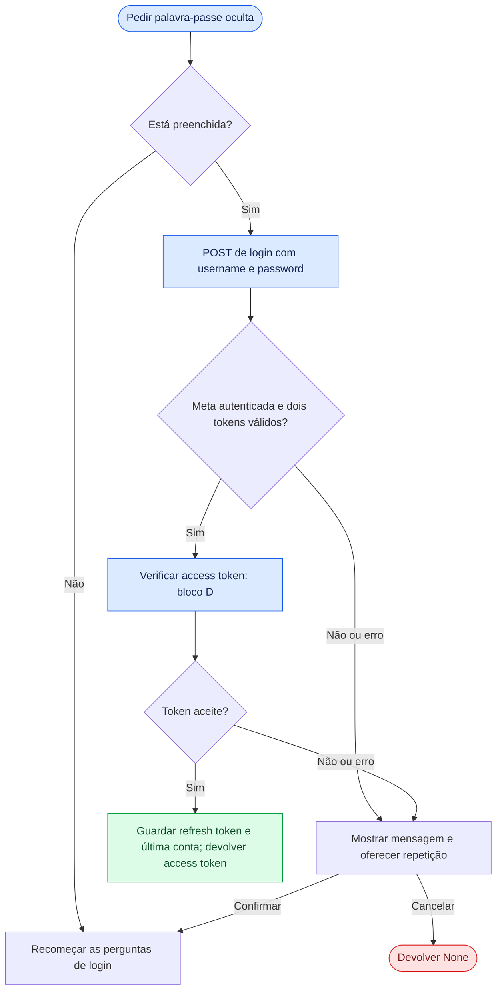
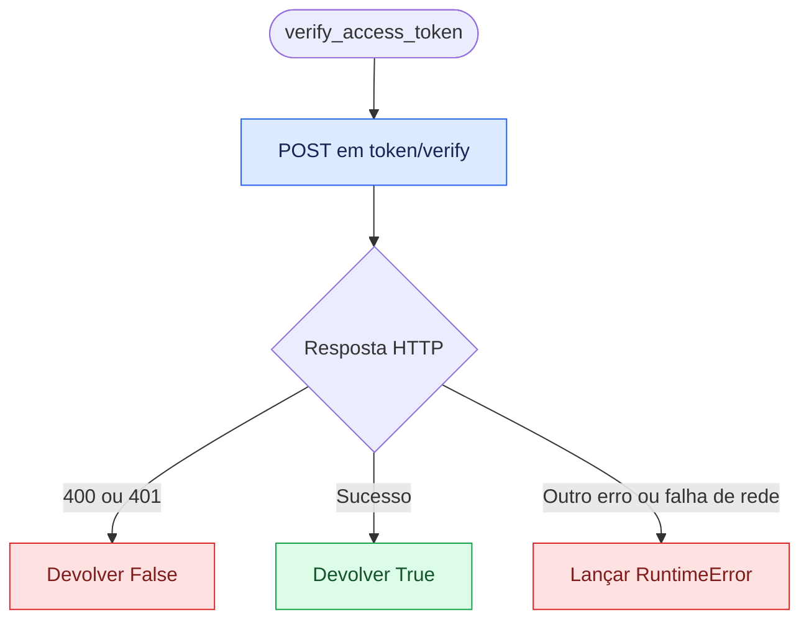

# XTcli — Login e sessão guardada

> **Código:** `tcli.py` · **Entrada interativa:** `connection_questionary()`

**Neste guia:** [funcionamento](#parte-1--funcionamento) ·
[código linha por linha](#parte-2--código-explicado-linha-por-linha) · [verificação](#verificação)

## Parte 1 — Funcionamento

### 1. Objetivo e dados da sessão

Entrar numa conta com credenciais ou renovar uma sessão previamente guardada.
A criação de conta tem um [guia próprio](XTcli_criacao_contas.md).

| Dado | Utilização | Persistência |
|---|---|---|
| Palavra-passe | Pedido de login | Não é guardada pelo código |
| Access token | Pedidos da sessão atual | Memória do processo |
| Refresh token | Renovar o access token | Keyring: serviço `FITCLI-wger`, chave do utilizador |
| `last_username` | Identificar a última conta | Outra entrada no mesmo serviço do keyring |

### 2. Bloco A — Escolha e nome da conta



### 3. Bloco B — Tentar renovar a sessão guardada



Este bloco trata um nome já validado. Antes de ler o keyring, a função também
rejeita nome ausente e a chave reservada `last_username`.

**Ordem importante:** guardar a rotação do refresh token acontece antes da
verificação do access token. Se o servidor já tiver substituído o token anterior,
adiar a gravação poderia perder a sessão renovável. A verificação usa o bloco D.

### 4. Bloco C — Login com palavra-passe



Uma falha de gravação no keyring não impede devolver um access token já verificado.
A tentativa de atualizar `last_username` ocorre apenas se o refresh token foi guardado.

### 5. Bloco D — Verificação do access token



### 6. Erros e cancelamento

| Situação | Comportamento atual |
|---|---|
| Nome vazio ou `last_username` | Voltar a perguntar, sem enviar credenciais |
| Token guardado rejeitado | Pedir palavra-passe |
| Palavra-passe vazia | Voltar às perguntas de login |
| Login incompleto ou token recusado | Mensagem e opção de nova tentativa |
| Erro HTTP/rede/JSON | Mensagem controlada; renovação não trata todo erro como token expirado |
| Falha de keyring | Permitir login manual ou manter a sessão já verificada em memória |
| Cancelar uma pergunta, Ctrl+C ou fim da entrada | Terminar o fluxo sem token |

MFA e outras etapas adicionais não são concluídas pelo programa. O login não
revela se a falha foi utilizador inexistente ou palavra-passe incorreta.
O helper `post_data` está explicado em [XTcli.md](XTcli.md#parte-2--código-explicado-linha-por-linha).

## Parte 2 — Código explicado linha por linha

Os trechos abaixo são cópias do código atual, não versões alternativas da implementação.
Cada tabela explica **todas as linhas não vazias de código do trecho**. A coluna
“Linha” refere-se ao ficheiro original; comentários separadores não precisam de
uma explicação repetida. Nas funções longas, os recortes são consecutivos e devem
ser lidos em conjunto: um recorte interior não é uma função autónoma para executar.

### `login_account()`

Seleciona o endpoint de login e reutiliza post_data. O helper HTTP e as mensagens comuns são explicados em [XTcli.md](XTcli.md#parte-2--código-explicado-linha-por-linha).

#### login_account

[Fonte: tcli.py, linha 66](../../tcli.py#L66)

```python
def login_account(dados: dict) -> dict:
    return post_data(
        "https://wger.de/allauth/app/v1/auth/login",
        dados
    )
```

| Linha | Explicação |
|---|---|
| 66 | Define `login_account` e os parâmetros/resultado usados neste bloco. |
| 67 | Delega o pedido de login no helper HTTP explicado em XTcli.md. |
| 68 | Seleciona o endpoint allauth de login; não é o endpoint público exerciseinfo. |
| 69 | Encaminha as credenciais recebidas, sem as guardar num ficheiro. |
| 70 | Fecha a chamada e devolve a resposta ao fluxo interativo. |

### `save_token()`

Guarda uma entrada no keyring e devolve sucesso/falha. É reutilizada pelo login, renovação e criação de conta.

#### save_token

[Fonte: tcli.py, linha 177](../../tcli.py#L177)

```python
def save_token(name: str, token: str) -> bool:
    try:
        keyring.set_password("FITCLI-wger", name, token)
        return True
    except (keyring.errors.KeyringError, OSError):
        print("Não foi possível guardar a sessão. Pode continuar nesta sessão.")
        return False
```

| Linha | Explicação |
|---|---|
| 177 | Define `save_token` e os parâmetros/resultado usados neste bloco. |
| 178 | Agrupa a tentativa de gravação no keyring. |
| 179 | Guarda o token no serviço FITCLI-wger, associado à chave name. |
| 180 | Confirma ao chamador que a gravação terminou. |
| 181 | Trata indisponibilidade do keyring ou erro do sistema. |
| 182 | Avisa que a persistência falhou, mas não invalida a sessão em memória. |
| 183 | Devolve False para o chamador não assumir que a sessão foi guardada. |

### `refresh_login()`

Tenta renovar a sessão guardada. Guarda a rotação do refresh token antes de verificar o access token, porque o token anterior pode já não ser válido.

#### Ler e renovar a sessão

[Fonte: tcli.py, linha 186](../../tcli.py#L186)

```python
def refresh_login(name: str | None) -> str | None:
    if not name or name == "last_username":
        return None

    try:
        token = keyring.get_password("FITCLI-wger", name)
    except (keyring.errors.KeyringError, OSError):
        print("Armazenamento seguro indisponível. Introduza a palavra-passe.")
        return None

    if not isinstance(token, str) or not token.strip():
        return None

    try:
        response = post_data(
            "https://wger.de/allauth/app/v1/tokens/refresh",
            {"refresh_token": token}
        )
    except RuntimeError as error:
        cause = error.__cause__
        if (isinstance(cause, requests.exceptions.HTTPError)
                and cause.response is not None
                and cause.response.status_code in (400, 401)):
            print("A sessão guardada expirou. Introduza a palavra-passe.")
            return None
        raise
```

| Linha | Explicação |
|---|---|
| 186 | Define `refresh_login` e os parâmetros/resultado usados neste bloco. |
| 187 | Ignora nomes ausentes e a chave de metadados reservada. |
| 188 | Indica que não existe sessão a restaurar para esse nome. |
| 190 | Protege a leitura do armazenamento seguro. |
| 191 | Procura o refresh token dessa conta, sem o mostrar no terminal. |
| 192 | Trata falha do keyring ou do sistema. |
| 193 | Orienta para autenticação manual. |
| 194 | Indica que não conseguiu restaurar uma sessão. |
| 196 | Rejeita tokens guardados que não sejam texto ou estejam vazios. |
| 197 | Permite que o chamador avance para pedir palavra-passe. |
| 199 | Protege o pedido HTTP de renovação. |
| 200 | Delega o POST no helper de autenticação. |
| 201 | Escolhe o endpoint allauth de renovação. |
| 202 | Envia apenas o refresh token guardado. |
| 203 | Fecha o pedido de renovação. |
| 204 | Trata a falha devolvida pelo helper HTTP. |
| 205 | Lê a causa original para distinguir rejeição de falha de rede. |
| 206 | Começa a exigir uma falha HTTP reconhecível. |
| 207 | Confirma a existência da resposta do servidor. |
| 208 | Identifica HTTP 400/401 como rejeição da sessão guardada. |
| 209 | Explica que será necessário fornecer a palavra-passe. |
| 210 | Devolve None para permitir o login manual. |
| 211 | Propaga outras falhas: não transforma indisponibilidade de rede em credenciais inválidas. |

#### Validar e guardar os novos tokens

[Fonte: tcli.py, linha 213](../../tcli.py#L213)

```python
    data = response.get("data")
    if not isinstance(data, dict):
        raise RuntimeError("Resposta de autenticação inválida.")
    access = data.get("access_token")
    refresh = data.get("refresh_token", token)
    if not all(isinstance(value, str) and value.strip() for value in (access, refresh)):
        raise RuntimeError("Resposta de autenticação inválida.")

    # Guardar a rotação antes da verificação: o token anterior pode já ter expirado.
    saved = save_token(name, refresh)
    if not verify_access_token(access):
        print("A sessão guardada foi rejeitada. Introduza a palavra-passe.")
        return None
    if saved:
        save_token("last_username", name)
    return access
```

| Linha | Explicação |
|---|---|
| 213 | Lê o objeto data da resposta de renovação. |
| 214 | Exige que esse conteúdo seja um dicionário. |
| 215 | Rejeita uma estrutura de resposta inesperada. |
| 216 | Lê o novo access token. |
| 217 | Usa o refresh token novo, ou conserva o anterior quando o campo está ausente. |
| 218 | Exige que ambos os tokens sejam textos não vazios. |
| 219 | Interrompe a renovação se os tokens forem inválidos. |
| 222 | Guarda a eventual rotação do refresh token antes de verificar o access token. |
| 223 | Verifica o novo access token antes de o devolver. |
| 224 | Informa que o token da sessão não foi aceite. |
| 225 | Permite regressar ao login manual. |
| 226 | Verifica se a persistência do refresh token teve sucesso. |
| 227 | Nesse caso tenta registar a última conta usada. |
| 228 | Devolve o access token verificado, mesmo que a persistência tenha falhado. |

### `verify_access_token()`

Distingue um token recusado (False) de uma verificação indisponível (RuntimeError). Não lê nem escreve a cache pública.

#### verify_access_token

[Fonte: tcli.py, linha 231](../../tcli.py#L231)

```python
def verify_access_token(token: str) -> bool:

    try:
        response = requests.post(
            "https://wger.de/api/v2/token/verify",
            json={"token": token},
            headers=HEADERS,
            timeout=15
        )

        if response.status_code in (400, 401):
            return False

        response.raise_for_status()
        return True

    except requests.exceptions.RequestException as error:
        raise RuntimeError(
            "Não foi possível verificar o token."
        ) from error
```

| Linha | Explicação |
|---|---|
| 231 | Define `verify_access_token` e os parâmetros/resultado usados neste bloco. |
| 233 | Protege a verificação HTTP. |
| 234 | Inicia o POST direto que valida o access token. |
| 235 | Seleciona o endpoint v2 de verificação. |
| 236 | Envia o token num corpo JSON; não utiliza a cache. |
| 237 | Aplica os cabeçalhos comuns. |
| 238 | Limita o pedido a 15 segundos. |
| 239 | Fecha a chamada HTTP de verificação. |
| 241 | Reconhece HTTP 400/401 como token não aceite. |
| 242 | Devolve False nesses casos em vez de ativar a sessão. |
| 244 | Propaga outros estados HTTP de erro para o tratamento abaixo. |
| 245 | Devolve True quando a resposta é de sucesso. |
| 247 | Trata falhas de requests, incluindo HTTP e rede. |
| 248 | Inicia a mensagem de verificação indisponível. |
| 249 | Define o texto apresentado pelo chamador. |
| 250 | Mantém a exceção original como causa. |

### `connection_questionary()`

Recolhe a escolha entre login/registo. No ramo de login, tenta renovação antes de pedir a palavra-passe e só devolve access tokens verificados.

#### Escolher o fluxo e validar o nome

[Fonte: tcli.py, linha 256](../../tcli.py#L256)

```python
def connection_questionary() -> str | None:
    try:
        if not questionary.confirm("Deseja conectar-se a uma conta?", default=True).ask():
            return None

        action = questionary.select(
            "O que deseja fazer?",
            choices=["Fazer login", "Criar conta"]
        ).ask()
        if action == "Criar conta":
            return creation_questionary()
        if action != "Fazer login":
            return None

        while True:
            name = questionary.text("Introduza o nome de utilizador:").ask()
            if name is None:
                return None
            name = name.strip()
            if not name or name == "last_username":
                print("Introduza um nome de utilizador válido.")
                continue
```

| Linha | Explicação |
|---|---|
| 256 | Define `connection_questionary` e os parâmetros/resultado usados neste bloco. |
| 257 | Permite cancelar o fluxo de ligação com teclado ou fim da entrada. |
| 258 | Pergunta primeiro se o utilizador quer conectar-se a uma conta. |
| 259 | Devolve None se a ligação não for confirmada. |
| 261 | Inicia a seleção entre login e registo. |
| 262 | Define o texto da pergunta. |
| 263 | Disponibiliza as duas ações da conta. |
| 264 | Apresenta a pergunta e recebe a escolha. |
| 265 | Identifica a escolha de criação de conta. |
| 266 | Delega o registo no guia separado XTcli_criacao_contas.md. |
| 267 | Trata uma escolha diferente de login, incluindo cancelamento. |
| 268 | Termina sem sessão para essa escolha. |
| 270 | Inicia o ciclo de tentativas de login. |
| 271 | Pede o nome de utilizador. |
| 272 | Identifica cancelamento da pergunta. |
| 273 | Termina sem access token. |
| 274 | Remove espaços exteriores do nome. |
| 275 | Rejeita nome vazio e last_username, que é uma chave reservada. |
| 276 | Informa o problema do nome. |
| 277 | Recomeça a pergunta sem enviar credenciais. |

#### Renovar ou pedir credenciais

[Fonte: tcli.py, linha 279](../../tcli.py#L279)

```python
            try:
                access = refresh_login(name)
                if access:
                    print("Login realizado com sucesso!")
                    return access

                password = questionary.password("Introduza a palavra-passe:").ask()
                if password is None:
                    return None
                if not password.strip():
                    print("A palavra-passe é obrigatória.")
                    continue

                response = login_account({"username": name, "password": password})
                meta = response.get("meta")
                if not isinstance(meta, dict) or meta.get("is_authenticated") is not True:
                    print("Login não concluído. Pode ser necessária outra etapa de autenticação.")
                else:
                    access = meta.get("access_token")
                    refresh = meta.get("refresh_token")
                    if not all(isinstance(value, str) and value.strip() for value in (access, refresh)):
                        print("Resposta de autenticação inválida.")
                    elif not verify_access_token(access):
                        print("A autenticação foi rejeitada. Tente novamente.")
                    else:
                        if save_token(name, refresh):
                            save_token("last_username", name)
                        print("Login realizado com sucesso!")
                        return access
```

| Linha | Explicação |
|---|---|
| 279 | Agrupa renovação, login e verificação para tratar as suas falhas. |
| 280 | Tenta reutilizar uma sessão guardada antes de pedir palavra-passe. |
| 281 | Verifica se a renovação devolveu um access token. |
| 282 | Informa o sucesso da sessão restaurada. |
| 283 | Devolve o token e evita pedir novamente a palavra-passe. |
| 285 | Pede a palavra-passe com entrada oculta quando não há sessão restaurada. |
| 286 | Identifica cancelamento da pergunta da palavra-passe. |
| 287 | Termina sem sessão. |
| 288 | Rejeita palavra-passe vazia ou só com espaços. |
| 289 | Explica que a palavra-passe é obrigatória. |
| 290 | Recomeça o ciclo de perguntas. |
| 292 | Envia as credenciais por login_account; a palavra-passe não é persistida. |
| 293 | Lê os metadados do login. |
| 294 | Exige meta como objeto e autenticação confirmada pelo servidor. |
| 295 | Mostra uma mensagem quando o login ainda não está concluído. |
| 296 | Passa à análise dos tokens quando a autenticação foi confirmada. |
| 297 | Lê o access token. |
| 298 | Lê o refresh token. |
| 299 | Exige dois tokens textuais e não vazios. |
| 300 | Informa resposta inválida sem aceitar a sessão. |
| 301 | Se os tokens têm formato válido, verifica o access token. |
| 302 | Informa rejeição da verificação. |
| 303 | Só entra no ramo de sucesso depois da verificação. |
| 304 | Tenta guardar o refresh token no keyring. |
| 305 | Se a gravação teve sucesso, tenta atualizar last_username. |
| 306 | Informa o sucesso do login. |
| 307 | Devolve o access token para navegação autenticada. |

#### Erros e repetição

[Fonte: tcli.py, linha 309](../../tcli.py#L309)

```python
            except RuntimeError as error:
                cause = error.__cause__
                if isinstance(cause, requests.exceptions.HTTPError) and cause.response is not None:
                    messages = {
                        400: "Nome de utilizador ou palavra-passe inválidos.",
                        401: "Credenciais inválidas ou autenticação adicional necessária.",
                        403: "Autenticação recusada. Verifique se a conta exige outra etapa.",
                        429: "Demasiadas tentativas. Aguarde antes de tentar novamente."
                    }
                    print(messages.get(cause.response.status_code, "Serviço de autenticação indisponível."))
                else:
                    print("Não foi possível autenticar. Verifique a ligação e tente novamente.")

            if not questionary.confirm("Deseja tentar novamente?", default=True).ask():
                return None
    except (KeyboardInterrupt, EOFError):
        return None
```

| Linha | Explicação |
|---|---|
| 309 | Trata falhas HTTP/rede/JSON convertidas em RuntimeError. |
| 310 | Lê a causa original preservada pelo helper. |
| 311 | Se há uma resposta HTTP, pode escolher uma mensagem por estado. |
| 312 | Inicia o mapa de mensagens de falha do login. |
| 313 | Para HTTP 400, indica nome ou palavra-passe inválidos. |
| 314 | Para HTTP 401, indica credenciais inválidas ou etapa adicional. |
| 315 | Para HTTP 403, indica recusa ou necessidade de outro passo. |
| 316 | Para HTTP 429, pede espera antes de nova tentativa. |
| 317 | Fecha o mapa de mensagens. |
| 318 | Apresenta a mensagem conhecida ou a alternativa de serviço indisponível. |
| 319 | Trata falhas sem resposta HTTP utilizável. |
| 320 | Mostra a mensagem de ligação/autenticação indisponível. |
| 322 | Depois de falha ou login incompleto, pergunta se deve repetir. |
| 323 | Termina sem sessão se a repetição não for confirmada. |
| 324 | Captura Ctrl+C e fim da entrada. |
| 325 | Abandona o fluxo sem token. |

## Verificação

A aplicação pode ser iniciada a partir de `ALPCD_12`:

```bash
uv run python tcli.py
```

| Caso | Resultado a verificar com mocks |
|---|---|
| Sessão renovável | Devolver token sem pedir palavra-passe |
| Refresh rejeitado com 400/401 | Avançar para login manual |
| Rede indisponível | Mostrar falha sem inventar credenciais inválidas |
| Token verificado e keyring indisponível | Manter sessão em memória |
| Token novo rejeitado | Não abrir o menu autenticado |
| Cancelamento | Devolver None |

Estes casos descrevem verificações recomendadas, não execuções reais novas.
A cópia atual não inclui uma pasta `tests/`. Para testes automáticos, simular
requests, keyring e questionary e usar pastas temporárias: não criar contas,
guardar tokens reais ou exportar templates apenas para validar a documentação.

Voltar ao [README oficial](../../README.md).