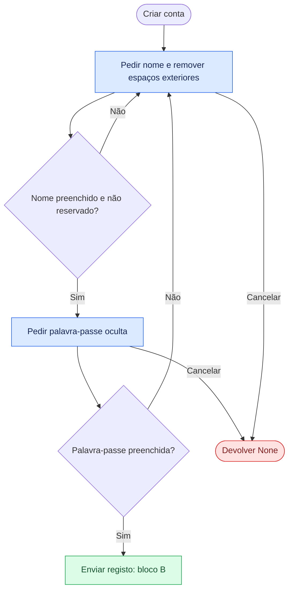
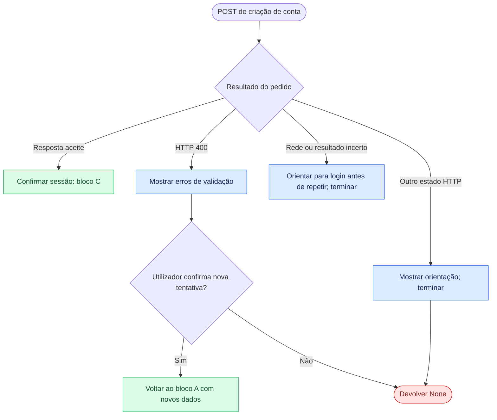
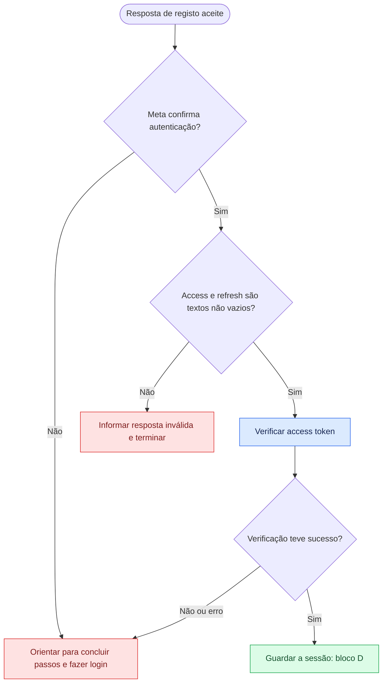
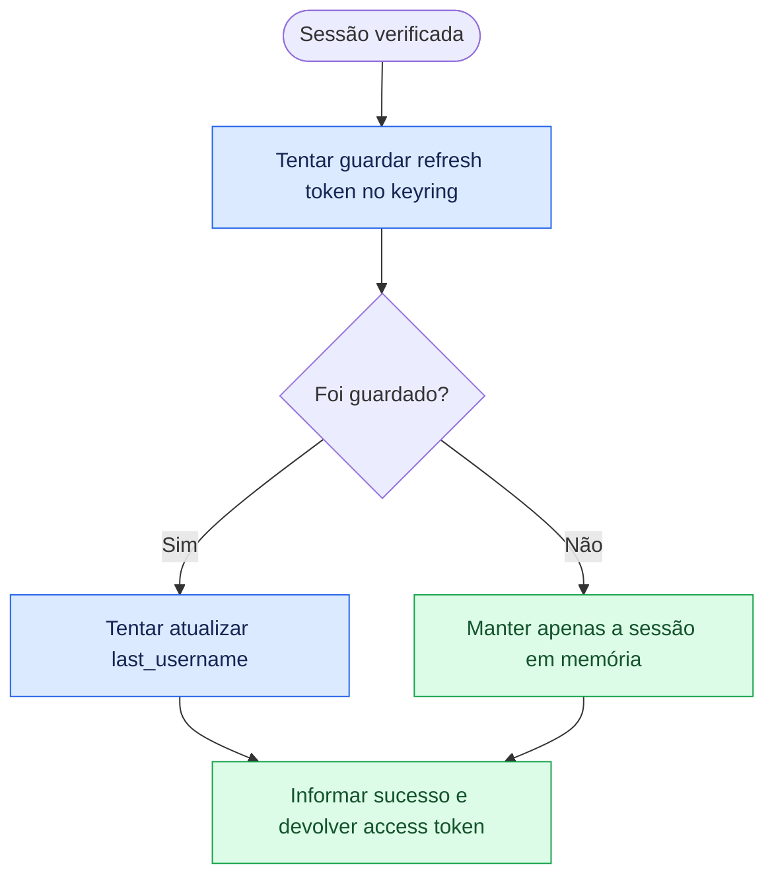

# XTcli — Criação de contas

> **Código:** `tcli.py` · **Entrada interativa:** `creation_questionary()`

**Neste guia:** [funcionamento](#parte-1--funcionamento) ·
[código linha por linha](#parte-2--código-explicado-linha-por-linha) · [verificação](#verificação)

## Parte 1 — Funcionamento

### 1. Objetivo e limites do fluxo

Pedir nome e palavra-passe, enviar um pedido de criação e só abrir sessão se a
resposta fornecer tokens válidos e o access token for verificado. Não grava a
palavra-passe e não utiliza cache HTTP.

O fluxo tem quatro blocos: **entrada → pedido → confirmação → persistência**.
As setas não repetem o fluxo inteiro dentro do mesmo diagrama.

### 2. Bloco A — Recolher dados válidos



### 3. Bloco B — Enviar o pedido uma vez



> **Não há reenvio automático de registo.** Depois de uma falha de rede a conta
> pode já ter sido criada. Depois de um pedido aceite, uma falha de verificação
> também não provoca outro pedido de criação.

### 4. Bloco C — Confirmar a resposta aceite



### 5. Bloco D — Persistência e conclusão



### 6. Mensagens de erro

| Resposta/situação | Tratamento |
|---|---|
| HTTP 400 | Ler `errors[].code`, mostrar mensagens específicas e oferecer repetição |
| `username_taken` | Informar que o nome já está ocupado |
| Códigos `password_*` conhecidos | Explicar o requisito de palavra-passe rejeitado |
| HTTP 401 | Informar que pode haver uma etapa adicional; não presumir falha definitiva do registo |
| HTTP 403, 409 ou 429 | Orientar sobre recusa, conflito ou espera e terminar a tentativa |
| Outros estados ou resultado incerto | Orientar para login antes de repetir |
| Falta de tokens ou token não verificado | Não ativar a sessão nem repetir o registo |
| Keyring indisponível | Avisar, conservando a sessão verificada em memória |

`last_username` é uma chave reservada e não pode ser nome de utilizador neste
programa. Ctrl+C e fim da entrada terminam o fluxo. O helper HTTP e a gravação de
tokens são explicados, respetivamente, em [XTcli.md](XTcli.md) e
[XTcli_login.md](XTcli_login.md).

## Parte 2 — Código explicado linha por linha

Os trechos abaixo são cópias do código atual, não versões alternativas da implementação.
Cada tabela explica **todas as linhas não vazias de código do trecho**. A coluna
“Linha” refere-se ao ficheiro original; comentários separadores não precisam de
uma explicação repetida. Nas funções longas, os recortes são consecutivos e devem
ser lidos em conjunto: um recorte interior não é uma função autónoma para executar.

### `create_account()`

Seleciona o endpoint de registo; post_data está explicado em [XTcli.md](XTcli.md#parte-2--código-explicado-linha-por-linha).

#### create_account

[Fonte: tcli.py, linha 76](../../tcli.py#L76)

```python
def create_account(dados: dict) -> dict:
    return post_data(
        "https://wger.de/allauth/app/v1/auth/signup",
        dados
    )
```

| Linha | Explicação |
|---|---|
| 76 | Define `create_account` e os parâmetros/resultado usados neste bloco. |
| 77 | Delega a criação de conta no mesmo helper HTTP usado pelo login. |
| 78 | Seleciona o endpoint allauth de registo. |
| 79 | Encaminha os dados de registo recebidos. |
| 80 | Fecha a chamada e devolve a resposta do registo. |

### `creation_questionary()`

Separa erros de entrada, falhas do pedido e confirmação de uma resposta aceite. Uma falha de verificação posterior não provoca outro POST de criação.

#### Entrada e validação

[Fonte: tcli.py, linha 83](../../tcli.py#L83)

```python
def creation_questionary() -> str | None:
    try:
        while True:
            name = questionary.text("Escolha o nome de utilizador:").ask()
            if name is None:
                return None
            name = name.strip()
            if not name or name == "last_username":
                print("Introduza um nome de utilizador válido.")
                continue

            password = questionary.password("Escolha a palavra-passe:").ask()
            if password is None:
                return None
            if not password.strip():
                print("A palavra-passe é obrigatória.")
                continue
```

| Linha | Explicação |
|---|---|
| 83 | Define `creation_questionary` e os parâmetros/resultado usados neste bloco. |
| 84 | Permite abandonar o fluxo por interrupção do teclado ou fim da entrada. |
| 85 | Repete as perguntas apenas enquanto o fluxo ainda não devolveu um resultado. |
| 86 | Pede um nome de utilizador para a nova conta. |
| 87 | Deteta que a pergunta foi cancelada. |
| 88 | Termina sem fornecer um token. |
| 89 | Remove espaços exteriores do nome. |
| 90 | Rejeita nomes vazios e a chave reservada last_username. |
| 91 | Mostra a mensagem de nome inválido. |
| 92 | Recomeça as perguntas sem enviar um pedido de registo. |
| 94 | Pede a palavra-passe através do campo oculto de questionary. |
| 95 | Deteta cancelamento da pergunta da palavra-passe. |
| 96 | Termina o registo sem token. |
| 97 | Rejeita uma palavra-passe vazia ou composta só por espaços. |
| 98 | Mostra que a palavra-passe é obrigatória. |
| 99 | Recomeça as perguntas; não envia dados vazios. |

#### Pedido e erros de validação

[Fonte: tcli.py, linha 101](../../tcli.py#L101)

```python
            try:
                response = create_account({"username": name, "password": password})
            except RuntimeError as error:
                cause = error.__cause__
                if not isinstance(cause, requests.exceptions.HTTPError) or cause.response is None:
                    print("Não foi possível confirmar o registo. Tente Fazer login antes de voltar a criar a conta.")
                    return None

                status = cause.response.status_code
                if status == 400:
                    messages = {
                        "username_taken": "Este nome de utilizador já está em uso.",
                        "password_too_short": "A palavra-passe é demasiado curta.",
                        "password_too_common": "A palavra-passe é demasiado comum.",
                        "password_entirely_numeric": "A palavra-passe não pode conter apenas números.",
                        "password_too_similar": "A palavra-passe é demasiado semelhante ao nome de utilizador."
                    }
                    try:
                        details = cause.response.json()
                    except ValueError:
                        details = {}
                    errors = details.get("errors", []) if isinstance(details, dict) else []
                    if not isinstance(errors, list) or not errors:
                        print("Dados de registo inválidos. Verifique o nome e a palavra-passe.")
                    else:
                        for item in errors:
                            code = item.get("code") if isinstance(item, dict) else None
                            if not isinstance(code, str):
                                code = None
                            print(messages.get(code, "Dados de registo inválidos. Verifique o nome e a palavra-passe."))
```

| Linha | Explicação |
|---|---|
| 101 | Separa a falha do pedido de criação das verificações posteriores. |
| 102 | Envia username e password para create_account. |
| 103 | Recebe o RuntimeError do helper HTTP. |
| 104 | Consulta a exceção original que o helper preservou. |
| 105 | Distingue uma resposta HTTP conhecida de uma falha sem confirmação do servidor. |
| 106 | Quando o resultado é incerto, orienta para login antes de repetir a criação. |
| 107 | Interrompe a tentativa, evitando reenviar automaticamente um possível registo já aceite. |
| 109 | Obtém o estado HTTP da resposta de erro. |
| 110 | Reserva o tratamento detalhado para HTTP 400. |
| 111 | Inicia o mapa de códigos de validação do registo. |
| 112 | Traduz o código de nome de utilizador já ocupado. |
| 113 | Traduz o código de palavra-passe demasiado curta. |
| 114 | Traduz o código de palavra-passe demasiado comum. |
| 115 | Traduz o código de palavra-passe inteiramente numérica. |
| 116 | Traduz o código de palavra-passe demasiado semelhante ao utilizador. |
| 117 | Fecha as mensagens de validação. |
| 118 | Tenta ler os detalhes JSON da resposta HTTP 400. |
| 119 | Descodifica o corpo de erro do servidor. |
| 120 | Trata um corpo que não possa ser lido como JSON. |
| 121 | Usa um dicionário vazio como alternativa ao erro ilegível. |
| 122 | Só procura errors se o corpo for um dicionário; caso contrário usa lista vazia. |
| 123 | Deteta lista de erros ausente, vazia ou de tipo incorreto. |
| 124 | Mostra uma mensagem genérica de dados de registo inválidos. |
| 125 | Segue para as mensagens específicas quando existe uma lista de erros. |
| 126 | Percorre os erros devolvidos pelo servidor. |
| 127 | Lê code apenas quando o item de erro é um dicionário. |
| 128 | Rejeita códigos com tipo diferente de texto. |
| 129 | Usa None para que o mapa escolha a mensagem genérica. |
| 130 | Apresenta a tradução conhecida do código ou a mensagem de alternativa. |

#### Outros estados e repetição

[Fonte: tcli.py, linha 131](../../tcli.py#L131)

```python
                else:
                    messages = {
                        401: "Registo pendente. Pode ser necessária outra etapa de autenticação. Consulte a conta na wger antes de tentar novamente.",
                        403: "A criação de contas não está disponível neste momento.",
                        409: "O registo não pôde ser concluído. Tente Fazer login.",
                        429: "Demasiadas tentativas. Aguarde antes de tentar novamente."
                    }
                    print(messages.get(status, "Serviço indisponível. Tente Fazer login antes de repetir o registo."))
                    return None

                if not questionary.confirm("Deseja tentar novamente?", default=True).ask():
                    return None
                continue
```

| Linha | Explicação |
|---|---|
| 131 | Trata estados HTTP diferentes de 400. |
| 132 | Inicia as orientações para esses outros estados. |
| 133 | Para HTTP 401, indica que o registo pode exigir uma etapa adicional. |
| 134 | Para HTTP 403, informa que criar contas não está disponível. |
| 135 | Para HTTP 409, informa o conflito e orienta para login. |
| 136 | Para HTTP 429, pede que se aguarde antes de tentar novamente. |
| 137 | Fecha o mapa de orientações por estado HTTP. |
| 138 | Mostra a orientação adequada ou a mensagem de indisponibilidade. |
| 139 | Termina para os estados diferentes de 400, sem repetir o pedido. |
| 141 | Depois de HTTP 400, pergunta se o utilizador quer tentar com novos dados. |
| 142 | Se a repetição não for confirmada, termina sem token. |
| 143 | Se confirmada, volta ao início do ciclo de perguntas. |

#### Confirmar e guardar a sessão

[Fonte: tcli.py, linha 145](../../tcli.py#L145)

```python
            # O pedido foi aceite: não repetir o registo se a verificação falhar.
            meta = response.get("meta")
            if not isinstance(meta, dict) or meta.get("is_authenticated") is not True:
                print("Registo recebido. Pode ser necessária outra etapa. Consulte a conta na wger e depois escolha Fazer login.")
                return None

            access = meta.get("access_token")
            refresh = meta.get("refresh_token")
            if not all(isinstance(value, str) and value.strip() for value in (access, refresh)):
                print("Resposta de registo inválida. Tente Fazer login antes de repetir o registo.")
                return None

            try:
                verified = verify_access_token(access)
            except RuntimeError:
                verified = False
            if not verified:
                print("A conta foi criada, mas não foi possível confirmar a sessão. Escolha Fazer login.")
                return None

            if save_token(name, refresh):
                save_token("last_username", name)
            print("Conta criada com sucesso!")
            return access
```

| Linha | Explicação |
|---|---|
| 145 | Lê os metadados da resposta de um pedido aceite. |
| 146 | Exige que meta seja objeto e is_authenticated seja exatamente True. |
| 147 | Explica que a conta pode precisar de outro passo antes do login. |
| 148 | Termina sem ativar uma sessão incompleta. |
| 150 | Obtém o access token da resposta. |
| 151 | Obtém o refresh token da resposta. |
| 152 | Exige dois tokens textuais e não vazios. |
| 153 | Informa que a resposta não permite confirmar a sessão. |
| 154 | Não repete a criação nem fornece um token incompleto. |
| 156 | Protege a verificação do access token. |
| 157 | Consulta o endpoint de verificação antes de aceitar a sessão. |
| 158 | Trata falha da verificação, incluindo rede. |
| 159 | Considera a sessão não confirmada se a verificação falhar. |
| 160 | Verifica o resultado booleano da confirmação. |
| 161 | Orienta para Fazer login, pois o pedido de criação já foi aceite. |
| 162 | Termina sem repetir o registo. |
| 164 | Tenta guardar o refresh token no keyring sob o nome do utilizador. |
| 165 | Só depois de guardar o token tenta atualizar a identificação da última conta. |
| 166 | Informa o sucesso da criação e confirmação da sessão. |
| 167 | Devolve o access token para uso na sessão em memória. |

#### Cancelamento exterior

[Fonte: tcli.py, linha 170](../../tcli.py#L170)

```python
    except (KeyboardInterrupt, EOFError):
        return None
```

| Linha | Explicação |
|---|---|
| 170 | Captura Ctrl+C e fim da entrada em qualquer pergunta. |
| 171 | Abandona o registo de forma controlada. |

## Verificação

A aplicação pode ser iniciada a partir de `ALPCD_12`:

```bash
uv run python tcli.py
```

| Caso | Resultado a verificar com mocks |
|---|---|
| Entrada vazia ou nome reservado | Não enviar o POST |
| HTTP 400 com códigos conhecidos | Mostrar mensagens específicas e oferecer repetição |
| Resposta incerta | Orientar para login; não reenviar automaticamente |
| Resposta aceite e verificação falha | Não criar a conta outra vez |
| Keyring falha após verificação | Devolver sessão em memória |
| Cancelamento | Devolver None |

Estes casos descrevem verificações recomendadas, não execuções reais novas.
A cópia atual não inclui uma pasta `tests/`. Para testes automáticos, simular
requests, keyring e questionary e usar pastas temporárias: não criar contas,
guardar tokens reais ou exportar templates apenas para validar a documentação.

Voltar ao [README oficial](../../README.md).