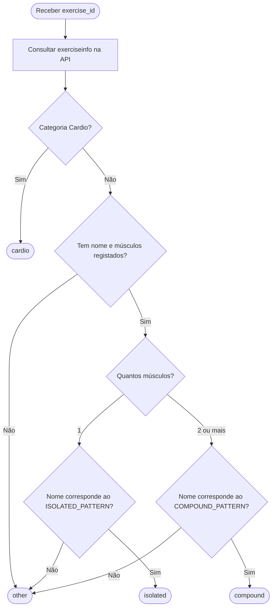

# Alínea C: Classificação do tipo de exercício

## Objetivo

Implementar o comando `type`, que recebe o `exercise_id` de um exercício da API **wger** e devolve uma das classificações: `cardio`, `compound`, `isolated` ou `other`.

## 1. Metodologia

A ideia inicial foi de gerar o algoritmo a partir das informações estruturadas que a API fornece. Assim, na classificação dos exercícios para `cardio` foi utilizado apenas a categoria já registada nos próprios dados. Para diferenciar exercícios `isolated` de `compound`, pensou-se em utilizar o total de músculos envolvidos e as palavras mais comuns associadas a cada quantidade. Já o tipo `other` vai ser utilizado para os restantes exercícios que faltam dados ou informação.

## 2. Análise dos dados

Antes de definir as expressões regulares (*regex*), foi realizada uma análise exploratória dos exercícios disponíveis em inglês:

1. Recolha dos dados da API, incluindo **nome, categoria e músculos principais e secundários**.
2. Contagem das palavras presentes nos nomes e exclusão de termos pouco informativos (artigos, conectores, abreviaturas, etc.).
3. Para cada palavra, contagem dos exercícios com **1 músculo** e com **2 ou mais músculos**, excluindo a categoria `Cardio` e os registos sem músculos associados.
4. Cálculo das percentagens por palavra. Foram considerados candidatos os termos com **pelo menos 6 ocorrências** e **2/3 ou mais** de associação a um dos grupos.
5. Construção de `ISOLATED_PATTERN` e `COMPOUND_PATTERN` com base nos candidatos identificados.

O limiar de 2/3 é utilizado **apenas para selecionar palavras durante a análise**, não na classificação individual de cada exercício.

## 3. Funcionamento do algoritmo

**Regras:**

- **`cardio`** — a categoria da API é `Cardio`; tem prioridade sobre as restantes regras.
- **`isolated`** — há exatamente **1 músculo** registado **e** o nome corresponde ao regex de isolamento.
- **`compound`** — há **2 ou mais músculos** registados **e** o nome corresponde ao regex de exercícios compostos.
- **`other`** — falta informação ou o nome não corresponde ao regex exigido pela contagem muscular.

É verificado **apenas o regex correspondente à contagem de músculos**. Por isso, mesmo que um nome contenha termos presentes nos dois padrões, o algoritmo segue apenas o ramo aplicável.
