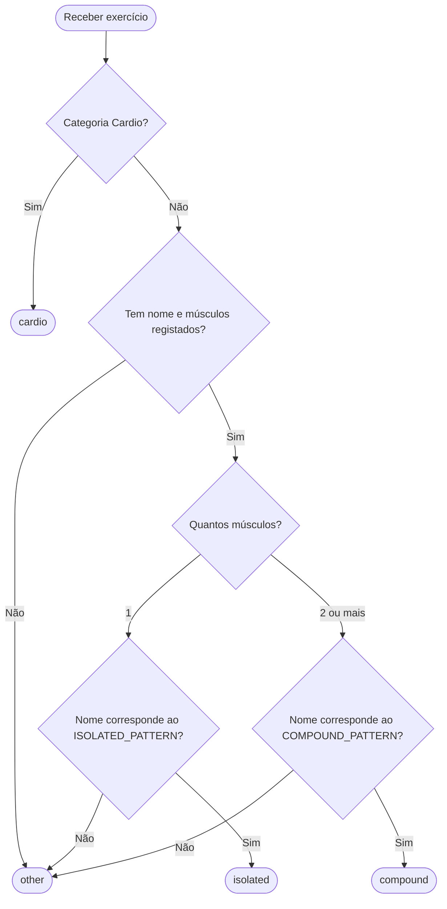

# Alínea C: Classificação do tipo de exercício

## Objetivo

Implementar o comando `type`, que recebe o ID de um exercício da API **wger** e devolve uma das classificações: `cardio`, `compound`, `isolated` ou `other`.

Adicionalmente, o comando permite pesquisar exercícios por palavras através da opção `--find`, reutilizando a funcionalidade Extra 1.

## 1. Metodologia

A ideia inicial foi desenvolver o algoritmo a partir das informações estruturadas fornecidas pela API.

- **Cardio** — utiliza diretamente a categoria registada na API.
- **Isolated e compound** — utiliza o número de músculos envolvidos e as palavras mais comuns associadas a cada grupo.
- **Other** — corresponde aos exercícios com informação insuficiente ou que não satisfazem as regras anteriores.

O algoritmo utiliza expressões regulares (*regex*) para verificar as palavras presentes nos nomes dos exercícios, combinando-as com a contagem de músculos.

## 2. Análise dos dados

Antes de definir as expressões regulares, foi realizada uma análise exploratória dos exercícios disponíveis em inglês:

1. Recolha dos dados da API, incluindo **nome, categoria e músculos principais e secundários**.
2. Contagem das palavras presentes nos nomes e exclusão de termos pouco informativos (artigos, conectores, abreviaturas, etc.).
3. Para cada palavra, contagem dos exercícios com **1 músculo** e com **2 ou mais músculos**, excluindo a categoria `Cardio` e os registos sem músculos associados.
4. Cálculo das percentagens por palavra. Foram considerados candidatos os termos com **pelo menos 6 ocorrências** e **2/3 ou mais** de associação a um dos grupos.
5. Construção de `ISOLATED_PATTERN` e `COMPOUND_PATTERN` com base nos candidatos identificados.

O limiar de 2/3 é utilizado **apenas para selecionar palavras durante a análise**, não na classificação individual de cada exercício.

## 3. Funcionamento do algoritmo



**Regras:**

- **`cardio`** — a categoria da API é `Cardio`; tem prioridade sobre as restantes regras.
- **`isolated`** — há exatamente **1 músculo** registado **e** o nome corresponde ao regex de isolamento.
- **`compound`** — há **2 ou mais músculos** registados **e** o nome corresponde ao regex de exercícios compostos.
- **`other`** — falta informação ou o nome não corresponde ao regex exigido pela contagem muscular.

É verificado **apenas o regex correspondente à contagem de músculos**. Por isso, mesmo que um nome contenha termos presentes nos dois padrões, o algoritmo segue apenas o ramo aplicável.

## 4. Pesquisa de exercícios

Originalmente, o comando `type` recebe um ID e consulta diretamente o exercício através de `api.get_data()`.

Com a integração do Extra 1, foi acrescentada a opção `--find`, permitindo classificar exercícios encontrados por palavras.

O funcionamento depende da entrada:

1. **Por ID** — `exercise_type()` consulta o exercício e executa `classify_effort()`, devolvendo uma única classificação.
2. **Por palavras (`--find`)** — `search_exercise_types()` utiliza `find_exercises(raw=True)` para obter os exercícios completos e aplica `classify_effort()` a cada resultado.
3. **Com `--find --deep`** — a pesquisa considera também as descrições e as regras de singular/plural implementadas no Extra 1.

A classificação é sempre realizada pela mesma função `classify_effort()`, evitando duplicação de código. Os exercícios encontrados por pesquisa são classificados sem necessidade de pedidos individuais adicionais à API.

## 5. Exemplos de utilização

**Classificação por ID:**

```bash
python fitcli.py type 123
```

Devolve uma única classificação, como `compound` ou `isolated`.

**Classificação através da pesquisa por nome:**

```bash
python fitcli.py type "bench press" --find
```

**Classificação através da pesquisa aprofundada:**

```bash
python fitcli.py type "biceps dumbbells" --find --deep --limit 5
```

Quando é utilizada a opção `--find`, o programa devolve uma lista com **ID, nome e tipo de esforço** de cada exercício encontrado, apresentando também o total de exercícios exibidos.

A pesquisa não altera as regras de classificação: apenas disponibiliza uma forma alternativa de obter os exercícios.