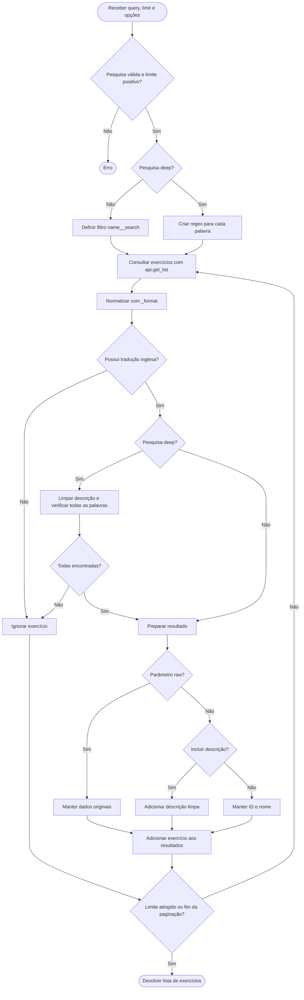

# Extra 1: Pesquisa textual de exercícios

## Objetivo

Implementar o comando `find`, que permite encontrar exercícios da API **wger** através de palavras introduzidas pelo utilizador, devolvendo o **ID e o nome**, com a possibilidade de incluir a **descrição**.

A pesquisa possui dois modos: `normal`, baseado na pesquisa nativa da API, e `deep`, que utiliza expressões regulares (*regex*) para procurar no nome e na descrição.

## 1. Metodologia

Para evitar complexidade e pedidos desnecessários à API, foram desenvolvidos dois modos:

- **Pesquisa normal** — utiliza o parâmetro `name__search` da API, que permite pesquisar nomes de exercícios por correspondência aproximada, com ordenação por relevância.
- **Pesquisa aprofundada (`--deep`)** — percorre os exercícios disponíveis e aplica regex ao nome e à descrição, exigindo a presença de todas as palavras pesquisadas, independentemente da ordem.

Em ambos os modos, são reutilizadas as funções `_format()` e `api.get_list()`, responsáveis pela normalização dos dados e pela consulta à API, incluindo cache e paginação.

## 2. Tratamento das palavras

Na pesquisa aprofundada, a função `word_pattern()` cria um regex para cada palavra, considerando:

1. Separação das palavras através de espaços, pontuação e outros símbolos.
2. Correspondência sem distinguir maiúsculas de minúsculas.
3. Reconhecimento de palavras completas através de `\b`.
4. Plurais regulares terminados em `s`, `es` e `ies`.
5. Algumas exceções relevantes para exercícios: `calf/calves`, `foot/feet`, `scapula/scapulae` e `vertebra/vertebrae`.

Os padrões são compilados com `re.compile()` apenas uma vez por pesquisa e reutilizados na verificação dos exercícios.

A pesquisa utiliza `all()` para garantir que todas as palavras estejam presentes no nome e/ou na descrição. O reconhecimento de plurais é aproximado e não contempla todas as irregularidades da língua inglesa.

## 3. Funcionamento do algoritmo



O algoritmo começa por validar a pesquisa e o limite solicitado. Depois, seleciona o método de pesquisa:

- **Normal** — utiliza o filtro `name__search` da API para pesquisar pelo nome.
- **Aprofundado (`--deep`)** — utiliza regex para verificar se todas as palavras estão presentes no nome e/ou na descrição, independentemente da ordem.

A função `filter_exercise()` é aplicada aos exercícios recebidos através do parâmetro `transform` de `api.get_list()`. Os exercícios sem tradução inglesa ou que não satisfazem as condições da pesquisa são ignorados.

A opção `--description` permite incluir a descrição limpa nos resultados, enquanto o parâmetro interno `raw=True` devolve os dados originais para reutilização noutras funcionalidades.

A recolha termina quando é atingido o limite de exercícios aceites ou quando se esgotam as páginas disponíveis.

## 4. Reutilização noutras funcionalidades

A função `find_exercises()` possui o parâmetro interno `raw=False`.

- **`raw=False`** — devolve os campos destinados à apresentação: ID, nome e descrição opcional.
- **`raw=True`** — devolve os dados completos do exercício, permitindo reutilizá-los noutras funcionalidades sem novos pedidos à API.

Esta opção é utilizada na alínea C, através da função `search_exercise_types()`, para classificar os exercícios encontrados.

## 5. Exemplos de utilização

```bash
python fitcli.py find "bench press"
python fitcli.py find "bench press" --description
python fitcli.py find "biceps dumbbells" --deep
python fitcli.py find "biceps dumbbells" --deep --description --limit 5
```

**Notas:**

- A opção `--description` apenas controla a apresentação da descrição, não o método de pesquisa.
- A opção `--deep` ativa a pesquisa no nome e na descrição.
- O programa apresenta o total de exercícios exibidos, que pode ser inferior ao total de correspondências existentes na API.
- A pesquisa aprofundada pode exigir a consulta de muitas páginas, e os primeiros resultados encontrados não são necessariamente os mais relevantes.