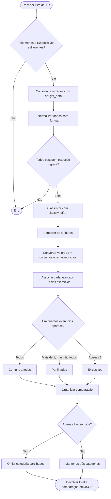

# Extra 2: Comparação de exercícios

## Objetivo

Implementar o comando `compare`, que permite comparar **dois ou mais exercícios** da API **wger** através dos seus IDs, identificando semelhanças e diferenças nos atributos disponíveis.

São comparados a **categoria, o tipo de esforço, os músculos principais e secundários e os equipamentos**.

## 1. Metodologia

O algoritmo foi desenvolvido para comparar N exercícios sem ser necessário comparar cada exercício individualmente com todos os restantes.

Para isso, são utilizadas duas funções:

- **`compare_exercises()`** — recebe os IDs, consulta os exercícios, prepara os dados e organiza a comparação.
- **`_compare_attribute()`** — analisa cada atributo e identifica os valores comuns, partilhados ou exclusivos.

## 2. Critérios de comparação

Os valores são classificados em três grupos:

- **Comuns a todos** — presentes em todos os exercícios comparados.
- **Partilhados** — presentes em pelo menos dois exercícios, mas não em todos.
- **Exclusivos** — presentes apenas num exercício.

Quando são comparados **apenas dois exercícios**, a categoria `partilhados` é omitida, uma vez que qualquer valor presente em ambos já é considerado comum a todos.

O algoritmo utiliza `set()` para eliminar valores repetidos dentro de cada exercício e ignorar valores vazios (`None` ou `""`).

A mesma lógica é aplicada a todos os atributos. Quando um atributo possui um único valor, como a categoria, este é convertido numa lista para permitir o mesmo processamento.

## 3. Funcionamento do algoritmo



A função `compare_exercises()` valida os IDs, consulta os exercícios e reutiliza `_format()` e `classify_effort()` para preparar os atributos.

Depois, `_compare_attribute()` analisa cada atributo, convertendo os valores em conjuntos para eliminar duplicações e ignorar valores vazios. Cada valor é associado aos IDs dos exercícios onde aparece.

Os valores são classificados conforme a quantidade de exercícios em que estão presentes:

- **Comuns a todos** — presentes em todos os exercícios.
- **Partilhados** — presentes em pelo menos dois exercícios, mas não em todos.
- **Exclusivos** — presentes apenas num exercício.

Quando são comparados apenas dois exercícios, a categoria `partilhados` é omitida, pois qualquer valor presente em ambos já é considerado comum a todos.

O resultado final apresenta apenas o número total de exercícios e a comparação dos atributos, sem incluir os dados individuais completos.

## 4. Resultado e limitações

O comando devolve um JSON com duas secções principais:

- **`total_exercicios`** — quantidade de exercícios comparados.
- **`comparacao`** — resultados de cada atributo, organizados conforme a quantidade de exercícios.

Para **dois exercícios**, são apresentados `comuns_a_todos` e `exclusivos`.

Para **três ou mais exercícios**, são apresentados `comuns_a_todos`, `partilhados` e `exclusivos`.

Os valores comuns/partilhados incluem a lista dos IDs correspondentes. Os exclusivos incluem o ID do único exercício associado.

## 5. Exemplos de utilização

**Comparação de dois exercícios:**

```bash
python fitcli.py compare 123 456
```

**Comparação de três exercícios:**

```bash
python fitcli.py compare 123 456 789
```

**Comparação de quatro exercícios:**

```bash
python fitcli.py compare 123 456 789 101
```

Os IDs devem corresponder a exercícios válidos da wger.

A comparação funciona com qualquer quantidade de exercícios a partir de dois, sem um máximo fixo definido no comando.